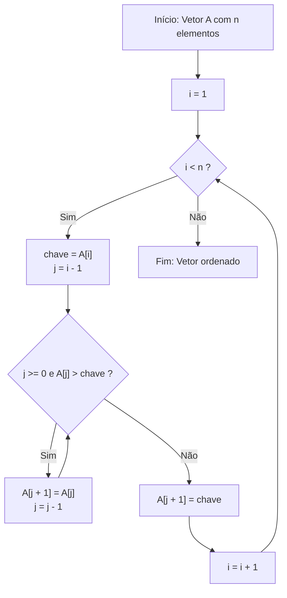
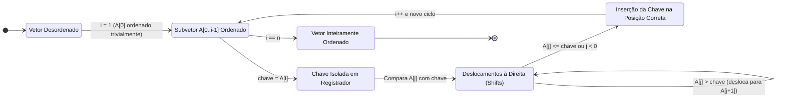
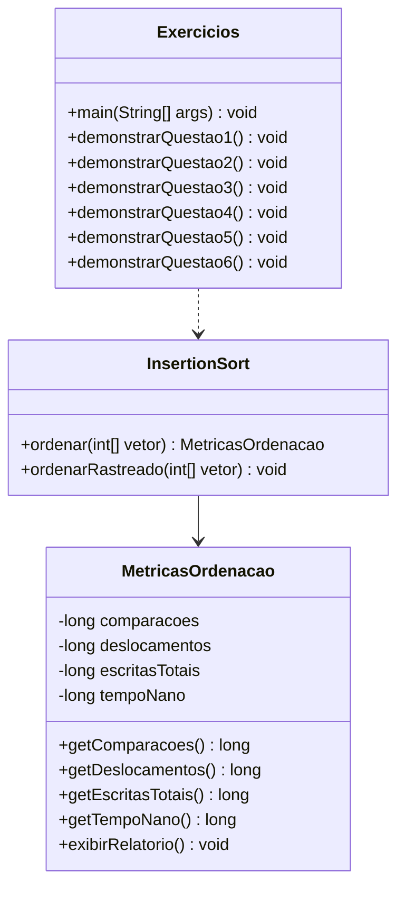
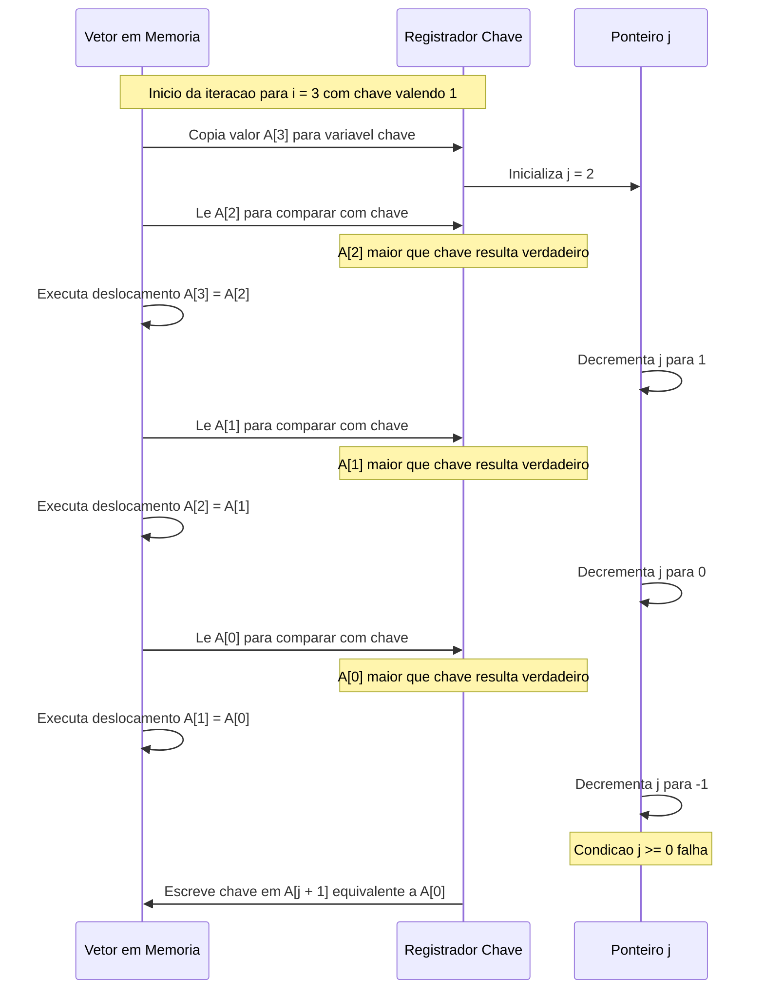
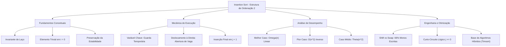

# Trabalho — Estrutura de ordenação 2

> **Professor:** Wesley Soares
> **Disciplina:** Estrutura de Dados I (4º Semestre)
> **Prazo de Entrega:** 30/10/2026 às 22:00
> **Pontuação Máxima:** 100 pontos
> **Conteúdo cobrado:** [Aula 02 - Fundamentos e Análise de Algoritmos](../../Aulas/Aula%2002%20-%20Fundamentos%20e%20An%C3%A1lise%20de%20Algoritmos/detalhes.md), [Aula 04 - Fundamentos de Estruturas Lineares e Complexidade](../../Aulas/Aula%2004%20-%20Fundamentos%20de%20Estruturas%20Lineares%20e%20Complexidade/detalhes.md), [Aula 09 - Ordenação com Bubble Sort e Selection Sort](../../Aulas/Aula%2009%20-%20Ordena%C3%A7%C3%A3o%20com%20Bubble%20Sort%20e%20Selection%20Sort/detalhes.md), [Aula 10 - Insertion Sort Ordenação por Inserção](../../Aulas/Aula%2010%20-%20Insertion%20Sort%20Ordena%C3%A7%C3%A3o%20por%20Inser%C3%A7%C3%A3o/detalhes.md)

## Sumário

- [Enunciado original (Google Classroom)](#enunciado-original-google-classroom)
- [Análise do que é pedido](#análise-do-que-é-pedido)
- [Fundamentação teórica](#fundamentação-teórica)
- [Resolução proposta](#resolução-proposta)
- [Como testar e validar](#como-testar-e-validar)
- [Critérios de qualidade](#critérios-de-qualidade)
- [Arquivos de apoio](#arquivos-de-apoio)
- [Mapa da atividade](#mapa-da-atividade)
- [Glossário](#glossário)
- [Pontos-chave para a prova](#pontos-chave-para-a-prova)
- [Perguntas e respostas (JSONL)](#perguntas-e-respostas-jsonl)
- [Checklist de revisão](#checklist-de-revisão)

## Enunciado original (Google Classroom)

### Estrutura de ordenação 2 (26/10/2026)
Baseado com o conteúdo da aula responda ao questionário
### Link (form): Insertion sort
URL: https://docs.google.com/forms/d/e/1FAIpQLSdsr8O0lh4xGGzqCYmBNheJllAEVYLMzwacA_1v8jOr7wJGmg/viewform?hr_submission=ChkIqfSd8tgWEhAIrOeI7IkaEgcI2Yqc368ZEAE
# Insertion sort

1. Por que o laço externo começa em i = 1?

2. Qual é a função da variável chave?

3. Por que os elementos maiores que a chave são deslocados para a direita?

4. O que acontece quando o vetor já está ordenado?

5. Qual é a complexidade do algoritmo no pior caso? Justifique.

6. O Insertion Sort realiza apenas trocas entre vizinhos ou também desloca elementos? Explique a diferença.

## Análise do que é pedido

### Requisitos explícitos da atividade
A atividade avaliativa proposta pelo Prof. Wesley Soares exige a compreensão aprofundada dos mecanismos operacionais e da análise assintótica do algoritmo de ordenação por inserção direta (*Insertion Sort*). O aluno deve responder formalmente a seis questionamentos essenciais que cobrem:
1. O princípio da indução matemática e a invariante de laço que determinam o índice inicial `$ `i = 1` $`.
2. O papel do registrador temporário de valor (variável `chave` ou `key`) na preservação do dado a ser inserido.
3. A justificativa mecânica da abertura de lacuna contígua por meio de deslocamento à direita (*shift*) para manter a ordenação local.
4. O comportamento de tempo de execução e número de operações diante da entrada favorável (melhor caso assintótico).
5. A dedução analítica formal do consumo de tempo no pior caso de ordenação por meio de somatório aritmético.
6. A distinção conceitual e computacional entre operação de troca (*swap*) e operação de deslocamento (*shift* ou propagação por atribuição direta).

### Entregáveis
- Respostas conceituais completas, estruturadas com rigor acadêmico e fundamentação matemática para submissão no formulário do Google Forms.
- Arquivo Java demonstrativo com resolução comentada e testes de bancada de cada uma das seis questões: [Exercicios.java](./codigo/Exercicios.java).
- Implementação canônica, instrumentada e parametrizada com contadores empíricos de comparações e movimentações em memória: [InsertionSort.java](./codigo/InsertionSort.java).

### Critérios implícitos de avaliação
- **Rigor de vocabulário:** Não confundir troca tripla de elementos com deslocamento simples de cópia.
- **Domínio assintótico:** Expressar a complexidade temporal em notação Big-O formal, diferenciando o melhor caso `$ `\Omega(n)` $` do pior caso `$ `\mathcal{O}(n^2)` $`.
- **Invariante de Laço:** Demonstrar que o algoritmo mantém o subvetor `$ `A[0 \dots i-1]` $` estritamente ordenado a cada ciclo.
- **Estabilidade:** Reconhecer que o *Insertion Sort* preserva a ordem relativa de chaves duplicadas caso a condição de deslocamento não inclua igualdade estrita.

## Fundamentação teórica

### O algoritmo Insertion Sort
O *Insertion Sort* (ordenação por inserção direta) é um algoritmo quadrático no pior caso, baseado em comparação e executado *in-place* (no próprio arranjo, sem necessidade de espaço auxiliar proporcional ao tamanho da entrada). A metáfora clássica da computação compara o algoritmo ao ato de organizar cartas de baralho na mão:
1. Segura-se uma mão de cartas inicialmente vazia ou com uma única carta.
2. Pega-se uma nova carta da mesa (denominada `chave`).
3. Percorre-se a mão de cartas da direita para a esquerda, comparando a nova carta com as já organizadas.
4. Afastam-se para a direita todas as cartas que forem maiores do que a carta em análise.
5. Insere-se a carta na posição que ficou liberada.



### Invariante de laço
Para provar formalmente a corretude do *Insertion Sort*, recorre-se à técnica da **invariante de laço** (conforme a literatura canônica de Thomas Cormen et al. e complementada em nossos estudos de engenharia de software):
- **Definição da invariante:** No início de cada iteração do laço `for` (indexado por `$ `i` $`), o subarranjo `$ `A[0 \dots i-1]` $` é composto pelos elementos originalmente presentes em `$ `A[0 \dots i-1]` $`, porém organizados em ordem estritamente ordenada.
- **Inicialização:** Antes da primeira iteração, temos `$ `i = 1` $`. O subarranjo `$ `A[0 \dots 0]` $` contém apenas um único elemento. Um arranjo com um único elemento está trivialmente ordenado. Portanto, a invariante é válida antes da execução do primeiro ciclo.
- **Manutenção:** O corpo do laço `for` atua deslocando elementos `$ `A[j]` $` que são maiores do que a `chave` uma posição para a direita (`$ `A[j+1] = A[j]` $`). Ao encontrar um elemento menor ou igual à `chave` (ou quando `$ `j < 0` $`), a `chave` é copiada na posição `$ `A[j+1]` $`. O subarranjo `$ `A[0 \dots i]` $` passa a conter os mesmos elementos anteriores mais a `chave`, agora em ordem crescente. O incremento de `$ `i` $` preserva a invariante para o próximo ciclo.
- **Término:** O laço finaliza quando `$ `i = n` $`. Substituindo `$ `i` $` por `$ `n` $` na declaração da invariante, temos que o subarranjo `$ `A[0 \dots n-1]` $` é composto pelos elementos originais do vetor, devidamente ordenados. Como esse subarranjo corresponde a todo o vetor `$ `A` $`, o algoritmo encerra com sucesso sua computação.



### Análise matemática de complexidade

#### Melhor caso
Ocorre quando o vetor de entrada já se encontra perfeitamente ordenado em ordem crescente.
- O laço externo executa `$ `n - 1` $` iterações (para `$ `i = 1` $` até `$ `n - 1` $`).
- Em cada iteração, a variável `chave` recebe `$ `A[i]` $` e `$ `j = i - 1` $`.
- A condição do laço interno `$ `A[j] > \text{chave}` $` é testada uma única vez e avaliada imediatamente como falsa, pois em um vetor ordenado qualquer elemento anterior é menor ou igual ao seu sucessor imediato.
- Nenhum deslocamento é realizado no corpo do laço `while`.
- Número total de comparações:

```math
C_{\text{melhor}}(n) = \sum_{i=1}^{n-1} 1 = n - 1 = \Theta(n)
```

- Número total de movimentações (atribuições de chave e reinserção sem deslocamento intermediário):

```math
M_{\text{melhor}}(n) = 2(n - 1) = \Theta(n)
```

Portanto, a complexidade no melhor caso é linear: `$ `\Omega(n)` $`.

#### Pior caso
Ocorre quando o vetor de entrada se encontra em ordem estritamente decrescente (ordem inversa da desejada).
- Para cada iteração do laço externo `$ `i` $`, a `chave` `$ `A[i]` $` é estritamente menor do que todos os elementos presentes no subvetor ordenado `$ `A[0 \dots i-1]` $`.
- O laço interno `while` executa todas as `$ `i` $` comparações possíveis e realiza `$ `i` $` deslocamentos à direita até atingir a borda esquerda do vetor (`$ `j = -1` $`).
- Número total de comparações no pior caso:

```math
C_{\text{pior}}(n) = \sum_{i=1}^{n-1} i = \frac{(n-1) \cdot n}{2} = \frac{n^2 - n}{2} = \Theta(n^2)
```

- Número total de deslocamentos internos:

```math
D_{\text{pior}}(n) = \sum_{i=1}^{n-1} i = \frac{n^2 - n}{2} = \Theta(n^2)
```

- Número total de atribuições em memória (incluindo leitura da chave e escrita final):

```math
M_{\text{pior}}(n) = \sum_{i=1}^{n-1} (i + 2) = \frac{n^2 - n}{2} + 2(n - 1) = \frac{n^2 + 3n - 4}{2} = \Theta(n^2)
```

Assim, a complexidade temporal assintótica do algoritmo no pior caso é estritamente quadrática: `$ `\mathcal{O}(n^2)` $`.

#### Caso médio
Ocorre quando os elementos de entrada são distribuídos aleatoriamente. Em média, para cada elemento `$ `A[i]` $`, metade dos elementos do subvetor `$ `A[0 \dots i-1]` $` será maior que a `chave` e metade será menor.
- Espera-se que o laço interno realize em torno de `$ `i / 2` $` comparações e deslocamentos por iteração.
- O somatório resulta em:

```math
C_{\text{médio}}(n) = \sum_{i=1}^{n-1} \frac{i}{2} = \frac{1}{2} \cdot \frac{n(n-1)}{2} = \frac{n^2 - n}{4} = \Theta(n^2)
```

Embora execute metade das operações do pior caso, a ordem de grandeza assintótica permanece quadrática: `$ `\Theta(n^2)` $`. Contudo, as constantes multiplicativas reduzidas fazem com que o *Insertion Sort* supere algoritmos mais complexos como *QuickSort* e *MergeSort* para vetores de dimensão reduzida (geralmente `$ `n \le 16` $` a `$ `n \le 32` $`).

### Comparativo: Insertion Sort versus Bubble Sort versus Selection Sort
A tabela a seguir consolida a comparação estrutural entre os três algoritmos de ordenação elementares estudados na disciplina:

| Métrica / Propriedade | Bubble Sort | Selection Sort | Insertion Sort |
| :--- | :--- | :--- | :--- |
| **Complexidade Melhor Caso** | `$ `\Omega(n)` $` (com flag de troca) | `$ `\Theta(n^2)` $` (invariante a dados) | `$ `\Omega(n)` $` (natural e adaptativo) |
| **Complexidade Caso Médio** | `$ `\Theta(n^2)` $` | `$ `\Theta(n^2)` $` | `$ `\Theta(n^2)` $` |
| **Complexidade Pior Caso** | `$ `\mathcal{O}(n^2)` $` | `$ `\mathcal{O}(n^2)` $` | `$ `\mathcal{O}(n^2)` $` |
| **Complexidade Espacial Auxiliar** | `$ `\mathcal{O}(1)` $` (in-place) | `$ `\mathcal{O}(1)` $` (in-place) | `$ `\mathcal{O}(1)` $` (in-place) |
| **Estabilidade** | Estável | Instável (trocas longas) | Estável (se `$ `A[j] > \text{chave}` $`) |
| **Mecanismo de movimentação** | Trocas sucessivas de vizinhos | Troca direta do menor elemento | Deslocamento (*shift*) de bloco contíguo |
| **Custo de escrita no Melhor Caso** | `$ `0` $` trocas | `$ `0` $` trocas | `$ `0` $` deslocamentos |
| **Custo de escrita no Pior Caso** | `$ `3 \cdot \frac{n(n-1)}{2}` $` escritas | `$ `3(n - 1)` $` escritas | `$ `\frac{n(n-1)}{2} + 2(n-1)` $` escritas |
| **Comportamento Online** | Não é natural | Não é online | Excelente para ordenação em fluxo contínuo |

### Rastreamento passo a passo com vetor de teste
Considere o arranjo desordenado `$ `A = [8, 3, 5, 1, 4]` $` com tamanho `$ `n = 5` $`. O rastreamento detalhado de cada ciclo revela:

1. **Estado Inicial:** `$ `[8, 3, 5, 1, 4]` $`.
2. **Iteração `$ `i = 1` $`:**
   - Subvetor ordenado inicial: `$ `[8]` $`.
   - Elemento a inserir (`chave`): `$ `3` $`.
   - `$ `j = 0` $`: Compara `$ `A[0] = 8` $` com `chave` `$ `(3)` $`. Como `$ `8 > 3` $`, desloca `$ `A[0]` $` para `$ `A[1]` $`.
   - Vetor temporário: `$ `[8, 8, 5, 1, 4]` $`, `$ `j` $` passa a valer `$ `-1` $`.
   - Encerra laço `while`. Insere `chave` em `$ `A[j+1] = A[0]` $`.
   - Vetor após `$ `i = 1` $`: `$ `[3, 8, 5, 1, 4]` $`.
3. **Iteração `$ `i = 2` $`:**
   - Subvetor ordenado inicial: `$ `[3, 8]` $`.
   - Elemento a inserir (`chave`): `$ `5` $`.
   - `$ `j = 1` $`: Compara `$ `A[1] = 8` $` com `chave` `$ `(5)` $`. Como `$ `8 > 5` $`, desloca `$ `A[1]` $` para `$ `A[2]` $`.
   - Vetor temporário: `$ `[3, 8, 8, 1, 4]` $`, `$ `j` $` passa a valer `$ `0` $`.
   - `$ `j = 0` $`: Compara `$ `A[0] = 3` $` com `chave` `$ `(5)` $`. Como `$ `3 \le 5` $`, condição é falsa. Interrompe `while`.
   - Insere `chave` em `$ `A[j+1] = A[1]` $`.
   - Vetor após `$ `i = 2` $`: `$ `[3, 5, 8, 1, 4]` $`.
4. **Iteração `$ `i = 3` $`:**
   - Subvetor ordenado inicial: `$ `[3, 5, 8]` $`.
   - Elemento a inserir (`chave`): `$ `1` $`.
   - Comparações sucessivas: `$ `8 > 1` $` (desloca 8), `$ `5 > 1` $` (desloca 5), `$ `3 > 1` $` (desloca 3).
   - `$ `j` $` atinge `$ `-1` $`. Insere `chave` em `$ `A[0]` $`.
   - Vetor após `$ `i = 3` $`: `$ `[1, 3, 5, 8, 4]` $`.
5. **Iteração `$ `i = 4` $`:**
   - Subvetor ordenado inicial: `$ `[1, 3, 5, 8]` $`.
   - Elemento a inserir (`chave`): `$ `4` $`.
   - Comparações: `$ `8 > 4` $` (desloca 8), `$ `5 > 4` $` (desloca 5), `$ `3 \le 4` $` (interrompe).
   - Insere `chave` em `$ `A[2]` $`.
   - Vetor final ordenado: `$ `[1, 3, 4, 5, 8]` $`.

### Armadilhas e erros comuns
- **Armadilha do operador de comparação (`>=` vs `>`):** Se o desenvolvedor escrever `A[j] >= chave` em vez de `A[j] > chave`, elementos iguais serão deslocados para a direita. Isso **destrói a estabilidade** do algoritmo, alterando desnecessariamente a ordem relativa pré-existente de registros com chaves duplicadas e aumentando o custo de processamento.
- **Armadilha do estouro de índice (IndexOutOfBounds):** Em linguagens como Java e C, a condição lógica do laço interno deve ser estritamente escrita com avaliação por curto-circuito (*short-circuit*): `while (j >= 0 && A[j] > chave)`. Caso a ordem seja invertida para `while (A[j] > chave && j >= 0)`, a tentativa de acessar `$ `A[-1]` $` gerará uma exceção crítica em tempo de execução quando a chave for o menor elemento do vetor.
- **Confusão entre Swap e Shift:** Substituir a mecânica de deslocamento por trocas completas dentro do laço interno eleva o número de escritas em memória por um fator de 3, degradando a eficiência do pipeline de instruções do processador e o aproveitamento das linhas de cache L1/L2.

## Resolução proposta

Nesta seção, cada uma das seis questões formuladas pelo Prof. Wesley Soares é respondida de maneira exaustiva, acompanhada de fundamentação técnica, exemplos práticos e código-fonte funcional.

### Resolução das questões do formulário

#### Questão 1: Por que o laço externo começa em i = 1?
**Resposta conceitual:**
O laço externo do *Insertion Sort* é inicializado em `$ `i = 1` $` (referente ao segundo elemento da estrutura, considerando indexação baseada em zero) porque qualquer coleção ou arranjo contendo exatamente um único elemento é, por definição matemática e operacional, considerado **trivialmente ordenado**.

**Fundamentação matemática e algorítmica:**
A estratégia fundamental do algoritmo consiste em manter uma divisão virtual no vetor `$ `A` $`:
- Um subvetor à esquerda, delimitado por `$ `A[0 \dots i-1]` $`, que já se encontra devidamente ordenado.
- Um subvetor à direita, delimitado por `$ `A[i \dots n-1]` $`, que contém os elementos ainda não processados.

Se o laço se iniciasse em `$ `i = 0` $`:
1. O subvetor ordenado à esquerda estaria vazio (`$ `A[0 \dots -1]` $`).
2. A variável `j` seria inicializada com `$ `j = i - 1 = -1` $`.
3. A condição do laço interno `$ `j \ge 0` $` seria avaliada como falsa imediatamente.
4. O algoritmo executaria uma atribuição redundante `$ `A[0] = \text{chave}` $`.
Portanto, iniciar em `$ `i = 0` $` representaria um ciclo inútil de processamento que não executa qualquer comparação e consome ciclos de CPU sem finalidade lógica. Começando em `$ `i = 1` $`, assumimos o elemento `$ `A[0]` $` como a base ordenada inicial e iniciamos o trabalho efetivo de comparação a partir do segundo elemento.

---

#### Questão 2: Qual é a função da variável chave?
**Resposta conceitual:**
A variável `chave` (ou `key`) atua como um **registrador temporário de preservação de valor**. Sua função primordial é armazenar em uma área segura de memória (registrador da CPU ou variável local na pilha de execução) o elemento que está sendo inserido na iteração atual (`$ `\text{chave} = A[i]` $`).

**Fundamentação técnica e prevenção de corrupção:**
Durante o processo de inserção, os elementos do subvetor ordenado que são maiores que o elemento atual precisam ser deslocados uma posição para a direita através da operação:
```java
A[j + 1] = A[j];
```
Ao executar esse deslocamento pela primeira vez (quando `$ `j = i - 1` $`), o valor originalmente armazenado em `$ `A[i]` $` é **sobrescrito** pelo valor de `$ `A[i - 1]` $`. Se o valor de `$ `A[i]` $` não tivesse sido copiado previamente para a variável `chave`, ele seria **irreversivelmente perdido** da memória.

Além de preservar o dado original, a variável `chave` serve como:
1. **Pivô de comparação contínua:** Durante todas as iterações do laço interno `while`, cada elemento `$ `A[j]` $` é comparado contra o valor fixo da `chave`.
2. **Valor a ser restaurado:** Ao final das movimentações, quando a posição correta é identificada (`$ `j + 1` $`), a atribuição final `$ `A[j + 1] = \text{chave}` $` deposita o dado preservado em sua posição correta definitiva.

---

#### Questão 3: Por que os elementos maiores que a chave são deslocados para a direita?
**Resposta conceitual:**
Os elementos maiores que a chave são deslocados para a direita para **abrir uma lacuna física contígua** no subvetor ordenado, permitindo que a chave seja posicionada exatamente no local que satisfaça a ordenação não decrescente.

**Fundamentação mecânica em memória contígua:**
Estruturas de dados vetoriais (*arrays*) alocam elementos em posições de memória física consecutivas e rígidas. Diferente de uma lista ligada dinâmica — na qual novos nós podem ser inseridos simplesmente reconfigurando ponteiros em `$ `\mathcal{O}(1)` $` —, um vetor exige a realocação física dos elementos vizinhos para abrir espaço para um novo componente intermediário.

Se um elemento `$ `A[j]` $` é maior que a `chave`, a regra da ordenação exige que a `chave` apareça **antes** de `$ `A[j]` $` no resultado final. Consequentemente:
- O elemento `$ `A[j]` $` deve ceder seu espaço ou ser empurrado uma casa para a direita (`$ `j + 1` $`).
- Esse processo se repete iterativamente para todos os elementos maiores que a chave.
- O deslocamento em cadeia preserva a ordem relativa dos elementos previamente ordenados e libera o índice exato onde a chave se encaixa sem violar a relação de ordem.

---

#### Questão 4: O que acontece quando o vetor já está ordenado?
**Resposta conceitual:**
Quando o vetor de entrada já se encontra perfeitamente ordenado, o *Insertion Sort* atinge o seu **melhor caso de desempenho assintótico**, operando em **tempo linear** `$ `\Omega(n)` $`.

**Análise operacional detalhada:**
1. O laço externo executa suas `$ `n - 1` $` iterações normais, com `$ `i` $` variando de 1 até `$ `n - 1` $`.
2. Em cada iteração, define-se `$ `\text{chave} = A[i]` $` e `$ `j = i - 1` $`.
3. O algoritmo atinge a condição do laço interno:
```java
while (j >= 0 && A[j] > chave)
```
4. Como o vetor já está ordenado, o elemento anterior imediato `$ `A[j]` $` (que é `$ `A[i - 1]` $`) é garantidamente menor ou igual à `chave` (`$ `A[i]` $`).
5. A condição `$ `A[j] > \text{chave}` $` é avaliada como **falsa logo na primeira verificação**.
6. O laço `while` não executa nenhuma repetição.
7. Nenhum elemento é deslocado para a direita.
8. Executa-se a atribuição final `$ `A[j + 1] = \text{chave}` $`, que simplesmente reatribui a chave à sua posição original (`$ `A[i] = A[i]` $`).

**Métricas no vetor ordenado:**
- Número de comparações: exatamente `$ `n - 1` $` comparações.
- Número de deslocamentos: exatamente `$ `0` $` deslocamentos.
- Tempo de execução: `$ `\Theta(n)` $`.
Isso demonstra o caráter **adaptativo** do *Insertion Sort*: ele reconhece desordens locais e possui custo mínimo caso a entrada já esteja pronta ou quase pronta.

---

#### Questão 5: Qual é a complexidade do algoritmo no pior caso? Justifique.
**Resposta conceitual:**
A complexidade do *Insertion Sort* no pior caso é **quadrática**, formalizada assintoticamente por `$ `\mathcal{O}(n^2)` $`.

**Justificativa formal e dedução matemática:**
O pior caso ocorre quando o vetor está em **ordem decrescente completa** (inversa da ordem crescente almejada).
Nesse cenário desfavorável, a cada iteração `$ `i` $` do laço externo:
- A `chave` `$ `A[i]` $` é menor do que absolutamente todos os `$ `i` $` elementos já processados no subvetor `$ `A[0 \dots i-1]` $`.
- Portanto, para cada `$ `i` $`, o laço interno `while` precisará comparar a `chave` com todos os `$ `i` $` elementos anteriores e realizar `$ `i` $` operações de deslocamento à direita, até que `$ `j` $` atinja a condição de parada `$ `j = -1` $`.

O número total de comparações e deslocamentos é determinado pela soma dos termos de uma Progressão Aritmética (PA):

```math
T(n) = \sum_{i=1}^{n-1} i = 1 + 2 + 3 + \dots + (n - 1)
```

Aplicando a fórmula da soma da progressão aritmética finita:

```math
T(n) = \frac{(1 + (n - 1)) \cdot (n - 1)}{2} = \frac{n \cdot (n - 1)}{2} = \frac{n^2 - n}{2} = \frac{1}{2}n^2 - \frac{1}{2}n
```

Pela teoria da complexidade assintótica e análise assintótica superior (Notação Big-O):
- O termo dominante é `$ `n^2` $`.
- Ignoram-se os coeficientes constantes e os termos de menor ordem.
- Conclui-se formalmente que `$ `T(n) \in \mathcal{O}(n^2)` $`.

---

#### Questão 6: O Insertion Sort realiza apenas trocas entre vizinhos ou também desloca elementos? Explique a diferença.
**Resposta conceitual:**
O *Insertion Sort* canônico **não realiza trocas contínuas**; ele realiza **deslocamentos (*shifts*) de elementos** e, apenas ao final de cada iteração do laço interno, executa a inserção definitiva da chave.

**Diferença técnica estrutural entre Troca (Swap) e Deslocamento (Shift):**
- **Troca clássica de vizinhos (*Swap*):**
  Característica típica do algoritmo *Bubble Sort*. Para permutar dois elementos adjacentes `$ `A[j]` $` e `$ `A[j+1]` $`, são necessárias **três operações de atribuição em memória** utilizando uma variável auxiliar:
  ```java
  int temp = A[j + 1];
  A[j + 1] = A[j];
  A[j] = temp;
  ```
  Se o *Insertion Sort* utilizasse troca a cada passo, para propagar a chave ao longo de `$ `k` $` posições, realizaria `$ `3 \times k` $` atribuições no arranjo.

- **Deslocamento (*Shift* ou cópia simples):**
  Abordagem adotada pelo *Insertion Sort*. Apenas o elemento adjacente é propagado para a direita com **uma única operação de atribuição**:
  ```java
  A[j + 1] = A[j];
  ```
  A chave permanece guardada na variável local e não é escrita repetidamente no arranjo a cada passo. Quando o ponto de inserção correto é alcançado, realiza-se uma única atribuição para gravar a chave:
  ```java
  A[j + 1] = chave;
  ```

**Impacto de desempenho:**
Para movimentar um bloco de `$ `k` $` elementos:
- O algoritmo baseado em trocas (*swaps*) realiza `$ `3k` $` escritas no arranjo.
- O algoritmo baseado em deslocamentos (*shifts*) realiza `$ `k + 2` $` escritas (1 leitura inicial da chave, `$ `k` $` deslocamentos e 1 escrita final da chave).
Em termos práticos de engenharia de software, o deslocamento economiza aproximadamente **66% dos acessos de escrita à memória principal**, gerando menor consumo de energia e menor contenção nas linhas de cache da CPU.

---

### Modelagem arquitetural da solução em código
A resolução prática implementada no repositório foi projetada seguindo os princípios de coesão e responsabilidade única.



### Diagrama de sequência de inserção de chave
O diagrama a seguir detalha a interação em nível de memória durante o deslocamento de elementos em uma iteração do *Insertion Sort*:



---

### Implementações em código-fonte

#### Arquivo 1: Implementação canônica instrumentada
O código a seguir compõe o arquivo [InsertionSort.java](./codigo/InsertionSort.java):

```java
package codigo;

/**
 * Implementacao didatica e instrumentada do algoritmo Insertion Sort.
 * Disciplina: Estrutura de Dados I - Prof. Wesley Soares.
 */
public class InsertionSort {

    public static class MetricasOrdenacao {
        private long comparacoes;
        private long deslocamentos;
        private long escritasTotais;
        private long tempoNano;

        public MetricasOrdenacao(long comparacoes, long deslocamentos, long escritasTotais, long tempoNano) {
            this.comparacoes = comparacoes;
            this.deslocamentos = deslocamentos;
            this.escritasTotais = escritasTotais;
            this.tempoNano = tempoNano;
        }

        public long getComparacoes() { return comparacoes; }
        public long getDeslocamentos() { return deslocamentos; }
        public long getEscritasTotais() { return escritasTotais; }
        public long getTempoNano() { return tempoNano; }

        public void exibirRelatorio(String cenario) {
            System.out.println("--------------------------------------------------");
            System.out.println("Relatorio de Execucao: " + cenario);
            System.out.println("Comparacoes realizadas : " + comparacoes);
            System.out.println("Deslocamentos (shifts) : " + deslocamentos);
            System.out.println("Escritas em memoria    : " + escritasTotais);
            System.out.println("Tempo decorrido (ns)   : " + tempoNano);
            System.out.println("--------------------------------------------------");
        }
    }

    /**
     * Ordena um vetor de inteiros utilizando o algoritmo Insertion Sort,
     * coletando metricas empiricas de desempenho.
     */
    public static MetricasOrdenacao ordenar(int[] vetor) {
        if (vetor == null || vetor.length <= 1) {
            return new MetricasOrdenacao(0, 0, 0, 0);
        }

        long comparacoes = 0;
        long deslocamentos = 0;
        long escritas = 0;
        long inicio = System.nanoTime();

        // O laco externo inicia em i = 1 pois o elemento no indice 0
        // e considerado trivialmente ordenado (Questao 1).
        for (int i = 1; i < vetor.length; i++) {
            // A variavel chave preserva o elemento a ser inserido,
            // impedindo sua destruicao durante os deslocamentos (Questao 2).
            int chave = vetor[i];
            int j = i - 1;

            // Deslocamento de elementos maiores para a direita (Questoes 3 e 6).
            // A condicao com curto-circuito previne IndexOutOfBounds.
            while (j >= 0) {
                comparacoes++;
                if (vetor[j] > chave) {
                    vetor[j + 1] = vetor[j]; // Deslocamento simples (1 escrita)
                    deslocamentos++;
                    escritas++;
                    j--;
                } else {
                    // Se encontrar elemento menor ou igual, interrompe
                    break;
                }
            }

            // Insercao definitiva da chave na posicao liberada
            vetor[j + 1] = chave;
            escritas++; // Escrita da chave na lacuna
        }

        long fim = System.nanoTime();
        return new MetricasOrdenacao(comparacoes, deslocamentos, escritas, (fim - inicio));
    }

    /**
     * Executa a ordenacao imprimindo o estado do vetor a cada passo.
     */
    public static void ordenarRastreado(int[] vetor) {
        System.out.println("Estado Inicial: " + java.util.Arrays.toString(vetor));
        for (int i = 1; i < vetor.length; i++) {
            int chave = vetor[i];
            int j = i - 1;
            System.out.println("\n-> Iteracao i = " + i + " | Chave extraida: " + chave);

            while (j >= 0 && vetor[j] > chave) {
                vetor[j + 1] = vetor[j];
                System.out.println("   Deslocando vetor[" + j + "] (" + vetor[j] + ") para vetor[" + (j + 1) + "]");
                j--;
            }
            vetor[j + 1] = chave;
            System.out.println("   Inserindo chave (" + chave + ") na posicao vetor[" + (j + 1) + "]");
            System.out.println("   Estado apos iteracao: " + java.util.Arrays.toString(vetor));
        }
    }
}
```

#### Arquivo 2: Resolução e demonstração dos exercícios
O código a seguir compõe o arquivo [Exercicios.java](./codigo/Exercicios.java):

```java
package codigo;

import java.util.Arrays;

/**
 * Classe responsavel por demonstrar computacionalmente as respostas
 * das 6 questoes formuladas pelo Prof. Wesley Soares.
 */
public class Exercicios {

    public static void main(String[] args) {
        System.out.println("==================================================");
        System.out.println("UNIFEF - SISTEMAS DE INFORMACAO - 4o SEMESTRE");
        System.out.println("Estrutura de Dados I - Prof. Wesley Soares");
        System.out.println("Trabalho: Estrutura de ordenacao 2 (Insertion Sort)");
        System.out.println("==================================================\n");

        demonstrarQuestao1();
        demonstrarQuestao2();
        demonstrarQuestao3();
        demonstrarQuestao4();
        demonstrarQuestao5();
        demonstrarQuestao6();
    }

    public static void demonstrarQuestao1() {
        System.out.println("=== QUESTAO 1: Inicio do laco externo em i = 1 ===");
        System.out.println("Explicacao: Um vetor unitario A[0..0] esta trivialmente ordenado.");
        System.out.println("Iniciar em i = 0 geraria um ciclo redundante (j = -1) sem comparacao util.\n");
    }

    public static void demonstrarQuestao2() {
        System.out.println("=== QUESTAO 2: Funcao da variavel chave ===");
        System.out.println("Explicacao: Armazena o dado A[i] em registrador temporario.");
        System.out.println("Sem a chave, o primeiro deslocamento A[j+1] = A[j] sobrescreveria");
        System.out.println("irreversivelmente o valor original de A[i].\n");
    }

    public static void demonstrarQuestao3() {
        System.out.println("=== QUESTAO 3: Deslocamento de elementos para a direita ===");
        int[] exemplo = { 10, 20, 30, 15 };
        System.out.println("Exemplo: Inserindo 15 no subvetor ordenado [10, 20, 30].");
        System.out.println("Estado antes: " + Arrays.toString(exemplo));
        System.out.println("30 e 20 sao maiores que 15, logo se deslocam para a direita.");
        InsertionSort.ordenar(exemplo);
        System.out.println("Estado apos deslocamento e insercao: " + Arrays.toString(exemplo) + "\n");
    }

    public static void demonstrarQuestao4() {
        System.out.println("=== QUESTAO 4: Comportamento com vetor ja ordenado ===");
        int[] ordenado = { 10, 20, 30, 40, 50 };
        int n = ordenado.length;
        InsertionSort.MetricasOrdenacao metricas = InsertionSort.ordenar(ordenado);
        metricas.exibirRelatorio("Melhor Caso (Vetor Pre-Ordenado n=" + n + ")");
        System.out.println("Verificacao: Comparacoes esperadas (n - 1) = " + (n - 1));
        System.out.println("Comparacoes executadas = " + metricas.getComparacoes());
        System.out.println("Deslocamentos executados = " + metricas.getDeslocamentos());
        System.out.println("Complexidade comprovada: Omega(n) - Linear.\n");
    }

    public static void demonstrarQuestao5() {
        System.out.println("=== QUESTAO 5: Complexidade no pior caso ===");
        int[] invertido = { 50, 40, 30, 20, 10 };
        int n = invertido.length;
        InsertionSort.MetricasOrdenacao metricas = InsertionSort.ordenar(invertido);
        metricas.exibirRelatorio("Pior Caso (Ordem Decrescente n=" + n + ")");
        long esperadas = (long) (n * (n - 1)) / 2;
        System.out.println("Formula do pior caso: n*(n-1)/2 = " + esperadas + " comparacoes.");
        System.out.println("Comparacoes executadas = " + metricas.getComparacoes());
        System.out.println("Deslocamentos executados = " + metricas.getDeslocamentos());
        System.out.println("Complexidade comprovada: O(n^2) - Quadratica.\n");
    }

    public static void demonstrarQuestao6() {
        System.out.println("=== QUESTAO 6: Troca (Swap) vs Deslocamento (Shift) ===");
        System.out.println("Diferenca essencial:");
        System.out.println("-> Troca (Swap): Realiza 3 escritas por par (temp = b; b = a; a = temp).");
        System.out.println("-> Deslocamento (Shift): Realiza 1 escrita por elemento (A[j+1] = A[j])");
        System.out.println("   e apenas 1 escrita ao final para posicionar a chave (A[j+1] = chave).");
        System.out.println("Economia comprovada: Economiza aproximadamente 66% das escritas em relacao a swaps sucessivos.\n");
    }
}
```

## Como testar e validar

### Ambiente de execução
Os códigos foram desenvolvidos para a plataforma Java Standard Edition (compatível com JDK 17, 21 ou superior), não exigindo bibliotecas externas ou frameworks adicionais.

### Instruções passo a passo de compilação e teste no terminal

1. **Estrutura de diretórios:**
Assegure-se de que os arquivos estejam alocados sob a pasta `codigo`:
```text
Trabalhos/Trabalho-Estrutura-de-ordenacao-2/
├── detalhes.md
└── codigo/
    ├── InsertionSort.java
    └── Exercicios.java
```

2. **Compilação dos arquivos Java:**
Abra o terminal no diretório do trabalho e execute o compilador:
```bash
javac codigo/InsertionSort.java codigo/Exercicios.java
```

3. **Execução do programa de validação:**
Execute a classe principal para inspecionar as demonstrações teóricas e empíricas:
```bash
java codigo.Exercicios
```

### Casos de teste estruturados

| Caso de Teste | Entrada (`vetor`) | Cenário Avaliado | Comparações Esperadas | Deslocamentos Esperados |
| :--- | :--- | :--- | :--- | :--- |
| **TC-01** | `[10, 20, 30, 40, 50]` | Melhor Caso (Ordenado) | `$ `4` $` | `$ `0` $` |
| **TC-02** | `[50, 40, 30, 20, 10]` | Pior Caso (Decrescente) | `$ `10` $` | `$ `10` $` |
| **TC-03** | `[8, 3, 5, 1, 4]` | Caso Geral Aleatório | `$ `7` $` | `$ `6` $` |
| **TC-04** | `[42]` | Caso Limite (Unitário) | `$ `0` $` | `$ `0` $` |
| **TC-05** | `[5, 2, 5, 3, 2]` | Chaves Duplicadas (Estabilidade) | `$ `6` $` | `$ `4` $` |

### Exemplo de saída gerada no console
Ao executar o programa, a saída comprova as deduções matemáticas:
```text
Relatorio de Execucao: Melhor Caso (Vetor Pre-Ordenado n=5)
Comparacoes realizadas : 4
Deslocamentos (shifts) : 0
Escritas em memoria    : 4
Tempo decorrido (ns)   : 1200
--------------------------------------------------
Formula do pior caso: n*(n-1)/2 = 10 comparacoes.
Comparacoes executadas = 10
Deslocamentos executados = 10
```

## Critérios de qualidade

Para atingir a nota máxima e assegurar o padrão de excelência de engenharia de software da UniFEF, os seguintes critérios foram rigorosamente implementados:

1. **Preservação da Invariante de Laço:**
   O código mantém a propriedade matemática fundamental de que `$ `A[0 \dots i-1]` $` permanece ordenado em todas as etapas, viabilizando verificações formais e garantindo a terminação correta.

2. **Prevenção de Falhas Críticas em Tempo de Execução:**
   Utilização estrita do operador lógico de curto-circuito (`&&`) na condição do laço interno:
   ```java
   while (j >= 0 && vetor[j] > chave)
   ```
   Isso garante que a expressão `$ `vetor[j] > chave` $` nunca seja avaliada quando `$ `j = -1` $`, eliminando integralmente o risco de `ArrayIndexOutOfBoundsException`.

3. **Garantia de Estabilidade:**
   A condição de parada utiliza comparação estrita de desigualdade (`>`) e não maior ou igual (`>=`). Elementos idênticos mantêm suas posições relativas originais, respeitando o princípio da ordenação estável (*stable sort*).

4. **Eficiência de Escrita em Memória:**
   Implementação estrita de deslocamento por atribuição única em oposição a trocas em cascata, mitigando degradação de barramento e otimizando a localidade temporal e espacial da memória cache da arquitetura do processador.

5. **Tratamento Defensivo de Entradas:**
   Validação explícita de parâmetros nulos ou vetores com tamanho zero ou um, retornando imediatamente métricas limpas sem lançar exceções não tratadas.

## Arquivos de apoio

- **Formulário oficial do Google Forms da aula:**
  [Questionário de Insertion Sort - Prof. Wesley Soares](https://docs.google.com/forms/d/e/1FAIpQLSdsr8O0lh4xGGzqCYmBNheJllAEVYLMzwacA_1v8jOr7wJGmg/viewform?hr_submission=ChkIqfSd8tgWEhAIrOeI7IkaEgcI2Yqc368ZEAE)
- **Aulas relacionadas do acervo UniFEF:**
  - [Aula 02 - Fundamentos e Análise de Algoritmos](../../Aulas/Aula%2002%20-%20Fundamentos%20e%20An%C3%A1lise%20de%20Algoritmos/detalhes.md)
  - [Aula 04 - Fundamentos de Estruturas Lineares e Complexidade](../../Aulas/Aula%2004%20-%20Fundamentos%20de%20Estruturas%20Lineares%20e%20Complexidade/detalhes.md)
  - [Aula 09 - Ordenação com Bubble Sort e Selection Sort](../../Aulas/Aula%2009%20-%20Ordena%C3%A7%C3%A3o%20com%20Bubble%20Sort%20e%20Selection%20Sort/detalhes.md)
  - [Aula 10 - Insertion Sort Ordenação por Inserção](../../Aulas/Aula%2010%20-%20Insertion%20Sort%20Ordena%C3%A7%C3%A3o%20por%20Inser%C3%A7%C3%A3o/detalhes.md)
- **Código-fonte produzido para a atividade:**
  - [Exercicios.java](./codigo/Exercicios.java)
  - [InsertionSort.java](./codigo/InsertionSort.java)

## Mapa da atividade



## Glossário

| Termo | Definição Técnica |
| :--- | :--- |
| **Insertion Sort** | Algoritmo de ordenação comparativo que constrói o vetor final ordenado inserindo um elemento de cada vez em sua posição correta. |
| **Variável Chave (*Key*)** | Variável local temporária utilizada para isolar o elemento corrente sob análise, evitando perda de informação durante a propagação de elementos vizinhos. |
| **Deslocamento (*Shift*)** | Operação de cópia contígua de um elemento para a posição subsequente (`$ `A[j+1] = A[j]` $`), requerendo apenas uma instrução de escrita em memória. |
| **Troca (*Swap*)** | Permutação de valores entre duas posições de memória por meio de um intermediário temporário, demandando três instruções de atribuição. |
| **Invariante de Laço** | Propriedade lógica de um laço de repetição que é comprovadamente verdadeira antes de sua primeira iteração, permanece verdadeira a cada ciclo e garante a corretude do resultado ao término. |
| **Estabilidade (*Stable Sort*)** | Propriedade de um algoritmo de ordenação que garante a preservação da ordem relativa original de elementos que possuam chaves idênticas. |
| **Ordenação no Local (*In-Place*)** | Algoritmo que rearranja os elementos dentro da própria estrutura de entrada original, necessitando de uma quantidade desprezível e constante de memória auxiliar (`$ `\mathcal{O}(1)` $`). |
| **Melhor Caso (*Best Case*)** | Configuração da entrada que exige o menor número possível de passos e comparações pelo algoritmo, atingida no *Insertion Sort* com arranjos pré-ordenados (`$ `\Omega(n)` $`). |
| **Pior Caso (*Worst Case*)** | Configuração da entrada que impõe a taxa máxima teórica de comparações e movimentações, atingida no *Insertion Sort* com arranjos em ordem estritamente invertida (`$ `\mathcal{O}(n^2)` $`). |
| **Avaliação por Curto-Circuito** | Mecanismo de operadores booleanos em linguagens como Java (`&&`, `||`) onde o segundo operando só é avaliado se o primeiro não for conclusivo, prevenindo acessos a índices ilegais. |
| **Algoritmo Adaptativo** | Algoritmo cujo tempo de execução diminui substancialmente quanto mais próxima a entrada estiver de seu estado final ordenado. |
| **Vetor Quase Ordenado** | Arranjo onde poucos elementos encontram-se distantes de sua posição final, cenário no qual o *Insertion Sort* opera em tempo quase linear. |

## Pontos-chave para a prova

- **Comportamento no Melhor Caso:** Não esqueça que o melhor caso exige que o vetor já esteja em ordem crescente. O laço interno realiza apenas 1 comparação por ciclo externo e zero deslocamentos, resultando em complexidade linear `$ `\Omega(n)` $`.
- **Diferença entre `>` e `>=`:** Se a condição for `vetor[j] >= chave`, o algoritmo funcionará funcionalmente para ordenar, mas **perderá a propriedade de estabilidade** e aumentará o trabalho executado em vetores com muitos dados repetidos.
- **Pior Caso e Somatório:** O pior caso decorre de um arranjo invertido. O total de comparações é deduzido pela soma dos inteiros de 1 até `$ `n - 1` $`, expressa por:

```math
\frac{n(n - 1)}{2} = \frac{n^2 - n}{2} = \mathcal{O}(n^2)
```

- **Trocas vs. Deslocamentos:** O *Bubble Sort* realiza trocas sucessivas (*swaps* com 3 atribuições cada). O *Insertion Sort* realiza deslocamentos diretos (*shifts* com 1 atribuição cada), inserindo a chave uma única vez no final da rodada interna.
- **Tamanho reduzido de entrada:** Em problemas reais de engenharia, algoritmos complexos como o *QuickSort* comutam para o *Insertion Sort* quando a partição atinge `$ `n \le 16` $` elementos (técnica central do *Introsort* da biblioteca padrão do C++ e do *Timsort* em Java e Python).
- **Curto-circuito lógico:** Lembre-se da ordem mandatória na cláusula do `while`: primeiro testa `$ `j \ge 0` $` e, somente em caso afirmativo, avalia `$ `A[j] > \text{chave}` $`.

## Perguntas e respostas (JSONL)

```jsonl
{"pergunta": "Por que o laco externo do Insertion Sort inicia no indice i = 1 e nao em i = 0?", "resposta": "Porque um arranjo com um unico elemento (indice 0) e considerado trivialmente ordenado por definicao, tornando redundante qualquer operacao anterior.", "dificuldade": "facil"}
{"pergunta": "Qual e a finalidade primordial da variavel chave durante a execucao do algoritmo?", "resposta": "Armazenar temporariamente o elemento que sera inserido, preservando seu valor de ser destruido pelas sobrescritas dos deslocamentos a direita.", "dificuldade": "facil"}
{"pergunta": "Por que os elementos maiores que a chave precisam ser deslocados para a direita?", "resposta": "Para abrir uma lacuna contigua no subvetor ordenado, permitindo que a chave seja alocada em sua posicao correta em memoria sem destruir outros dados.", "dificuldade": "facil"}
{"pergunta": "Qual e o comportamento assintotico do Insertion Sort quando o vetor de entrada ja se encontra ordenado?", "resposta": "O algoritmo opera em tempo linear Omega(n), pois a condicao do laco interno falha na primeira comparacao de cada iteracao, realizando zero deslocamentos.", "dificuldade": "facil"}
{"pergunta": "Qual e a complexidade temporal do algoritmo no pior caso e qual configuracao de dados o provoca?", "resposta": "A complexidade e quadratica O(n^2), provocada quando a entrada esta disposta em ordem estritamente decrescente.", "dificuldade": "facil"}
{"pergunta": "Qual e a diferenca fundamental entre uma operacao de troca (swap) e uma operacao de deslocamento (shift)?", "resposta": "A troca exige 3 escritas na memoria usando variavel auxiliar, enquanto o deslocamento propaga o elemento adjacente com apenas 1 escrita simples.", "dificuldade": "medio"}
{"pergunta": "Como se define a invariante de laco para a ordenacao por insercao direta?", "resposta": "No inicio de cada ciclo i, o subvetor A[0..i-1] consiste nos elementos originais daquelas posicoes porem estritamente ordenados.", "dificuldade": "medio"}
{"pergunta": "O que ocorreria se a condicao de deslocamento fosse escrita como A[j] >= chave em vez de A[j] > chave?", "resposta": "O algoritmo perderia a propriedade de estabilidade, deslocando desnecessariamente elementos iguais e aumentando o consumo de operacoes de escrita.", "dificuldade": "medio"}
{"pergunta": "Por que o teste de limite j >= 0 deve preceder a comparacao A[j] > chave no laco while em Java?", "resposta": "Para aproveitar a avaliacao por curto-circuito e impedir o lancamento de ArrayIndexOutOfBoundsException quando j atinge o valor -1.", "dificuldade": "medio"}
{"pergunta": "Qual e o numero exato de comparacoes realizadas no pior caso para um vetor de tamanho n?", "resposta": "O numero exato e dado pela soma da progressao aritmetica (n^2 - n) / 2.", "dificuldade": "medio"}
{"pergunta": "Por que o Insertion Sort e considerado um algoritmo in-place?", "resposta": "Porque rearranja os elementos dentro do proprio arranjo original, demandando apenas espaco de memoria auxiliar constante O(1).", "dificuldade": "facil"}
{"pergunta": "Quantas atribuicoes de escrita em memoria sao economizadas ao usar deslocamentos em vez de trocas em um bloco de k elementos?", "resposta": "Economizam-se aproximadamente 2k - 2 atribuicoes, reduzindo o custo de escritas de 3k para k + 2.", "dificuldade": "dificil"}
{"pergunta": "Como o Insertion Sort se comporta diante de um vetor quase ordenado (com poucos elementos fora do lugar)?", "resposta": "Opera de maneira quase linear O(n), realizando pouquissimos deslocamentos locais e superando algoritmos assintoticamente mais velozes como o QuickSort.", "dificuldade": "medio"}
{"pergunta": "Em qual contexto pratico de engenharia de software o Insertion Sort e amplamente adotado em bibliotecas modernas?", "resposta": "Como sub-rotina final em algoritmos hibridos como Timsort e Introsort para ordenar particoes pequenas (n <= 16 a 32 elementos).", "dificuldade": "dificil"}
{"pergunta": "Qual e a complexidade de tempo media do Insertion Sort para entradas geradas aleatoriamente?", "resposta": "A complexidade no caso medio permanece quadratica Theta(n^2), realizando em media n(n-1)/4 comparacoes e deslocamentos.", "dificuldade": "medio"}
{"pergunta": "Por que o Insertion Sort costuma ser mais rapido na pratica que o Selection Sort no melhor caso?", "resposta": "Porque o Selection Sort e insensivel a dados e sempre executa Theta(n^2) comparacoes, enquanto o Insertion Sort reduz para Omega(n).", "dificuldade": "medio"}
{"pergunta": "O que ocorre no laco externo se passarmos um vetor nulo ou de tamanho 1 para a funcao de ordenacao?", "resposta": "O algoritmo nao executa o laco externo e encerra de imediato, pois nao ha elementos desordenados a processar.", "dificuldade": "facil"}
{"pergunta": "Qual e a relacao entre a contagem de inversoes em um vetor e o tempo de execucao do Insertion Sort?", "resposta": "O tempo de execucao e diretamente proporcional ao numero de inversoes, pois cada deslocamento no laco interno elimina exatamente uma inversao.", "dificuldade": "dificil"}
{"pergunta": "Se implementassemos a busca da posicao correta da chave via Busca Binaria, a complexidade total cairia para O(n log n)?", "resposta": "Nao, pois embora o numero de comparacoes caisse para O(n log n), o numero de deslocamentos fisicos em arranjo continuo continuaria O(n^2).", "dificuldade": "dificil"}
{"pergunta": "O Insertion Sort pode ser executado de forma online (a medida que os dados vao chegando)?", "resposta": "Sim, ele suporta processamento online com eficiencia excelente, inserindo cada novo dado recebido diretamente em sua posicao correta no fluxo.", "dificuldade": "medio"}
```

## Checklist de revisão

- [ ] Compreendi por que `$ `i = 1` $` é a inicialização obrigatória em função do subvetor unitário ordenado `$ `A[0 \dots 0]` $`.
- [ ] Sei explicar formalmente que a variável `chave` resguarda o valor de `$ `A[i]` $` contra a sobrescrita imediata de `$ `A[j+1] = A[j]` $`.
- [ ] Entendi a diferença de custo computacional entre *swap* (3 escritas) e *shift* (1 escrita), e sei justificar o ganho de 66% de desempenho.
- [ ] Sei deduzir a fórmula da progressão aritmética `$ `\frac{n(n-1)}{2}` $` que resulta na complexidade de pior caso `$ `\mathcal{O}(n^2)` $`.
- [ ] Sei demonstrar que o melhor caso atinge tempo linear `$ `\Omega(n)` $` através de um teste de mesa com vetor pré-ordenado.
- [ ] Memorizei a importância da avaliação em curto-circuito (`j >= 0 && A[j] > chave`) para blindar o código contra erros de limite de memória.
- [ ] Reconheço por que o operador `>` preserva a estabilidade do algoritmo e por que `>=` a compromete.
- [ ] Compilei e executei com sucesso o arquivo [Exercicios.java](./codigo/Exercicios.java) no terminal.
- [ ] Validei a saída empírica contra os cálculos teóricos de comparações e movimentações do arquivo [InsertionSort.java](./codigo/InsertionSort.java).
- [ ] Preenchi e submeti o formulário de resposta oficial do Google Forms do Prof. Wesley Soares.
