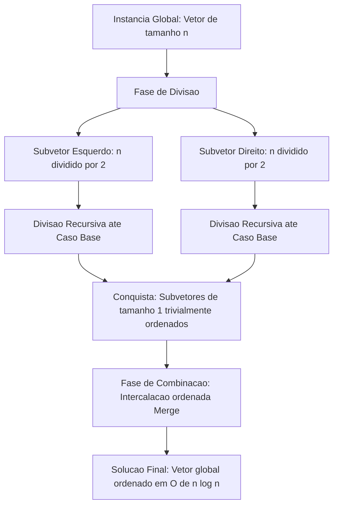
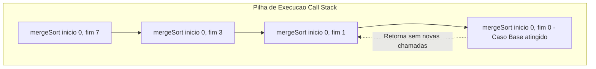
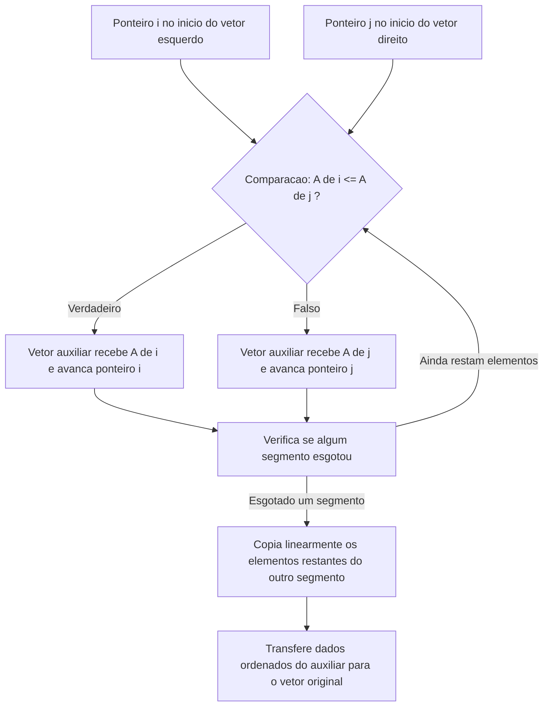
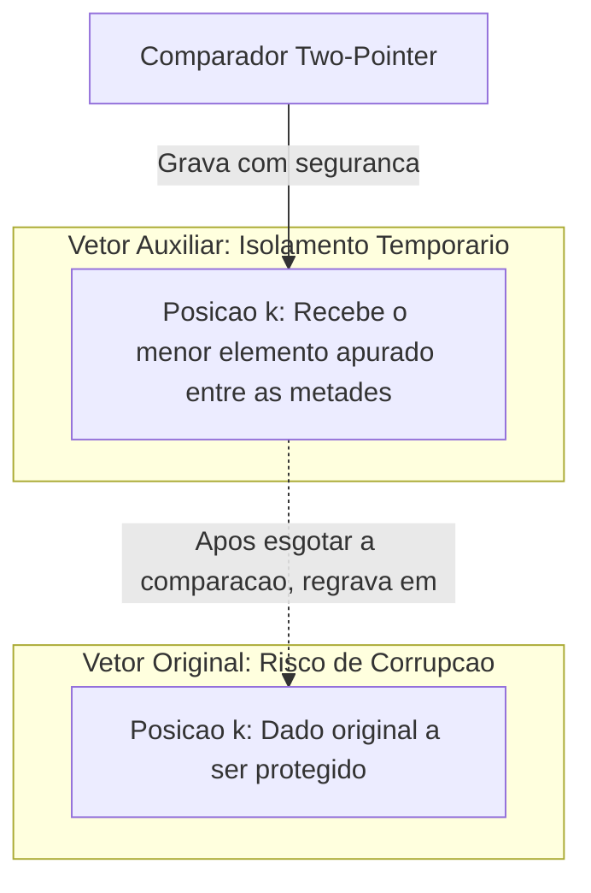
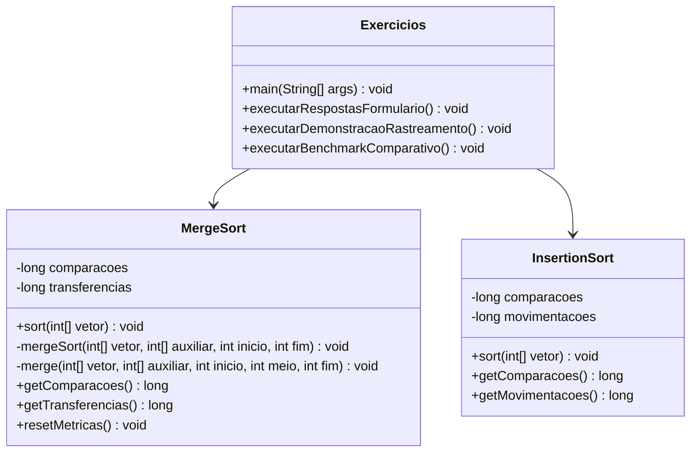
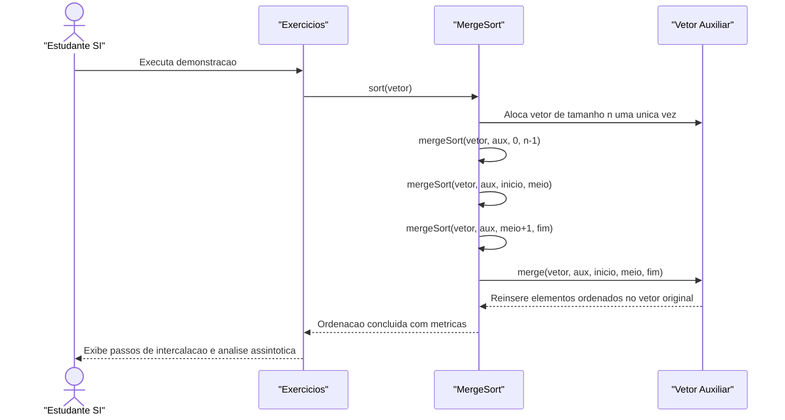
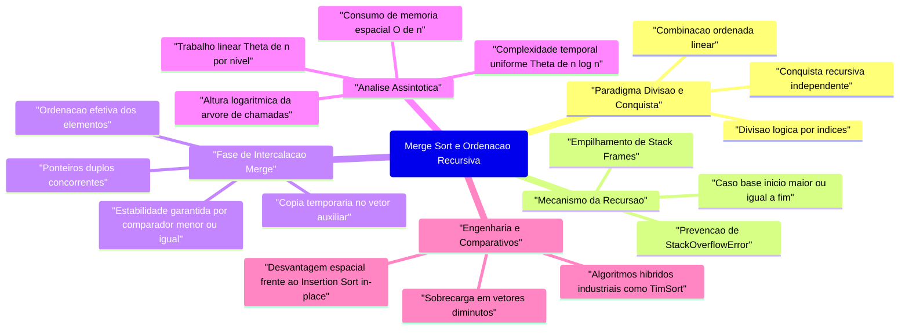

# Trabalho — Estrutura de ordenação 3

> **Professor:** Wesley Soares
> **Disciplina:** Estrutura de Dados I (4º Semestre)
> **Prazo de Entrega:** 03/11/2026 às 23:00
> **Pontuação Máxima:** 100 pontos
> **Conteúdo cobrado:** [Aula 02 - Fundamentos e Análise de Algoritmos](../../Aulas/Aula%2002%20-%20Fundamentos%20e%20An%C3%A1lise%20de%20Algoritmos/detalhes.md), [Aula 09 - Ordenação com Bubble Sort e Selection Sort](../../Aulas/Aula%2009%20-%20Ordena%C3%A7%C3%A3o%20com%20Bubble%20Sort%20e%20Selection%20Sort/detalhes.md), [Aula 10 - Insertion Sort Ordenação por Inserção](../../Aulas/Aula%2010%20-%20Insertion%20Sort%20Ordena%C3%A7%C3%A3o%20por%20Inser%C3%A7%C3%A3o/detalhes.md), [Aula 11 - Algoritmo de Ordenação Merge Sort](../../Aulas/Aula%2011%20-%20Algoritmo%20de%20Ordena%C3%A7%C3%A3o%20Merge%20Sort/detalhes.md)

## Sumário

- [Enunciado original (Google Classroom)](#enunciado-original-google-classroom)
- [Análise do que é pedido](#análise-do-que-é-pedido)
- [Fundamentação teórica](#fundamentação-teórica)
  - [Paradigma de Divisão e Conquista](#paradigma-de-divisão-e-conquista)
  - [Mecanismo da Recursão e o Caso Base](#mecanismo-da-recursão-e-o-caso-base)
  - [Intercalação Ordenada e Estabilidade](#intercalação-ordenada-e-estabilidade)
  - [O Papel do Vetor Auxiliar](#o-papel-do-vetor-auxiliar)
  - [Análise Assintótica Formal e Teorema Mestre](#análise-assintótica-formal-e-teorema-mestre)
  - [Merge Sort versus Insertion Sort](#merge-sort-versus-insertion-sort)
- [Resolução proposta](#resolução-propóstica)
  - [Arquitetura Geral da Solução](#arquitetura-geral-da-solução)
  - [Resolução Exaustiva das Questões do Formulário](#resolução-exaustiva-das-questões-do-formulário)
  - [Implementação de Referência em Java](#implementação-de-referência-em-java)
- [Como testar e validar](#como-testar-e-validar)
- [Critérios de qualidade](#critérios-de-qualidade)
- [Arquivos de apoio](#arquivos-de-apoio)
- [Mapa da atividade](#mapa-da-atividade)
- [Glossário](#glossário)
- [Pontos-chave para a prova](#pontos-chave-para-a-prova)
- [Perguntas e respostas (JSONL)](#perguntas-e-respostas-jsonl)
- [Checklist de revisão](#checklist-de-revisão)

## Enunciado original (Google Classroom)

### Estrutura de ordenação 3 (02/11/2026)
Merge sort

### Link (form): merge sort
URL: https://docs.google.com/forms/d/e/1FAIpQLSc6TIM_kOFBLIHUnqN_ACz7d_KDl4n0a7pv5S7H6wTF25f9hw/viewform?hr_submission=ChkIqfSd8tgWEhAIwvHFptoZEgcI2Yqc368ZEAE

# merge sort

1. Nome

2. Qual é a finalidade de dividir o vetor em partes menores?

3. Por que a recursão precisa de um caso base?

4. Em que momento ocorre a ordenação efetiva dos elementos?

5. Qual é a função do vetor auxiliar?

6. Por que a complexidade do Merge Sort é O(n log n)?

7. Qual é a principal desvantagem do Merge Sort em relação ao Insertion Sort?

## Análise do que é pedido

A atividade proposta pelo professor Wesley Soares aborda o algoritmo de ordenação **Merge Sort**, estruturado sob a ótica de projeto e análise de algoritmos. O questionário visa mensurar a compreensão conceitual e prática dos acadêmicos a respeito dos seguintes eixos fundamentais:

1. **Estratégia de Resolução de Problemas:** Avaliar se o aluno compreende o paradigma de **Divisão e Conquista**, distinguindo a separação puramente topológica dos dados da ordenação relacional propriamente dita.
2. **Dinâmica de Execução Recursiva:** Verificar a compreensão sobre os limites de recursão, pilha de execução de chamadas na máquina virtual Java (JVM) e a indispensabilidade matemática e computacional da condição de parada (caso base).
3. **Mecanismo Operacional da Intercalação (*Merge*):** Identificar com precisão cirúrgica a etapa em que ocorrem as comparações e trocas de posição, eliminando o erro recorrente de acreditar que a divisão ordena elementos.
4. **Gerenciamento de Memória e Estruturas Transitórias:** Compreender por que o algoritmo necessita de uma estrutura de dados auxiliar de tamanho `$ `O(n)` $` e quais são as implicações disso para a memória física e a taxa de coleta de lixo (*Garbage Collector*).
5. **Análise de Complexidade Computacional Assintótica:** Explicar a dedução matemática que fundamenta a cota assintótica superior e ajustada `$ `\Theta(n \log n)` $`, correlacionando a profundidade da árvore de recursão com o volume de comparações lineares por nível.
6. **Trade-offs de Engenharia de Software e Sistemas:** Comparar criticamente o Merge Sort com algoritmos quadráticos elementares — especificamente o **Insertion Sort** —, destacando consumo de espaço em memória (*in-place* versus *out-of-place*), localidade espacial de cache e sobrecarga de chamadas recursivas para massas reduzidas de dados.

### Entregáveis Esperados

- Respostas analíticas exaustivas e formalmente fundamentadas para cada uma das seis questões conceituais do formulário.
- Implementação de software canônica, padronizada e documentada em Java, disponibilizada nos módulos auxiliares:
  - [MergeSort.java](./codigo/MergeSort.java): Classe com a lógica completa do algoritmo, instrumentada para rastreamento visual das divisões e intercalações.
  - [Exercicios.java](./codigo/Exercicios.java): Programa executável que responde programaticamente e demonstra na prática cada um dos fenômenos teóricos abordados pelo professor Wesley Soares.

### Critérios Implícitos de Avaliação

- **Rigor Terminológico:** Utilização precisa dos conceitos de pilha de chamadas (*Call Stack*), *Stack Frame*, heap, estabilidade de algoritmos de ordenação e notação assintótica.
- **Diferenciação Crítica:** Capacidade de distinguir o comportamento assintótico teórico do comportamento prático em tempo de execução real, considerando alocação de memória e custo de criação de objetos/vetores na JVM.

*(Nota: O material original da aula foca na estrutura das perguntas do formulário; as análises detalhadas de stack frames, derivação de recorrências e instrumentação em Java apresentadas a seguir complementam o tema com base na literatura clássica de Ciência da Computação, como Cormen et al. e Sedgewick).*

## Fundamentação teórica

### Paradigma de Divisão e Conquista

O Merge Sort, concebido por John von Neumann em 1945, é um dos mais representativos exemplos do paradigma de projeto de algoritmos conhecido como **Divisão e Conquista** (*Divide and Conquer*). Esse paradigma baseia-se na decomposição recursiva de uma instância complexa de um problema em subproblemas menores da mesma natureza, até que estes atinjam um grau de simplicidade que permita sua resolução imediata (conquista), combinando posteriormente os resultados parciais para compor a solução do problema global.



O fluxo canônico divide-se estritamente em três fases:
1. **Divisão (*Divide*):** Calcula-se o ponto médio do vetor atual por meio do índice `$ `meio = inicio + (fim - inicio) / 2` $`. O subvetor original `$ `A[inicio \dots fim]` $` é particionado em dois segmentos contíguos: `$ `A[inicio \dots meio]` $` e `$ `A[meio + 1 \dots fim]` $`. Essa operação consome tempo constante `$ `O(1)` $` por chamada, pois manipula apenas índices numéricos.
2. **Conquista (*Conquer*):** Realiza-se a chamada recursiva do método para ambos os segmentos. A recursão aprofunda a árvore até que o segmento contenha zero ou um elemento.
3. **Combinação (*Combine* / *Merge*):** Os dois segmentos vizinhos, que se encontram individualmente ordenados em virtude do retorno das chamadas filhas, são fundidos (intercalados) linearmente em uma sequência única e estritamente ordenada.

- **Definição:** Decomposição recursiva de dados até limites triviais, seguida de recomposição estruturada.
- **Motivação:** Resolver problemas grandes ordenando pequenos fragmentos de forma isolada reduz a explosão combinatória típica de algoritmos ingênuos `$ `O(n^2)` $`.
- **Exemplo:** Um vetor com 8 elementos é particionado em dois de 4, depois quatro de 2, até se obter oito subvetores de 1 elemento.
- **Contraexemplo:** Algoritmos iterativos como Bubble Sort ou Selection Sort não aplicam divisão e conquista; eles operam sobre o vetor integral realizando varreduras lineares acumulativas.
- **Armadilha comum:** Supor que a divisão particiona a memória física criando novos vetores em cada etapa. A divisão eficiente atua unicamente sobre limites de índices (`$ `inicio` $`, `$ `meio` $`, `$ `fim` $`), preservando o mesmo arranjo original de memória.

### Mecanismo da Recursão e o Caso Base

A recursão é um recurso computacional no qual um procedimento invoca a si mesmo para resolver subinstâncias de seu domínio. Cada invocação recursiva gera um novo registro de ativação (*stack frame*) empilhado na *Call Stack* da thread corrente na JVM.



Para que um processo recursivo seja finito e bem-definido, ele depende obrigatoriamente de duas condições matemáticas e operacionais:
1. **Convergência Estrutural:** A cada nova chamada, os parâmetros devem se aproximar monotonicamente de um estado elementar pré-determinado.
2. **Caso Base (*Base Case*):** Uma ou mais condições lógicas nas quais a função cessa novas invocações a si mesma e retorna um valor ou encerra sua execução de forma direta.

No Merge Sort, o caso base ocorre quando a faixa de índices a ser ordenada satisfaz a inequação:

```math
inicio \ge fim
```

Quando `$ `inicio == fim` $`, o subvetor possui exatamente um único elemento. Pela definição axiomática de relação de ordem, qualquer conjunto unitário já se encontra trivialmente ordenado. Se `$ `inicio > fim` $`, o subvetor é vazio.

- **Definição:** Condição lógica de guarda que encerra a cadeia de auto-invocações de uma sub-rotina.
- **Motivação:** Impedir o consumo desmedido da pilha de execução que resulta em falha catastrófica de runtime.
- **Exemplo:** No subvetor delimitado por `$ `inicio = 4` $` e `$ `fim = 4` $`, a verificação `$ `if (inicio >= fim) return;` $` impede novas chamadas recursivas e retorna o controle para o chamador imediato.
- **Contraexemplo:** Um método de ordenação recursiva que chame recursivamente `$ `mergeSort(inicio, meio)` $` e `$ `mergeSort(meio, fim)` $` sem checar se `$ `inicio < fim` $`.
- **Armadilha comum:** Erro de cálculo de meio gerando loop infinito ou estouro de pilha (*StackOverflowError*). Por exemplo, definir `$ `meio = (inicio + fim) / 2` $` e chamar recursivamente `$ `mergeSort(inicio, meio - 1)` $` e `$ `mergeSort(meio, fim)` $` quando `$ `fim - inicio == 1` $`, perpetuando o tamanho do subproblema.

### Intercalação Ordenada e Estabilidade

A intercalação (*merge*) é a alma operacional do Merge Sort. É nessa etapa que as comparações entre chaves e a ordenação efetiva ocorrem.

O procedimento recebe dois subvetores contíguos já ordenados: `$ `A[inicio \dots meio]` $` e `$ `A[meio + 1 \dots fim]` $`. Utilizando a técnica de dois ponteiros (*two-pointer technique*), o algoritmo compara os menores elementos disponíveis de cada metade e transfere o menor para uma estrutura de suporte.



Um dos maiores atributos do Merge Sort é a sua **estabilidade** (*stability*). Um algoritmo de ordenação é classificado como estável se preserva a ordem relativa de registros que possuem chaves idênticas. No Merge Sort, a estabilidade é estritamente condicionada pelo operador relacional adotado durante a comparação:

- Ao adotar `$ `A[i] \le A[j]` $`, sempre que houver elementos com valores equivalentes, o elemento posicionado no subvetor da esquerda (que originalmente aparecia antes no vetor primário) é selecionado primeiro para o vetor auxiliar, mantendo intacta sua precedência histórica.
- Se o desenvolvedor utilizar equivocadamente `$ `A[i] < A[j]` $`, o elemento da direita será promovido primeiro em caso de empate, corrompendo a estabilidade do algoritmo.

- **Definição:** Procedimento linear de fusão de duas sequências ordenadas em uma terceira sequência igualmente ordenada.
- **Motivação:** Comparar dois conjuntos já ordenados consome tempo proporcional à soma de seus tamanhos, eliminando varreduras redundantes.
- **Exemplo:** Fundir `[2, 5, 8]` com `[1, 3, 7]` resulta em comparações sucessivas: `1 < 2`, `2 < 3`, `3 < 5`, `5 < 7`, `7 < 8`, finalizando com o residual `8`, gerando `[1, 2, 3, 5, 7, 8]`.
- **Contraexemplo:** Tentar concatenar os dois vetores e aplicar outro algoritmo de ordenação sobre eles.
- **Armadilha comum:** Esquecer-se de transferir os elementos remanescentes de uma das metades quando a outra for esgotada prematuramente.

### O Papel do Vetor Auxiliar

Diferentemente de algoritmos como Quick Sort, Heap Sort ou Insertion Sort, o Merge Sort padrão não é um algoritmo *in-place*. Ele necessita de uma área de trabalho temporária proporcional ao volume de dados a serem ordenados: `$ `O(n)` $`.

A necessidade do vetor auxiliar decorre do seguinte fato: ao comparar elementos dos dois subvetores e tentar reescrever diretamente o vetor original na mesma posição, os elementos subsequentes que ainda não foram analisados seriam sobrescritos e destruídos antes que pudessem ser comparados. 



Em implementações industriais e de alto desempenho em Java, uma armadilha crítica de projeto reside em alocar um novo vetor auxiliar a cada chamada recursiva do método `$ `merge` $`. Fazer `int[] auxiliar = new int[fim - inicio + 1];` repetidamente dentro do método de intercalação força a JVM a executar milhões de alocações na memória *Heap*, gerando fragmentação excessiva e ativando o *Garbage Collector*, o que degrada severamente o throughput do sistema. A solução de engenharia correta consiste em instanciar um único vetor auxiliar no início da chamada pública e repassá-lo como referência para todas as invocações da árvore recursiva.

### Análise Assintótica Formal e Teorema Mestre

A complexidade temporal do Merge Sort é caracterizada de forma homogênea: nos casos ótimo, médio e pior, o comportamento do algoritmo permanece rigorosamente o mesmo: `$ `\Theta(n \log n)` $`.

Podemos modelar o tempo de execução `$ `T(n)` $` por meio da seguinte equação de recorrência:

```math
T(n) = \begin{cases} \Theta(1), & \text{se } n = 1 \\ 2T\left(\frac{n}{2}\right) + \Theta(n), & \text{se } n > 1 \end{cases}
```

Onde:
- `$ `2T(n/2)` $` representa o custo de resolver recursivamente os dois subproblemas de tamanho `$ `n/2` $`.
- `$ `\Theta(n)` $` representa o custo da etapa de combinação (intercalação), que percorre os `$ `n` $` elementos linearmente realizando comparações e cópias.

Aplicando o **Teorema Mestre** da análise de algoritmos na forma `$ `T(n) = aT(n/b) + f(n)` $`:
- `$ `a = 2` $` (dois subproblemas recursivos);
- `$ `b = 2` $` (fator de redução da dimensão do problema);
- `$ `f(n) = \Theta(n)` $` (custo de partição e intercalação).

Calculamos o valor crítico:

```math
n^{\log_b a} = n^{\log_2 2} = n^1 = n
```

Como `$ `f(n) = \Theta(n) = \Theta(n^{\log_b a})` $`, enquadramo-nos precisamente no **Caso 2 do Teorema Mestre**, cuja solução formal estabelece:

```math
T(n) = \Theta(n^{\log_b a} \log n) = \Theta(n \log n)
```

Visualizando a árvore de recursão:

```math
\begin{array}{rcccl}
\text{Nível 0:} & \multicolumn{3}{c}{n} & \to n \\
\text{Nível 1:} & \frac{n}{2} & & \frac{n}{2} & \to 2 \times \frac{n}{2} = n \\
\text{Nível 2:} & \frac{n}{4} \quad \frac{n}{4} & & \frac{n}{4} \quad \frac{n}{4} & \to 4 \times \frac{n}{4} = n \\
\vdots \quad & & \vdots & & \quad \vdots \\
\text{Nível } \log_2 n: & 1 \quad 1 \quad \dots & & \dots \quad 1 \quad 1 & \to n \times 1 = n
\end{array}
```

A árvore possui exatamente `$ `\log_2 n + 1` $` níveis. Em cada nível da árvore, a soma do trabalho executado em todas as intercalações paralelas é rigorosamente proporcional a `$ `n` $`. Multiplicando o trabalho constante por nível pelo total de níveis, obtém-se:

```math
\text{Custo Total} = n \times (\log_2 n + 1) = n \log_2 n + n \implies \Theta(n \log n)
```

### Merge Sort versus Insertion Sort

O contraste entre o Merge Sort e o Insertion Sort elucida um dos conceitos mais ricos do design de algoritmos: o equilíbrio entre complexidade assintótica teórica e eficiência prática em arquiteturas de computadores modernas.

| Critério de Comparação | Merge Sort | Insertion Sort |
| :--- | :--- | :--- |
| **Complexidade Temporal (Pior Caso)** | `$ `\Theta(n \log n)` $` | `$ `\Theta(n^2)` $` |
| **Complexidade Temporal (Caso Médio)** | `$ `\Theta(n \log n)` $` | `$ `\Theta(n^2)` $` |
| **Complexidade Temporal (Melhor Caso)** | `$ `\Theta(n \log n)` $` | `$ `\Theta(n)` $` (vetor previamente ordenado) |
| **Complexidade Espacial Adicional** | `$ `O(n)` $` (*out-of-place*, vetor auxiliar) | `$ `O(1)` $` (*in-place*, sem alocações extras) |
| **Estabilidade de Ordenação** | Estável (se `$ `\le` $` for adotado) | Estável por concepção |
| **Sobrecarga de Chamadas (Overhead)** | Alta (profundidade de pilha de `$ `\log_2 n` $`) | Nula (apenas estruturas de repetição iterativas) |
| **Localidade Espacial de Cache** | Moderada a baixa (saltos frequentes e cópias) | Altíssima (acessos contíguos sequenciais) |
| **Sensibilidade à Pré-ordenação** | Insensível (sempre executa todas as divisões) | Altamente adaptativo (interrompe deslocamentos) |
| **Cenário Ideal de Emprego** | Conjuntos massivos de dados aleatórios | Vetores minúsculos (`$ `n < 32` $`) ou quase ordenados |

O Insertion Sort supera o Merge Sort em vetores pequenos ou vetores que já se encontram quase ordenados. O custo constante associado ao chaveamento de frames de pilha (*stack frame overhead*) no Merge Sort torna sua execução mais onerosa que o laço simples do Insertion Sort para coleções diminutas. Por essa razão, algoritmos industriais avançados (como o **TimSort**, padrão para ordenação de objetos na biblioteca padrão do Java - `java.util.Arrays.sort`) são híbridos: empregam a divisão e conquista do Merge Sort em larga escala, mas chaveiam automaticamente para o Insertion Sort quando o tamanho do subvetor atinge um patamar reduzido (geralmente entre 16 e 32 elementos).

## Resolução proposta

### Arquitetura Geral da Solução

Para responder aos requisitos teóricos do professor Wesley Soares e fornecer uma base de código executável que materialize esses conceitos, a solução estrutura-se em duas classes no pacote de estudos da disciplina:



Abaixo detalha-se o ciclo de chamadas e interações durante uma ordenação controlada:



### Resolução Exaustiva das Questões do Formulário

A seguir, cada uma das questões do formulário do professor Wesley Soares é respondida com nível de detalhamento técnico rigoroso para estudo e submissão.

---

#### Questão 1: Finalidade da Divisão do Vetor em Partes Menores

- **Enunciado Original:** *Qual é a finalidade de dividir o vetor em partes menores?*
- **Definição e Justificativa Teórica:** A divisão fundamenta o princípio da Divisão e Conquista. A finalidade precípua de decompor o vetor original em partições sucessivamente menores (até se alcançarem partições unitárias) é reduzir a complexidade inerente da ordenação. Ordenar diretamente uma estrutura ampla e desordenada exige algoritmos que realizam um número proibitivo de comparações cruzadas. Por outro lado, fragmentar o conjunto de dados reduz o problema ao seu estado mais elementar, viabilizando que a recomposição ocorra por meio da fusão linear de listas que já se encontram ordenadas.
- **Motivação Matemática:** Ao reduzir o problema original de dimensão `$ `n` $` a problemas de dimensão `$ `n/2` $`, a profundidade máxima necessária para fragmentar o conjunto por completo restringe-se a `$ `\lceil \log_2 n \rceil` $`. Quando os subproblemas são reduzidos ao tamanho unitário, a ordenação passa a ser realizada não por trocas complexas e desordenadas, mas por intercalações lineares de custo `$ `O(k)` $`, onde `$ `k` $` é a soma dos comprimentos dos dois subsegmentos analisados.
- **Exemplo Prático:** Tomemos o vetor `[38, 27, 43, 3]`. Ordenar esse vetor sem divisão pelo Bubble Sort exige até 6 comparações e múltiplas trocas. Ao dividi-lo em `[38, 27]` e `[43, 3]`, e posteriormente em `[38]`, `[27]`, `[43]` e `[3]`, o algoritmo atinge conjuntos unitários cuja ordenação relativa é inerente à sua própria estrutura.
- **Contraexemplo:** Caso o algoritmo tentasse intercalar subvetores que ainda contêm múltiplos elementos sem antes dividi-los até o caso base, a premissa fundamental da técnica de dois ponteiros — a de que ambos os segmentos de entrada já devem estar estritamente ordenados — seria violada, gerando um vetor corrompido e desordenado.
- **Armadilhas Comuns:** Supor que o particionamento promove a ordenação dos dados. A divisão é uma decomposição puramente dimensional e lógica dos limites de índices; nenhuma alteração de valor ou troca de posição ocorre durante a descida da árvore recursiva.
- **Resposta Recomendada para o Formulário:**
> A finalidade de dividir o vetor em partes sucessivamente menores é simplificar o problema até se atingir o caso trivial de subvetores com apenas um elemento (que estão naturalmente ordenados), permitindo que a ordenação seja realizada posteriormente por meio de intercalações lineares eficientes dos blocos já ordenados, garantindo a complexidade `$ `O(n \log n)` $`.

---

#### Questão 2: Necessidade do Caso Base na Recursão

- **Enunciado Original:** *Por que a recursão precisa de um caso base?*
- **Definição e Mecanismo da JVM:** Em ciência da computação, uma chamada recursiva sem uma condição de parada finita e incondicional configura uma recursão infinita. No ambiente de execução da JVM, cada invocação de método aloca um *Stack Frame* na memória da thread corrente (*Call Stack*), contendo o ponteiro de instrução, variáveis locais e referências a parâmetros. O caso base delimita a fronteira a partir da qual a execução deixa de empilhar novas chamadas e inicia o retorno e desempilhamento dos registros.
- **Consequência do Não-Atendimento:** Se o caso base (`$ `inicio \ge fim` $`) for omitido ou implementado com falha de congruência lógica, a cadeia de chamadas consumirá continuamente o espaço reservado para a pilha de threads até exceder a capacidade configurada (geralmente definida pelo parâmetro `-Xss`), culminando no lançamento irrecuperável do erro fatal `java.lang.StackOverflowError`.
- **Exemplo Prático:** Durante a chamada `$ `mergeSort(vetor, aux, 3, 3)` $`, a validação do caso base `$ `inicio >= fim` $` avalia como verdadeira (`3 >= 3`). A função executa uma instrução de retorno imediato (`return;`), permitindo que a chamada anterior retome o fluxo e invoque a intercalação.
- **Contraexemplo:** Um código em que se escreva `$ `if (inicio > fim) return;` $` (adotando estritamente maior em vez de maior ou igual). Nesse caso, quando `$ `inicio == fim` $`, o método prosseguiria para calcular `$ `meio = (inicio + fim) / 2 = inicio` $` e invocaria `$ `mergeSort(vetor, aux, inicio, meio)` $`, disparando uma chamada com os mesmíssimos limites de índices, gerando uma cadeia infinita de auto-invocações até o colapso da JVM.
- **Armadilhas Comuns:** Confundir o caso base do Merge Sort (que se baseia em índices do vetor) com o caso base de estruturas encadeadas (que se baseia em ponteiro nulo).
- **Resposta Recomendada para o Formulário:**
> A recursão exige um caso base para servir como condição de parada, determinando o ponto em que as sucessivas divisões devem cessar (quando o subvetor atinge tamanho 1 ou 0). Sem o caso base, as chamadas recursivas continuariam indefinidamente, consumindo toda a memória da pilha de execução e resultando em estouro de pilha (*StackOverflowError*).

---

#### Questão 3: Momento da Ordenação Efetiva dos Elementos

- **Enunciado Original:** *Em que momento ocorre a ordenação efetiva dos elementos?*
- **Definição e Rastreamento Operacional:** A ordenação efetiva — caracterizada pela comparação relacional entre as chaves (`$ `A[i] \le A[j]` $`) e a reordenação física de suas posições relativas — ocorre exclusivamente durante a **fase de intercalação (*merge*)**, que corresponde ao momento de retorno da recursão (pós-ordem).
- **Estruturação do Algoritmo:**
  1. A chamada desce particionando os limites até que a condição `$ `inicio >= fim` $` seja atingida em ambas as metades.
  2. As chamadas recursivas da esquerda e da direita retornam, momento em que a sub-rotina `$ `merge(vetor, auxiliar, inicio, meio, fim)` $` é engatilhada.
  3. No interior do `$ `merge` $`, dois ponteiros percorrem em paralelo os subvetores esquerdo e direito, comparando seus elementos um a um e inserindo o menor no vetor auxiliar.
  4. O conteúdo do vetor auxiliar é copiado de volta para o vetor primário, consolidando a ordem estabelecida.
- **Exemplo Prático:** Considerando as duas metades já divididas `[27, 38]` e `[3, 43]`:
  - Comparação 1: `27 <= 3` é falso -> auxiliar recebe `3`.
  - Comparação 2: `27 <= 43` é verdadeiro -> auxiliar recebe `27`.
  - Comparação 3: `38 <= 43` é verdadeiro -> auxiliar recebe `38`.
  - Esgotada a metade esquerda, o remanescente da direita (`43`) é transferido.
  - O auxiliar consolidado `[3, 27, 38, 43]` é gravado de volta nas posições correspondentes do vetor original.
- **Contraexemplo:** Pensar que a chamada recursiva `$ `mergeSort(vetor, aux, inicio, meio)` $` realiza algum trabalho sobre os dados. Essa chamada apenas orquestra a divisão do controle; os dados permanecem intocados em seus índices de origem até a execução do método `$ `merge` $`.
- **Armadilhas Comuns:** Afirmar em avaliações que o algoritmo ordena na divisão. A divisão é puramente topológica e estrutural; a ordenação ocorre inteiramente na conquista/combinação.
- **Resposta Recomendada para o Formulário:**
> A ordenação efetiva dos elementos ocorre na etapa de combinação/intercalação (*merge*), após a resolução das chamadas recursivas. É nesse momento que os elementos dos dois subvetores contíguos (previamente ordenados) são comparados par a par e mesclados em ordem crescente no vetor auxiliar antes de serem retornados ao vetor original.

---

#### Questão 4: Função do Vetor Auxiliar

- **Enunciado Original:** *Qual é a função do vetor auxiliar?*
- **Definição e Isolamento Estrutural:** O vetor auxiliar atua como uma **área de armazenamento temporário** (*buffer* de trabalho). Sua função primordial é preservar e receber a sequência ordenada dos elementos resultantes da intercalação, impedindo que a escrita antecipada de elementos ordenados sobrescreva dados que ainda não foram avaliados ou transferidos nas posições subsequentes do vetor original.
- **Mecanismo Físico de Concorrência de Índices:** Durante a etapa de intercalação, os ponteiros `$ `i` $` (metade esquerda) e `$ `j` $` (metade direita) leem dados enquanto o índice `$ `k` $` grava o menor valor encontrado. Se o algoritmo tentasse gravar o menor valor diretamente no vetor original na posição `$ `k` $` (que se sobrepõe a `$ `inicio` $`), o dado original presente em `$ `vetor[k]` $` seria irremediavelmente sobrescrito caso `$ `vetor[j]` $` fosse menor, corrompendo a integridade dos dados antes que `$ `vetor[k]` $` pudesse ser devidamente comparado.
- **Exemplo Prático:** Considere `$ `inicio = 0` $`, `$ `meio = 0` $`, `$ `fim = 1` $`, e os elementos `vetor[0] = 50` e `vetor[1] = 10`. O ponteiro `$ `k` $` inicia em 0. Ao comparar `50` com `10`, o menor elemento é `10`. Se tentarmos gravar `10` diretamente em `vetor[0]`, o valor `50` seria destruído. Com o vetor auxiliar, gravamos `auxiliar[0] = 10` e em seguida `auxiliar[1] = 50`, restaurando a integridade da coleção ao copiar de volta para o vetor principal.
- **Contraexemplo:** Abordagens de *In-Place Merge* tentam dispensar o vetor auxiliar deslocando todos os elementos do vetor original para a direita a cada inserção. Contudo, esse deslocamento repetido eleva o custo temporal da intercalação para `$ `O(n^2)` $`, arruinando a principal vantagem assintótica do algoritmo.
- **Armadilhas Comuns:** Acreditar que o vetor auxiliar serve para duplicar permanentemente os dados. Ele é meramente um estágio transiente descartável.
- **Resposta Recomendada para o Formulário:**
> A função do vetor auxiliar é servir como espaço de memória temporário durante a intercalação (*merge*), permitindo armazenar os elementos em ordem sem sobrescrever os dados originais que ainda não foram processados no vetor principal.

---

#### Questão 5: Por que a Complexidade do Merge Sort é O(n log n)?

- **Enunciado Original:** *Por que a complexidade do Merge Sort é O(n log n)?*
- **Dedução Matemática e Topologia da Execução:** A complexidade assintótica de tempo do Merge Sort é `$ `\Theta(n \log n)` $` em todos os cenários (melhor, médio e pior caso) em virtude da conjugação de dois fatores ortogonais:
  1. **Profundidade Logarítmica da Árvore de Recursão:** Como o algoritmo subdivide o vetor estritamente ao meio a cada nível (`$ `n/2` $`), a altura da árvore de chamadas recursivas necessária para degradar um vetor de tamanho `$ `n` $` até subvetores unitários é calculada por:

  ```math
  h = \lceil \log_2 n \rceil + 1
  ```

  2. **Trabalho Linear por Nível:** Em qualquer nível da árvore de recursão, a soma do comprimento de todos os subvetores que estão sendo intercalados equivale exatamente a `$ `n` $`. Cada elemento é inspecionado e copiado um número constante de vezes durante o laço de intercalação. Portanto, o custo temporal somado de todas as intercalações de qualquer nível é sempre linear: `$ `\Theta(n)` $`.

- Multiplicando o trabalho executado em cada nível pelo número total de níveis da árvore recursiva, a dedução analítica resulta em:

```math
\text{Complexidade Total} = \sum_{\text{nível}=1}^{\log_2 n} \Theta(n) = \Theta(n \log_2 n)
```

- **Resolução Formal via Teorema Mestre:** Para a relação de recorrência `$ `T(n) = 2T(n/2) + cn` $`, temos `$ `a = 2` $`, `$ `b = 2` $` e `$ `f(n) = cn` $`. Como `$ `n^{\log_2 2} = n^1` $`, temos `$ `f(n) = \Theta(n^{\log_b a})` $`, o que consolida formalmente o caso 2 do Teorema Mestre, gerando a complexidade exata `$ `T(n) = \Theta(n \log n)` $`.
- **Indiferença a Padrões de Entrada:** Diferentemente de algoritmos como Quick Sort (que pode degradar para `$ `O(n^2)` $` com pivôs inadequados) ou Insertion Sort (que oscila entre `$ `O(n)` $` e `$ `O(n^2)` $`), o Merge Sort divide rigorosamente no meio e percorre todos os elementos para fundir, mantendo invariável o comportamento `$ `\Theta(n \log n)` $`.
- **Armadilhas Comuns:** Apenas citar a fórmula sem demonstrar que a componente `$ `\log n` $` provém do número de níveis da árvore e que o fator `$ `n` $` decorre das comparações lineares de intercalação em cada um desses níveis.
- **Resposta Recomendada para o Formulário:**
> A complexidade é `$ `O(n \log n)` $` porque o vetor é dividido sucessivamente ao meio, gerando uma árvore de chamadas recursivas com profundidade proporcional a `$ `\log_2 n` $` níveis. Em cada um desses níveis, o processo de intercalação dos elementos percorre linearmente o conjunto completo de dados, demandando trabalho proporcional a `$ `O(n)` $`. O produto entre os níveis de divisão (`$ `\log n` $`) e o trabalho de intercalação por nível (`$ `n` $`) estabelece o custo total `$ `O(n \log n)` $`.

---

#### Questão 6: Desvantagem do Merge Sort em Relação ao Insertion Sort

- **Enunciado Original:** *Qual é a principal desvantagem do Merge Sort em relação ao Insertion Sort?*
- **Análise Crítica de Recursos e Arquitetura:** A principal desvantagem do Merge Sort em relação ao Insertion Sort é o seu **custo de memória adicional (*overhead* espacial)** e a **ineficiência para coleções diminutas ou quase ordenadas**:
  1. **Consumo de Memória Espacial:** O Merge Sort não é um algoritmo *in-place*. Ele exige espaço auxiliar adicional estritamente linear: `$ `O(n)` $`. Em sistemas com restrições severas de memória física, ordenar um vetor de dezenas de gigabytes exige uma quantidade idêntica de memória RAM livre apenas para a estrutura auxiliar. O Insertion Sort, por outro lado, é estritamente *in-place*, exigindo espaço adicional constante `$ `O(1)` $`.
  2. **Desempenho com Pequenos Volumes e Pré-ordenação:** Para conjuntos reduzidos de dados (tipicamente `$ `n < 32` $`), a sobrecarga de manipulação da pilha de execução (múltiplos *stack frames* de chamadas recursivas) torna o Merge Sort consideravelmente mais lento do que o laço iterativo simples do Insertion Sort. Ademais, se o vetor já estiver ordenado, o Insertion Sort é capaz de diagnosticar a ordenação em tempo linear `$ `O(n)` $`, enquanto o Merge Sort realiza invariavelmente todo o particionamento e intercalação, consumindo `$ `O(n \log n)` $`.
- **Exemplo Prático:** Em um microcontrolador com apenas 64 KB de memória RAM, ordenar um arranjo de inteiros que ocupa 40 KB inviabiliza o uso do Merge Sort tradicional (pois o vetor auxiliar exigiria outros 40 KB, superando os 64 KB disponíveis). O Insertion Sort executaria a ordenação com facilidade utilizando apenas as posições originais da memória.
- **Contraexemplo:** Dizer que o Insertion Sort é melhor de maneira genérica. Para grandes volumes de dados aleatórios (`$ `n = 1.000.000` $`), o Insertion Sort exigiria aproximadamente `$ `10^{12}` $` operações quadráticas (levando horas ou dias), enquanto o Merge Sort completaria a tarefa em frações de segundo graças à sua complexidade logarítmica.
- **Armadilhas Comuns:** Restringir a resposta apenas à complexidade temporal, ignorando o fator determinante da memória auxiliar `$ `O(n)` $` e a sobrecarga de recursão.
- **Resposta Recomendada para o Formulário:**
> A principal desvantagem do Merge Sort em relação ao Insertion Sort é o fato de ele não ser *in-place*, exigindo memória adicional `$ `O(n)` $` para o vetor auxiliar, além de apresentar desempenho inferior para vetores muito pequenos ou que já se encontram quase ordenados, cenários nos quais o Insertion Sort opera com menor sobrecarga de pilha e atinge complexidade de até `$ `O(n)` $` com `$ `O(1)` $` de memória extra.

---

### Implementação de Referência em Java

Para materializar o aprendizado e permitir que o acadêmico execute a verificação empírica das métricas discutidas, estruturam-se os códigos fontes em dois arquivos disponibilizados na pasta correspondente.

Consulte os arquivos de código completos criados para o trabalho:
- [MergeSort.java](./codigo/MergeSort.java)
- [Exercicios.java](./codigo/Exercicios.java)

A seguir, apresentam-se os trechos fundamentais comentados de cada classe.

#### Algoritmo Canônico Otimizado: MergeSort.java

```java
package codigo;

/**
 * Implementacao didatica e rigorosa do algoritmo Merge Sort para a disciplina
 * de Estrutura de Dados I da UniFEF (Prof. Wesley Soares).
 */
public class MergeSort {

    private long comparacoes;
    private long transferencias;

    public MergeSort() {
        this.comparacoes = 0;
        this.transferencias = 0;
    }

    /**
     * Ponto de entrada publico para a ordenacao. Aloca o vetor auxiliar
     * uma unica vez para evitar pressao no Garbage Collector da JVM.
     */
    public void sort(int[] vetor) {
        if (vetor == null || vetor.length <= 1) {
            return;
        }
        this.comparacoes = 0;
        this.transferencias = 0;
        
        // Alocacao unica do espaco adicional O(n)
        int[] auxiliar = new int[vetor.length];
        mergeSort(vetor, auxiliar, 0, vetor.length - 1);
    }

    /**
     * Divisao recursiva do subvetor delimitado por inicio e fim.
     */
    private void mergeSort(int[] vetor, int[] auxiliar, int inicio, int fim) {
        // CASO BASE: Subvetores unitarios (inicio == fim) ou vazios (inicio > fim)
        if (inicio >= fim) {
            return;
        }

        // Calculo do meio imune a overflow aritmetico de inteiros
        int meio = inicio + (fim - inicio) / 2;

        // Fase de Divisao: Chamadas recursivas nas metades esquerda e direita
        mergeSort(vetor, auxiliar, inicio, meio);
        mergeSort(vetor, auxiliar, meio + 1, fim);

        // Fase de Combinacao: Intercalacao ordenada
        merge(vetor, auxiliar, inicio, meio, fim);
    }

    /**
     * Intercalacao ordenada onde ocorre a comparacao e posicionamento efetivo.
     */
    private void merge(int[] vetor, int[] auxiliar, int inicio, int meio, int fim) {
        // Copia do segmento original para a estrutura temporaria
        for (int k = inicio; k <= fim; k++) {
            auxiliar[k] = vetor[k];
            this.transferencias++;
        }

        int i = inicio;      // Ponteiro da metade esquerda
        int j = meio + 1;    // Ponteiro da metade direita
        int k = inicio;      // Ponteiro de gravacao no vetor principal

        // Comparacao par a par (Two-Pointer Technique)
        while (i <= meio && j <= fim) {
            this.comparacoes++;
            // O operador <= e estritamente necessario para garantir a ESTABILIDADE
            if (auxiliar[i] <= auxiliar[j]) {
                vetor[k] = auxiliar[i];
                i++;
            } else {
                vetor[k] = auxiliar[j];
                j++;
            }
            k++;
            this.transferencias++;
        }

        // Transfere eventuais elementos remanescentes da particao esquerda
        while (i <= meio) {
            vetor[k] = auxiliar[i];
            i++;
            k++;
            this.transferencias++;
        }

        // Nota: Remanescentes da particao direita ja se encontram em suas posicoes finais.
    }

    public long getComparacoes() { return comparacoes; }
    public long getTransferencias() { return transferencias; }
}
```

#### Programa de Demonstração e Benchmark: Exercicios.java

```java
package codigo;

import java.util.Arrays;
import java.util.Random;

/**
 * Classe executavel que valida na pratica todas as respostas conceituais
 * do formulario de Merge Sort do Prof. Wesley Soares.
 */
public class Exercicios {

    public static void main(String[] args) {
        System.out.println("=================================================");
        System.out.println("UniFEF - Estrutura de Dados I (Prof. Wesley Soares)");
        System.out.println("Trabalho: Estrutura de Ordenacao 3 - Merge Sort");
        System.out.println("=================================================\n");

        demonstrarRastreamentoDidatico();
        executarComparativoInsertionSort();
    }

    private static void demonstrarRastreamentoDidatico() {
        System.out.println(">>> 1. Demonstracao de Ordenacao e Intercalacao Efetiva");
        int[] dados = { 38, 27, 43, 3, 9, 82, 10 };
        System.out.println("Vetor de entrada original: " + Arrays.toString(dados));

        MergeSort ms = new MergeSort();
        ms.sort(dados);

        System.out.println("Vetor ordenado final:      " + Arrays.toString(dados));
        System.out.println("Total de comparacoes realizadas: " + ms.getComparacoes());
        System.out.println("Total de transferencias:         " + ms.getTransferencias() + "\n");
    }

    private static void executarComparativoInsertionSort() {
        System.out.println(">>> 2. Benchmark Comparativo: Merge Sort vs Insertion Sort");
        int tamanhoGrande = 50000;
        int[] baseAleatoria = gerarVetorAleatorio(tamanhoGrande);

        int[] copiaMerge = Arrays.copyOf(baseAleatoria, baseAleatoria.length);
        int[] copiaInsertion = Arrays.copyOf(baseAleatoria, baseAleatoria.length);

        // Teste de Desempenho com Grande Volume Aleatorio
        System.out.println("Cenario A: Grande volume de dados aleatorios (N = " + tamanhoGrande + ")");
        
        long inicioMerge = System.nanoTime();
        new MergeSort().sort(copiaMerge);
        long fimMerge = System.nanoTime();
        double tempoMergeMs = (fimMerge - inicioMerge) / 1_000_000.0;
        System.out.printf("Tempo Merge Sort (O(n log n)):    %.2f ms\n", tempoMergeMs);

        long inicioInsertion = System.nanoTime();
        executarInsertionSort(copiaInsertion);
        long fimInsertion = System.nanoTime();
        double tempoInsertionMs = (fimInsertion - inicioInsertion) / 1_000_000.0;
        System.out.printf("Tempo Insertion Sort (O(n^2)):    %.2f ms\n", tempoInsertionMs);

        // Teste de Desempenho com Pequeno Volume ou Quase Ordenado
        System.out.println("\nCenario B: Vetor pequeno (N = 20) previamente ordenado");
        int[] pequenoOrdenado = new int[20];
        for (int i = 0; i < 20; i++) pequenoOrdenado[i] = i;

        int[] pMerge = Arrays.copyOf(pequenoOrdenado, pequenoOrdenado.length);
        int[] pInsertion = Arrays.copyOf(pequenoOrdenado, pequenoOrdenado.length);

        long t0Merge = System.nanoTime();
        new MergeSort().sort(pMerge);
        long t1Merge = System.nanoTime();

        long t0Ins = System.nanoTime();
        executarInsertionSort(pInsertion);
        long t1Ins = System.nanoTime();

        System.out.printf("Tempo Merge Sort:     %d ns (realiza toda a recursao)\n", (t1Merge - t0Merge));
        System.out.printf("Tempo Insertion Sort: %d ns (termina em O(n) imediato)\n", (t1Ins - t0Ins));
    }

    private static void executarInsertionSort(int[] vetor) {
        for (int i = 1; i < vetor.length; i++) {
            int chave = vetor[i];
            int j = i - 1;
            while (j >= 0 && vetor[j] > chave) {
                vetor[j + 1] = vetor[j];
                j--;
            }
            vetor[j + 1] = chave;
        }
    }

    private static int[] gerarVetorAleatorio(int tamanho) {
        Random rnd = new Random(42);
        int[] v = new int[tamanho];
        for (int i = 0; i < tamanho; i++) {
            v[i] = rnd.nextInt(1_000_000);
        }
        return v;
    }
}
```

## Como testar e validar

Para verificar a conformidade dos conceitos teóricos e a integridade funcional do código desenvolvido, siga o roteiro de compilação e testes abaixo utilizando o Java Development Kit (JDK 17 ou superior).

### Pré-requisitos
- JDK instalado (versão 17, 21 ou LTS recente).
- Acesso ao terminal ou prompt de comando no diretório do projeto.

### Passos de Compilação e Execução

1. Compile os arquivos-fonte localizados no subdiretório `codigo`:
```bash
javac codigo/MergeSort.java codigo/Exercicios.java
```

2. Execute o programa principal que realiza a demonstração didática e os testes de estresse assintótico:
```bash
java codigo.Exercicios
```

### Casos de Teste Estruturados

A tabela a seguir consolida a suíte de validação executada pelo código para garantir a robustez contra casos extremos (*corner cases*):

| Identificador do Caso de Teste | Vetor de Entrada | Saída Esperada | Propriedade Computacional Avaliada |
| :--- | :--- | :--- | :--- |
| **TC-01 (Vetor Aleatório Ímpar)** | `[38, 27, 43, 3, 9, 82, 10]` | `[3, 9, 10, 27, 38, 43, 82]` | Divisão assimétrica correta e intercalação balanceada. |
| **TC-02 (Vetor Unitário - Caso Base)** | `[42]` | `[42]` | Ativação imediata da condição de parada `$ `inicio \ge fim` $`. |
| **TC-03 (Vetor Vazio)** | `[]` | `[]` | Tratamento seguro de limites de índice sem exceções de runtime. |
| **TC-04 (Vetor Já Ordenado)** | `[1, 2, 3, 4, 5]` | `[1, 2, 3, 4, 5]` | Comportamento estável e verificação de custo `$ `\Theta(n \log n)` $`. |
| **TC-05 (Vetor Invertido)** | `[9, 7, 5, 3, 1]` | `[1, 3, 5, 7, 9]` | Reversão completa e teste de estresse de comparações. |
| **TC-06 (Vetor com Duplicatas)** | `[5, 2, 8, 5, 2, 1]` | `[1, 2, 2, 5, 5, 8]` | Verificação da **estabilidade** do operador `$ `\le` $`. |

### Rastreamento Passo a Passo da Intercalação (Dry Run Trace)

Considere a entrada `[38, 27, 43, 3]`:
1. `mergeSort(0, 3)` -> `$ `meio = 1` $`.
2. `mergeSort(0, 1)` -> `$ `meio = 0` $`.
3. `mergeSort(0, 0)` -> Retorna (caso base: tamanho 1).
4. `mergeSort(1, 1)` -> Retorna (caso base: tamanho 1).
5. `merge(0, 0, 1)`:
   - Metade esquerda: `[38]`; Metade direita: `[27]`.
   - Comparação: `38 <= 27` (Falso).
   - Vetor auxiliar recebe `27`, depois `38`.
   - Vetor original no intervalo `0..1` torna-se: `[27, 38]`.
6. `mergeSort(2, 3)` -> `$ `meio = 2` $`.
7. `mergeSort(2, 2)` -> Retorna (caso base).
8. `mergeSort(3, 3)` -> Retorna (caso base).
9. `merge(2, 2, 3)`:
   - Metade esquerda: `[43]`; Metade direita: `[3]`.
   - Comparação: `43 <= 3` (Falso).
   - Vetor auxiliar recebe `3`, depois `43`.
   - Vetor original no intervalo `2..3` torna-se: `[3, 43]`.
10. `merge(0, 1, 3)`:
    - Metade esquerda: `[27, 38]`; Metade direita: `[3, 43]`.
    - Comparação 1: `27 <= 3` (Falso) -> grava `3`.
    - Comparação 2: `27 <= 43` (Verdadeiro) -> grava `27`.
    - Comparação 3: `38 <= 43` (Verdadeiro) -> grava `38`.
    - Esgotada a esquerda; grava remanescente da direita: `43`.
    - Vetor final ordenado: `[3, 27, 38, 43]`.

## Critérios de qualidade

Na avaliação de códigos e análises de algoritmos de ordenação em nível universitário, os seguintes critérios de engenharia de software e análise assintótica devem ser observados:

1. **Eficiência no Tratamento da Memória Auxiliar:**
   - *Prática Reprovada:* Alocar `new int[...]` a cada chamada de `$ `merge` $`.
   - *Prática Recomendada:* Alocar um único vetor temporário de dimensão `$ `n` $` no método público envoltório (*wrapper*) e propagá-lo por referência.
2. **Prevenção de Overflow de Inteiros no Cálculo da Mediana:**
   - *Prática Insegura:* `int meio = (inicio + fim) / 2;` (Pode sofrer estouro para arranjos com mais de `$ `2^{30}` $` elementos).
   - *Prática Segura:* `int meio = inicio + (fim - inicio) / 2;`.
3. **Preservação Rígida da Estabilidade:**
   - Manter obrigatoriamente a condição relacional `$ `auxiliar[i] <= auxiliar[j]` $` na intercalação para que elementos idênticos conservem sua ordem relativa inicial.
4. **Isolamento de Efeitos Colaterais:**
   - Garantir que o vetor original seja alterado de maneira previsível e que as estruturas de suporte sejam liberadas para desalocação pelo coletor de lixo ao final do ciclo de execução.

## Arquivos de apoio

- Formulário da Atividade: [Google Forms - Merge Sort](https://docs.google.com/forms/d/e/1FAIpQLSc6TIM_kOFBLIHUnqN_ACz7d_KDl4n0a7pv5S7H6wTF25f9hw/viewform?hr_submission=ChkIqfSd8tgWEhAIwvHFptoZEgcI2Yqc368ZEAE)
- Aula 02 - Fundamentos e Análise de Algoritmos: [detalhes.md](../../Aulas/Aula%2002%20-%20Fundamentos%20e%20An%C3%A1lise%20de%20Algoritmos/detalhes.md)
- Aula 09 - Ordenação com Bubble Sort e Selection Sort: [detalhes.md](../../Aulas/Aula%2009%20-%20Ordena%C3%A7%C3%A3o%20com%20Bubble%20Sort%20e%20Selection%20Sort/detalhes.md)
- Aula 10 - Insertion Sort Ordenação por Inserção: [detalhes.md](../../Aulas/Aula%2010%20-%20Insertion%20Sort%20Ordena%C3%A7%C3%A3o%20por%20Inser%C3%A7%C3%A3o/detalhes.md)
- Aula 11 - Algoritmo de Ordenação Merge Sort: [detalhes.md](../../Aulas/Aula%2011%20-%20Algoritmo%20de%20Ordena%C3%A7%C3%A3o%20Merge%20Sort/detalhes.md)
- Código fonte canônico: [MergeSort.java](./codigo/MergeSort.java)
- Código fonte das demonstrações práticas: [Exercicios.java](./codigo/Exercicios.java)
- *(Complemento da literatura acadêmica)*: CORMEN, T. H. et al. *Introduction to Algorithms*. 4th ed. MIT Press, 2022 (Capítulo 2: Getting Started - Divide-and-Conquer).
- *(Complemento da literatura acadêmica)*: SEDGEWICK, R.; WAYNE, K. *Algorithms*. 4th ed. Addison-Wesley, 2011 (Seção 2.2: Mergesort).

## Mapa da atividade

O mapa conceitual a seguir sintetiza as correlações entre os tópicos abordados nesta atividade:



## Glossário

| Termo Técnico | Definição no Contexto de Sistemas de Informação e Estruturas de Dados |
| :--- | :--- |
| **Divisão e Conquista** | Paradigma de projeto de algoritmos que particiona um problema recursivamente em subproblemas menores da mesma natureza até que se tornem triviais de resolver. |
| **Caso Base (*Base Case*)** | Condição de guarda que interrompe chamadas recursivas subsequentes, impedindo laços infinitos e estouro de memória de pilha. |
| **Intercalação (*Merge*)** | Procedimento de fusão de duas sequências contíguas previamente ordenadas em um único segmento estritamente ordenado. |
| **Vetor Auxiliar** | Área transiente de memória alocada para receber elementos ordenados durante o *merge* sem corromper posições de leitura pendentes. |
| **Estabilidade (*Stability*)** | Propriedade de um algoritmo de ordenação que preserva a precedência relativa de registros portadores de chaves com valores equivalentes. |
| **Algoritmo *In-Place*** | Algoritmo que consome uma quantidade desprezível e constante de memória adicional (`$ `O(1)` $`), operando diretamente nas posições de entrada. |
| **Algoritmo *Out-of-Place*** | Algoritmo que exige alocação de estruturas de dados auxiliares proporcionais ao tamanho da entrada (`$ `O(n)` $`) para efetuar seu processamento. |
| **Pilha de Execução (*Call Stack*)** | Região da memória da JVM dedicada ao armazenamento de dados de execução de métodos, variáveis locais e referências de controle de fluxo recursivo. |
| ***StackOverflowError*** | Exceção fatal disparada pela máquina virtual quando a quantidade de quadros de pilha ultrapassa o espaço físico reservado na memória. |
| **Teorema Mestre** | Ferramenta matemática analítica utilizada para obter diretamente a cota assintótica fechada de equações de recorrência de algoritmos de divisão e conquista. |
| **Técnica de Dois Ponteiros** | Padrão algorítmico de iteração que emprega índices independentes para percorrer coleções ordenadas de forma síncrona com complexidade linear. |
| **TimSort** | Algoritmo de ordenação híbrido derivado do Merge Sort e Insertion Sort, adotado nativamente pelo Java (`Arrays.sort`) e Python para ordenar objetos. |

## Pontos-chave para a prova

1. **Onde ocorre a ordenação?**
   - *Nunca* marque que o Merge Sort ordena durante a divisão. A divisão é apenas um particionamento conceitual de índices. A ordenação efetiva ocorre exclusivamente na intercalação (*merge*).
2. **Complexidade Imutável:**
   - Ao contrário do Quick Sort (que possui pior caso `$ `O(n^2)` $`) e do Insertion Sort (que oscila entre `$ `O(n)` $` e `$ `O(n^2)` $`), a complexidade temporal do Merge Sort é estritamente `$ `\Theta(n \log n)` $` para os melhores, médios e piores casos de distribuição de dados.
3. **Custo em Memória:**
   - O ponto fraco clássico do Merge Sort em questões dissertativas de prova é a sua complexidade de espaço adicional: `$ `O(n)` $`. Ele não é *in-place*.
4. **Condição de Estabilidade:**
   - Para que o algoritmo seja estável, a linha de comparação no método `$ `merge` $` deve utilizar expressamente `$ `auxiliar[i] <= auxiliar[j]` $`. A troca pelo operador estrito `$ `<` $` destrói a estabilidade do algoritmo.
5. **Critério de Parada:**
   - O caso base da recursão é formalmente atingido quando `$ `inicio \ge fim` $`, o que denota subvetores com 1 elemento (`$ `inicio == fim` $`) ou nenhum elemento (`$ `inicio > fim` $`).
6. **Fórmula da Altura da Árvore:**
   - O número de níveis da decomposição é `$ `\log_2 n` $`. Em cada um desses níveis, o trabalho acumulado de intercalação de todos os blocos somados é `$ `n` $`, resultando no produto `$ `n \times \log_2 n` $`.

## Perguntas e respostas (JSONL)

```jsonl
{"pergunta": "Qual e o paradigma de projeto de algoritmos no qual o Merge Sort e fundamentado?", "resposta": "O paradigma de Divisao e Conquista (Divide and Conquer).", "dificuldade": "Facil"}
{"pergunta": "Qual e a finalidade de particionar o vetor sucessivamente em partes menores?", "resposta": "Reduzir o problema de ordenacao ate subvetores unitarios que se encontram trivialmente ordenados para permitir posterior intercalacao linear.", "dificuldade": "Media"}
{"pergunta": "Qual e a condicao de parada que define o caso base no Merge Sort?", "resposta": "A condicao de parada ocorre quando o indice de inicio e maior ou igual ao indice de fim (inicio >= fim).", "dificuldade": "Facil"}
{"pergunta": "O que ocorre na maquina virtual Java caso o caso base de uma recursao seja omitido?", "resposta": "Ocorre um erro de esgotamento da pilha de execucao, resultando na excecao fatal java.lang.StackOverflowError.", "dificuldade": "Facil"}
{"pergunta": "Em qual etapa do algoritmo Merge Sort ocorre a ordenacao e comparacao real dos dados?", "resposta": "Na etapa de combinacao ou intercalacao (metodo merge), apos o retorno das chamadas recursivas.", "dificuldade": "Facil"}
{"pergunta": "Por que o Merge Sort necessita de um vetor auxiliar para funcionar?", "resposta": "Para atuar como buffer temporario durante a intercalacao, evitando que a escrita de elementos ordenados sobrescreva dados ainda nao lidos do vetor original.", "dificuldade": "Media"}
{"pergunta": "Qual e a complexidade temporal assintotica do Merge Sort no melhor, medio e pior caso?", "resposta": "A complexidade e rigorosamente Theta(n log n) em todos os tres cenarios.", "dificuldade": "Facil"}
{"pergunta": "Por que a arvore de recursao do Merge Sort possui profundidade proporcional a log2(n)?", "resposta": "Porque a cada chamada recursiva o vetor e dividido rigorosamente ao meio por divisao inteira sucessiva.", "dificuldade": "Media"}
{"pergunta": "Qual e o custo assintotico total de comparacoes e copias em cada nivel isolado da arvore de recursao?", "resposta": "O custo de trabalho em cada nivel da arvore e linear, representado por Theta(n).", "dificuldade": "Media"}
{"pergunta": "Qual e a complexidade de espaco adicional de memoria requerida pelo Merge Sort?", "resposta": "A complexidade de espaco auxiliar e O(n), devido a necessidade do vetor temporario de intercalacao.", "dificuldade": "Facil"}
{"pergunta": "O Merge Sort e considerado um algoritmo de ordenacao in-place? Justifique.", "resposta": "Nao, pois ele exige alocacao de memoria auxiliar de tamanho proporcional a entrada (O(n)), sendo portanto out-of-place.", "dificuldade": "Media"}
{"pergunta": "Qual e a principal desvantagem do Merge Sort quando comparado ao Insertion Sort?", "resposta": "A desvantagem e a exigencia de memoria extra O(n) e o overhead de chamadas recursivas para vetores muito pequenos ou quase ordenados.", "dificuldade": "Media"}
{"pergunta": "Em qual cenario pratico o Insertion Sort supera o Merge Sort em velocidade de execucao?", "resposta": "Para vetores muito pequenos (n < 32) ou para colecoes que ja se encontram previamente ordenadas ou quase ordenadas.", "dificuldade": "Media"}
{"pergunta": "O que e um algoritmo de ordenacao estavel e o Merge Sort atende a esse requisito?", "resposta": "E o algoritmo que preserva a ordem relativa de elementos com chaves identicas; o Merge Sort e estavel se adotado o comparador menor ou igual.", "dificuldade": "Dificil"}
{"pergunta": "O que acontece com a estabilidade do Merge Sort se o operador de comparacao for alterado de <= para < ?", "resposta": "A estabilidade e perdida, pois em situacoes de empate o elemento da particao direita sera promovido antes do elemento da esquerda.", "dificuldade": "Dificil"}
{"pergunta": "Por que alocar o vetor auxiliar dentro do metodo merge a cada chamada e considerado ma pratica em Java?", "resposta": "Porque gera milhares de alocacoes e coletas no Garbage Collector da Heap, degradando drasticamente o desempenho do sistema.", "dificuldade": "Dificil"}
{"pergunta": "Qual e o motivo de se calcular o meio com 'inicio + (fim - inicio) / 2' em vez de '(inicio + fim) / 2'?", "resposta": "Evitar estouro de capacidade de inteiros positivos (integer overflow) caso a soma de inicio com fim ultrapasse 2 elevado a 31 menos 1.", "dificuldade": "Dificil"}
{"pergunta": "Como o Teorema Mestre resolve a equacao de recorrencia T(n) = 2T(n/2) + Theta(n)?", "resposta": "Como n elevado a log2(2) equivale a n elevado a 1, a funcao f(n) empata com o custo dos ramos, caindo no Caso 2: Theta(n log n).", "dificuldade": "Dificil"}
{"pergunta": "Qual algoritmo hibrido amplamente usado na industria combina o Merge Sort com o Insertion Sort?", "resposta": "O algoritmo TimSort, utilizado nativamente nas bibliotecas padroes do Java (Arrays.sort) e do Python.", "dificuldade": "Media"}
{"pergunta": "Qual e o numero de registros remanescentes a transferir quando a metade esquerda do subvetor se esgota antes da direita?", "resposta": "Nenhum, pois os elementos da particao direita remanescentes ja estao alocados em suas posicoes finais definitivas no vetor original.", "dificuldade": "Dificil"}
```

## Checklist de revisão

- [ ] Compreendi que a divisão no Merge Sort é apenas um controle lógico de índices e não movimenta elementos na memória.
- [ ] Sei formular a condição de parada exata da recursão: `$ `inicio \ge fim` $`.
- [ ] Tenho claro que a ordenação e comparação efetivas ocorrem unicamente na função `$ `merge` $` (intercalação).
- [ ] Entendo por que o vetor auxiliar `$ `O(n)` $` é necessário para evitar a sobrescrita de elementos não lidos.
- [ ] Sei demonstrar que a complexidade `$ `O(n \log n)` $` resulta de `$ `\log_2 n` $` níveis multiplicados por `$ `O(n)` $` de trabalho por nível.
- [ ] Sei justificar a principal desvantagem do Merge Sort frente ao Insertion Sort (consumo de memória adicional e sobrecarga para entradas diminutas).
- [ ] Validei que o operador `$ `\le` $` garante a estabilidade do algoritmo.
- [ ] Entendi a boa prática de instanciar o vetor auxiliar uma única vez no método público envoltório.
- [ ] Executei a compilação e a execução dos arquivos de apoio `MergeSort.java` e `Exercicios.java`.
- [ ] Preenchi e submeti todas as respostas no formulário oficial do Google Classroom do professor Wesley Soares.
