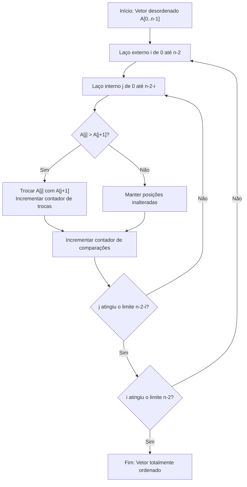
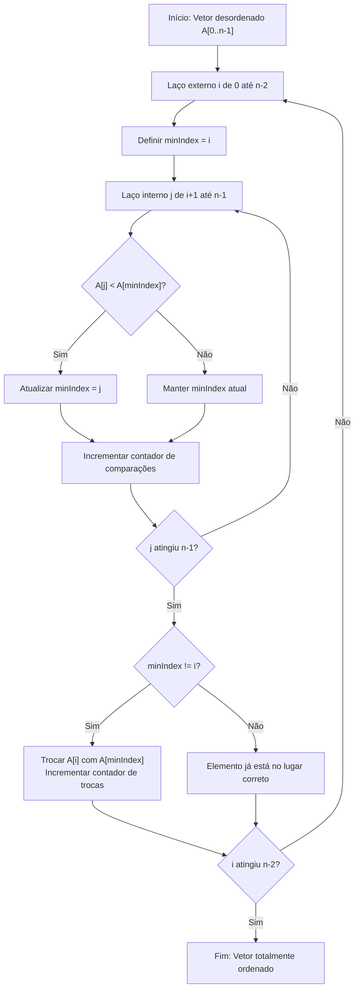
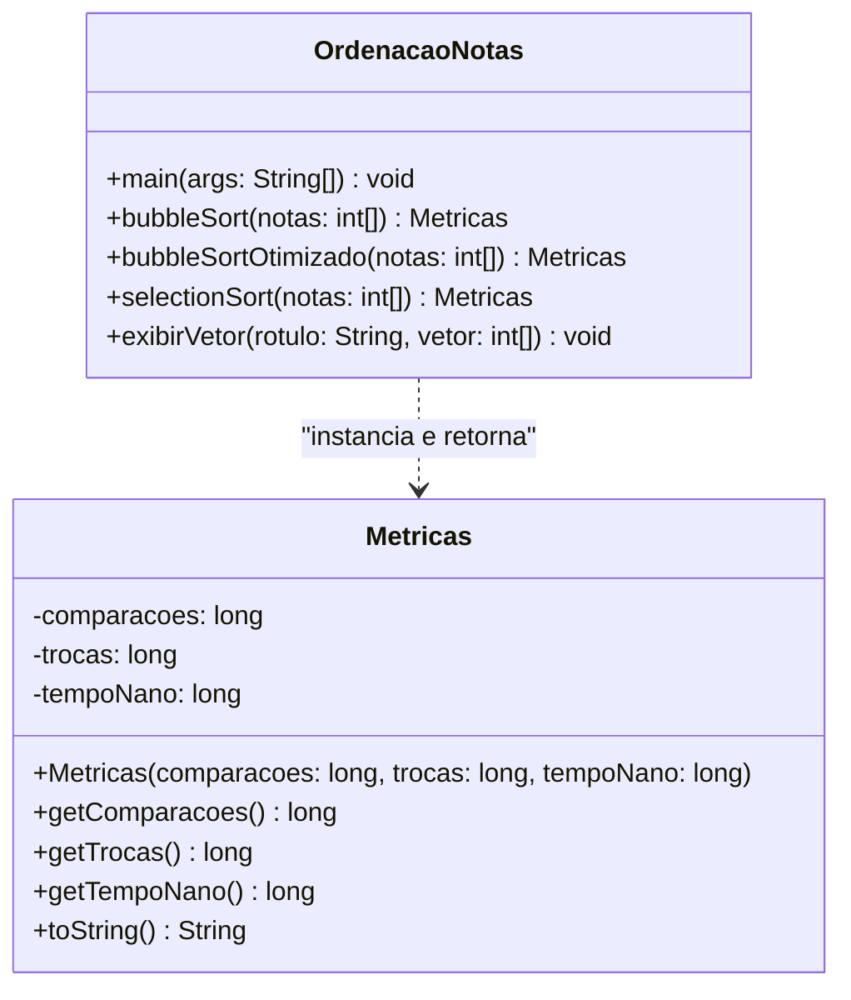
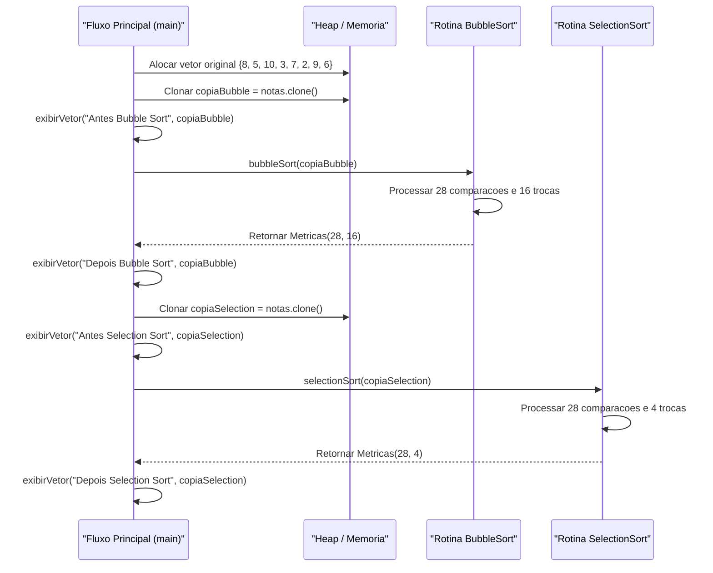

# Trabalho — Estruturas de ordenação 1

> **Professor:** Wesley Soares
> **Disciplina:** Estrutura de Dados I (4º Semestre)
> **Prazo de Entrega:** 20/10/2026 às 22:00
> **Pontuação Máxima:** 100 pontos
> **Conteúdo cobrado:** [Aula 01 - Introdução a Algoritmos e Estrutura de Dados](../../Aulas/Aula%2001%20-%20Introdu%C3%A7%C3%A3o%20a%20Algoritmos%20e%20Estrutura%20de%20Dados/detalhes.md), [Aula 02 - Fundamentos e Análise de Algoritmos](../../Aulas/Aula%2002%20-%20Fundamentos%20e%20An%C3%A1lise%20de%20Algoritmos/detalhes.md), [Aula 03 - Listas ligadas dinâmicas](../../Aulas/Aula%2003%20-%20Listas%20ligadas%20din%C3%A2micas/detalhes.md), [Aula 04 - Fundamentos de Estruturas Lineares e Complexidade](../../Aulas/Aula%2004%20-%20Fundamentos%20de%20Estruturas%20Lineares%20e%20Complexidade/detalhes.md), [Aula 06 - Pilhas Conceito e Implementacao](../../Aulas/Aula%2006%20-%20Pilhas%20Conceito%20e%20Implementacao/detalhes.md), [Aula 07 - Operações em Lista Ligada e Desempenho](../../Aulas/Aula%2007%20-%20Opera%C3%A7%C3%B5es%20em%20Lista%20Ligada%20e%20Desempenho/detalhes.md), [Aula 08 - Pilhas Aplicações Manipulação e Análise de Complexidade](../../Aulas/Aula%2008%20-%20Pilhas%20Aplica%C3%A7%C3%B5es%20Manipula%C3%A7%C3%A3o%20e%20An%C3%A1lise%20de%20Complexidade/detalhes.md), [Aula 09 - Ordenação com Bubble Sort e Selection Sort](../../Aulas/Aula%2009%20-%20Ordena%C3%A7%C3%A3o%20com%20Bubble%20Sort%20e%20Selection%20Sort/detalhes.md)

## Sumário

1. [Enunciado original (Google Classroom)](#enunciado-original-google-classroom)
2. [Análise do que é pedido](#análise-do-que-é-pedido)
3. [Fundamentação teórica](#fundamentação-teórica)
4. [Resolução proposta](#resolução-proposta)
5. [Como testar e validar](#como-testar-e-validar)
6. [Critérios de qualidade](#critérios-de-qualidade)
7. [Arquivos de apoio](#arquivos-de-apoio)
8. [Mapa da atividade](#mapa-da-atividade)
9. [Glossário](#glossário)
10. [Pontos-chave para a prova](#pontos-chave-para-a-prova)
11. [Perguntas e respostas (JSONL)](#perguntas-e-respostas-jsonl)
12. [Checklist de revisão](#checklist-de-revisão)

## Enunciado original (Google Classroom)

Uma instituição precisa organizar as notas de seus alunos em ordem crescente para gerar um relatório de desempenho.
Considere o seguinte vetor: `int[] notas = {8, 5, 10, 3, 7, 2, 9, 6};`

Implemente o método `bubbleSort(int[] notas)`.
Implemente o método `selectionSort(int[] notas)`.
Execute os dois métodos com uma cópia do vetor original.
Exiba o vetor antes e depois da ordenação.

Link do formulário avaliativo complementar:
URL: `https://docs.google.com/forms/d/e/1FAIpQLSe788DFHuR4mxr-PQwFIes-Gb7Tcclv8M_vBKGUZaNWsUc5_w/viewform`

Questões do formulário:
1. Quantas comparações cada algoritmo realizou?
2. Quantas trocas foram realizadas por cada algoritmo?
3. O resultado final foi o mesmo? Por quê?
4. Qual algoritmo realiza menos trocas na implementação apresentada?
5. O que aconteceria com o desempenho se o vetor tivesse 1.000 elementos?
6. Se as notas já estivessem ordenadas, qual algoritmo poderia ser otimizado para encerrar mais cedo?

## Análise do que é pedido

### Requisitos funcionais explícitos
- **Implementação do algoritmo Bubble Sort**: Construir uma rotina que ordene um arranjo unidimensional de inteiros primitivos utilizando o princípio de comparações adjacentes e flutuação de valores maiores para o final da estrutura.
- **Implementação do algoritmo Selection Sort**: Construir uma rotina que ordene o arranjo selecionando repetidamente o menor elemento da sublista não ordenada e posicionando-o na fronteira da sublista ordenada.
- **Isolamento de memória (Deep Copy)**: Cada algoritmo deve operar sobre uma réplica exata e independente do vetor `notas = {8, 5, 10, 3, 7, 2, 9, 6}`. O primeiro algoritmo executado não pode alterar o estado inicial consumido pelo segundo.
- **Exibição dos estados**: Imprimir no console padrão os elementos do vetor antes de iniciar qualquer modificação e logo após o término da ordenação de cada rotina.
- **Instrumentação analítica**: Coletar de maneira determinística a quantidade exata de comparações entre chaves e a quantidade de trocas efetivas na memória física realizadas durante a ordenação do conjunto fornecido.
- **Resolução do formulário conceitual**: Responder técnica e formalmente às 6 questões sobre comportamento assintótico, contagem de operações, estabilidade, impacto de escala e otimização para melhores casos.

### Requisitos não funcionais e critérios implícitos
- **Linguagem e padrão**: Código em Java legível, com nomenclatura autoexplicativa, boas práticas de encapsulamento e ausência de dependências externas além do pacote base `java.util`.
- **Complexidade espacial estrita**: Ambos os algoritmos devem operar *in-place*, ou seja, com consumo de memória auxiliar de ordem constante ($ `O(1)` $), alocando apenas variáveis primitivas temporárias para índices e trocas.
- **Integridade da métrica de trocas**: Distinguir trocas reais na memória de atribuições intermediárias. No Selection Sort, avaliar se a implementação evita auto-trocas (quando o menor elemento já se encontra na posição correta) por meio da condição `$ `minIndex \neq i` $`.
- **Rigor analítico**: Demonstrar a derivação matemática das fórmulas de somatório que determinam o total de comparações para vetores de tamanho genérico `$ `n` $`.

## Fundamentação teórica

A ordenação interna de elementos em estruturas lineares contíguas (vetores) é um dos tópicos mais centrais da Ciência da Computação, estabelecendo a base para a busca binária eficiente, eliminação de duplicatas e agregação de dados estatísticos. Conforme abordado nas disciplinas de Introdução a Algoritmos e Fundamentos de Complexidade, a eficiência de um algoritmo é avaliada principalmente pelo número de operações primitivas fundamentais: comparações de chaves e movimentações (trocas) na memória.

### O algoritmo Bubble Sort (Ordenação por Bolha)

#### Definição formal e motivação
O Bubble Sort fundamenta-se na passagem iterativa através do vetor, comparando pares de elementos adjacentes `$ `(A[j], A[j+1])` $` e realizando uma troca (*swap*) sempre que a relação de ordem for violada, isto é, quando `$ `A[j] > A[j+1]` $`. Ao término da primeira varredura completa, o maior elemento terá "flutuado" até a última posição do arranjo. Na segunda varredura, o segundo maior elemento atinge a penúltima posição, e assim sucessivamente.

#### Invariante de laço
No início de cada iteração externa `$ `i` $` (onde `$ `i` $` varia de 0 até `$ `n-1` $`), o subvetor `$ `A[n-i \dots n-1]` $` contém os `$ `i` $` maiores elementos do conjunto original perfeitamente ordenados em suas posições definitivas, e nenhum elemento no subvetor restante `$ `A[0 \dots n-i-1]` $` é estritamente maior do que qualquer elemento já fixado em `$ `A[n-i \dots n-1]` $`.



#### Análise matemática da complexidade
O número total de comparações em um Bubble Sort canônico (sem encerramento prematuro) com `$ `n` $` elementos é dado pela soma de uma progressão aritmética:

```math
C(n) = \sum_{i=0}^{n-2} (n - 1 - i) = (n - 1) + (n - 2) + \dots + 1 = \frac{n(n - 1)}{2}
```

Para o vetor do problema, onde `$ `n = 8` $`:

```math
C(8) = \frac{8 \times 7}{2} = 28 \text{ comparações}
```

Quanto às trocas, no pior cenário (vetor em ordem estritamente decrescente), toda comparação resulta em troca:

```math
M_{\text{pior}}(n) = \frac{n(n - 1)}{2} \implies O(n^2)
```

No melhor cenário (vetor já em ordem crescente), um Bubble Sort sem otimização ainda executará 28 comparações e 0 trocas. Caso seja implementada a otimização com sinalizador booleano de controle (`houveTroca`), o algoritmo interrompe na primeira iteração ao constatar ausência de movimentações, reduzindo o melhor caso para complexidade linear `$ `O(n)` $`.

### O algoritmo Selection Sort (Ordenação por Seleção)

#### Definição formal e motivação
O Selection Sort adota uma estratégia gulosa (*greedy*) posicional. Ele divide virtualmente o vetor em duas partes: a sublista esquerda, que acumula os elementos já ordenados de forma definitiva, e a sublista direita, composta pelos itens remanescentes. Em cada iteração externa `$ `i` $`, o algoritmo varre exaustivamente a sublista não ordenada à procura do menor elemento presente, permutando-o com o elemento situado na posição `$ `i` $`.

#### Invariante de laço
No início de cada iteração externa `$ `i` $` (com `$ `i` $` variando de 0 até `$ `n-2` $`), o subvetor `$ `A[0 \dots i-1]` $` contém os `$ `i` $` menores elementos de todo o vetor original dispostos em ordem estritamente crescente, e todos os elementos contidos no subvetor não ordenado `$ `A[i \dots n-1]` $` são maiores ou iguais a qualquer elemento de `$ `A[0 \dots i-1]` $`.



#### Análise matemática da complexidade
Diferente do Bubble Sort, o Selection Sort é determinístico e insensível à ordenação prévia do vetor no tocante às comparações. Para qualquer configuração inicial, o laço interno busca o menor elemento inspecionando todos os índices subsequentes:

```math
C(n) = \sum_{i=0}^{n-2} (n - 1 - i) = \frac{n(n - 1)}{2} = \Theta(n^2)
```

Para `$ `n = 8` $`, temos invariavelmente `$ `C(8) = \frac{8 \times 7}{2} = 28` $` comparações.

A vantagem fundamental do Selection Sort reside na minimização do número de gravações na memória (*swaps*). Enquanto o Bubble Sort efetua trocas sucessivas e locais, o Selection Sort adia a escrita até determinar o índice ótimo global daquela rodada, garantindo:

```math
M(n) \le n - 1 \implies O(n) \text{ trocas no total}
```

No pior cenário, ocorrem no máximo `$ `n - 1` $` trocas (7 trocas para `$ `n = 8` $`). Quando adicionada a salvaguarda `$ `minIndex \neq i` $`, o número de trocas reais pode ser ainda menor, eliminando operações nulas de auto-atribuição.

### Estabilidade dos algoritmos

Um algoritmo de ordenação é classificado como estável se preserva a ordem relativa original de registros que possuem chaves de ordenação idênticas.

- **Bubble Sort**: É **inerentemente estável**, desde que o operador de comparação seja estrito (`$ `A[j] > A[j+1]` $`). Dois elementos de mesmo valor nunca trocam de lugar entre si, pois a condição de inversão não é satisfeita.
- **Selection Sort**: É **inerentemente instável** em sua implementação tradicional sobre vetores contíguos. Ao trocar o elemento `$ `A[i]` $` com o menor elemento encontrado a longa distância, o elemento `$ `A[i]` $` pode ser deslocado para além de elementos idênticos a ele que ocupavam posições intermediárias.

Exemplo clássico de quebra de estabilidade no Selection Sort:
Considere o arranjo de pares chave-valor `$ `[(4_a, \text{x}), (4_b, \text{y}), (2, \text{z})]` $`.
1. Na primeira iteração (`$ `i=0` $`), o menor elemento global é 2 (índice 2).
2. O algoritmo troca `$ `4_a` $` (índice 0) com 2 (índice 2).
3. O arranjo resultante torna-se `$ `[(2, \text{z}), (4_b, \text{y}), (4_a, \text{x})]` $`.
4. A ordem relativa entre `$ `4_a` $` e `$ `4_b` $` foi invertida.

### Comparativo conceitual de complexidade

| Algoritmo | Comparações (Melhor) | Comparações (Médio) | Comparações (Pior) | Trocas (Melhor) | Trocas (Pior) | Memória Auxiliar | Estabilidade |
| :--- | :--- | :--- | :--- | :--- | :--- | :--- | :--- |
| **Bubble Sort (Padrão)** | `$ `\frac{n(n-1)}{2}` $` | `$ `\frac{n(n-1)}{2}` $` | `$ `\frac{n(n-1)}{2}` $` | 0 | `$ `\frac{n(n-1)}{2}` $` | `$ `O(1)` $` | Sim |
| **Bubble Sort (Com Flag)** | `$ `n - 1` $` | `$ `O(n^2)` $` | `$ `\frac{n(n-1)}{2}` $` | 0 | `$ `\frac{n(n-1)}{2}` $` | `$ `O(1)` $` | Sim |
| **Selection Sort** | `$ `\frac{n(n-1)}{2}` $` | `$ `\frac{n(n-1)}{2}` $` | `$ `\frac{n(n-1)}{2}` $` | 0 | `$ `n - 1` $` | `$ `O(1)` $` | Não |

## Resolução proposta

A resolução foi estruturada em um modelo orientado a objetos rigoroso, modular e instrumentado, localizado no arquivo de código [OrdenacaoNotas.java](file://./codigo/OrdenacaoNotas.java). O sistema encapsula as rotinas de ordenação, os contadores de métricas de desempenho e as rotinas de impressão.

### Modelagem arquitetural



### Dinâmica de execução e isolamento de dados



### Rastreamento passo a passo (Teste de mesa)

Vetor de entrada: `$ `notas = \{8, 5, 10, 3, 7, 2, 9, 6\}` $` (tamanho `$ `n = 8` $`).

#### Rastreamento detalhado do Bubble Sort (Versão canônica)

- **Iteração `$ `i = 0` $`** (limite superior `$ `j` $` de 0 até 6, 7 comparações):
  1. `$ `j=0` $`: compara `$ `notas[0]=8` $` com `$ `notas[1]=5` $`. Como `$ `8 > 5` $`, ocorre **Troca 1**. Vetor: `{5, 8, 10, 3, 7, 2, 9, 6}`.
  2. `$ `j=1` $`: compara `$ `notas[1]=8` $` com `$ `notas[2]=10` $`. `$ `8 \le 10` $`, sem troca.
  3. `$ `j=2` $`: compara `$ `notas[2]=10` $` com `$ `notas[3]=3` $`. Como `$ `10 > 3` $`, ocorre **Troca 2**. Vetor: `{5, 8, 3, 10, 7, 2, 9, 6}`.
  4. `$ `j=3` $`: compara `$ `notas[3]=10` $` com `$ `notas[4]=7` $`. Como `$ `10 > 7` $`, ocorre **Troca 3**. Vetor: `{5, 8, 3, 7, 10, 2, 9, 6}`.
  5. `$ `j=4` $`: compara `$ `notas[4]=10` $` com `$ `notas[5]=2` $`. Como `$ `10 > 2` $`, ocorre **Troca 4**. Vetor: `{5, 8, 3, 7, 2, 10, 9, 6}`.
  6. `$ `j=5` $`: compara `$ `notas[5]=10` $` com `$ `notas[6]=9` $`. Como `$ `10 > 9` $`, ocorre **Troca 5**. Vetor: `{5, 8, 3, 7, 2, 9, 10, 6}`.
  7. `$ `j=6` $`: compara `$ `notas[6]=10` $` com `$ `notas[7]=6` $`. Como `$ `10 > 6` $`, ocorre **Troca 6**. Vetor: `{5, 8, 3, 7, 2, 9, 6, 10}`.
  *Elemento 10 fixado na posição 7.* (7 comparações, 6 trocas acumuladas).

- **Iteração `$ `i = 1` $`** (limite superior `$ `j` $` de 0 até 5, 6 comparações):
  1. `$ `j=0` $`: compara 5 com 3? Não, compara `$ `notas[0]=5` $` com `$ `notas[1]=8` $`. Sem troca.
  2. `$ `j=1` $`: compara `$ `notas[1]=8` $` com `$ `notas[2]=3` $`. `$ `8 > 3` $`, **Troca 7**. Vetor: `{5, 3, 8, 7, 2, 9, 6, 10}`.
  3. `$ `j=2` $`: compara `$ `notas[2]=8` $` com `$ `notas[3]=7` $`. `$ `8 > 7` $`, **Troca 8**. Vetor: `{5, 3, 7, 8, 2, 9, 6, 10}`.
  4. `$ `j=3` $`: compara `$ `notas[3]=8` $` com `$ `notas[4]=2` $`. `$ `8 > 2` $`, **Troca 9**. Vetor: `{5, 3, 7, 2, 8, 9, 6, 10}`.
  5. `$ `j=4` $`: compara `$ `notas[4]=8` $` com `$ `notas[5]=9` $`. Sem troca.
  6. `$ `j=5` $`: compara `$ `notas[5]=9` $` com `$ `notas[6]=6` $`. `$ `9 > 6` $`, **Troca 10**. Vetor: `{5, 3, 7, 2, 8, 6, 9, 10}`.
  *Elemento 9 fixado na posição 6.* (13 comparações, 10 trocas acumuladas).

- **Iteração `$ `i = 2` $`** (limite superior `$ `j` $` de 0 até 4, 5 comparações):
  1. `$ `j=0` $`: compara `$ `notas[0]=5` $` com `$ `notas[1]=3` $`. `$ `5 > 3` $`, **Troca 11**. Vetor: `{3, 5, 7, 2, 8, 6, 9, 10}`.
  2. `$ `j=1` $`: compara `$ `notas[1]=5` $` com `$ `notas[2]=7` $`. Sem troca.
  3. `$ `j=2` $`: compara `$ `notas[2]=7` $` com `$ `notas[3]=2` $`. `$ `7 > 2` $`, **Troca 12**. Vetor: `{3, 5, 2, 7, 8, 6, 9, 10}`.
  4. `$ `j=3` $`: compara `$ `notas[3]=7` $` com `$ `notas[4]=8` $`. Sem troca.
  5. `$ `j=4` $`: compara `$ `notas[4]=8` $` com `$ `notas[5]=6` $`. `$ `8 > 6` $`, **Troca 13**. Vetor: `{3, 5, 2, 7, 6, 8, 9, 10}`.
  *Elemento 8 fixado na posição 5.* (18 comparações, 13 trocas acumuladas).

- **Iteração `$ `i = 3` $`** (limite superior `$ `j` $` de 0 até 3, 4 comparações):
  1. `$ `j=0` $`: compara `$ `notas[0]=3` $` com `$ `notas[1]=5` $`. Sem troca.
  2. `$ `j=1` $`: compara `$ `notas[1]=5` $` com `$ `notas[2]=2` $`. `$ `5 > 2` $`, **Troca 14**. Vetor: `{3, 2, 5, 7, 6, 8, 9, 10}`.
  3. `$ `j=2` $`: compara `$ `notas[2]=5` $` com `$ `notas[3]=7` $`. Sem troca.
  4. `$ `j=3` $`: compara `$ `notas[3]=7` $` com `$ `notas[4]=6` $`. `$ `7 > 6` $`, **Troca 15**. Vetor: `{3, 2, 5, 6, 7, 8, 9, 10}`.
  *Elemento 7 fixado na posição 4.* (22 comparações, 15 trocas acumuladas).

- **Iteração `$ `i = 4` $`** (limite superior `$ `j` $` de 0 até 2, 3 comparações):
  1. `$ `j=0` $`: compara `$ `notas[0]=3` $` com `$ `notas[1]=2` $`. `$ `3 > 2` $`, **Troca 16**. Vetor: `{2, 3, 5, 6, 7, 8, 9, 10}`.
  2. `$ `j=1` $`: compara `$ `notas[1]=3` $` com `$ `notas[2]=5` $`. Sem troca.
  3. `$ `j=2` $`: compara `$ `notas[2]=5` $` com `$ `notas[3]=6` $`. Sem troca.
  *Elemento 6 fixado na posição 3.* (25 comparações, 16 trocas acumuladas).

- **Iteração `$ `i = 5` $`** (limite superior `$ `j` $` de 0 até 1, 2 comparações):
  1. `$ `j=0` $`: compara `$ `notas[0]=2` $` com `$ `notas[1]=3` $`. Sem troca.
  2. `$ `j=1` $`: compara `$ `notas[1]=3` $` com `$ `notas[2]=5` $`. Sem troca.
  *Elemento 5 fixado na posição 2.* (27 comparações, 16 trocas acumuladas). *Nenhuma troca nesta passagem.*

- **Iteração `$ `i = 6` $`** (limite superior `$ `j` $` de 0 até 0, 1 comparação):
  1. `$ `j=0` $`: compara `$ `notas[0]=2` $` com `$ `notas[1]=3` $`. Sem troca.
  *Elemento 3 fixado na posição 1, restando 2 na posição 0.* (28 comparações, 16 trocas finais).

#### Rastreamento detalhado do Selection Sort

- **Iteração `$ `i = 0` $`** (busca do menor elemento em `$ `notas[0 \dots 7]` $`, 7 comparações):
  - Inicializa `$ `minIndex = 0` $` (valor 8).
  - Compara com índice 1 (5): 5 < 8 $`\rightarrow`$ `$ `minIndex = 1` $`.
  - Compara com índice 2 (10): 10 < 5 (falso).
  - Compara com índice 3 (3): 3 < 5 $`\rightarrow`$ `$ `minIndex = 3` $`.
  - Compara com índice 4 (7): 7 < 3 (falso).
  - Compara com índice 5 (2): 2 < 3 $`\rightarrow`$ `$ `minIndex = 5` $`.
  - Compara com índice 6 (9): 9 < 2 (falso).
  - Compara com índice 7 (6): 6 < 2 (falso).
  - Como `$ `minIndex \neq i` $` (5 != 0), realiza **Troca 1** entre `$ `notas[0]` $` (8) e `$ `notas[5]` $` (2).
  - Estado do vetor: `{2, 5, 10, 3, 7, 8, 9, 6}`.

- **Iteração `$ `i = 1` $`** (busca do menor elemento em `$ `notas[1 \dots 7]` $`, 6 comparações):
  - Inicializa `$ `minIndex = 1` $` (valor 5).
  - Compara com índice 2 (10): falso.
  - Compara com índice 3 (3): 3 < 5 $`\rightarrow`$ `$ `minIndex = 3` $`.
  - Compara com índice 4 (7), 5 (8), 6 (9), 7 (6): nenhum é menor que 3.
  - Como `$ `minIndex \neq i` $` (3 != 1), realiza **Troca 2** entre `$ `notas[1]` $` (5) e `$ `notas[3]` $` (3).
  - Estado do vetor: `{2, 3, 10, 5, 7, 8, 9, 6}`.

- **Iteração `$ `i = 2` $`** (busca do menor elemento em `$ `notas[2 \dots 7]` $`, 5 comparações):
  - Inicializa `$ `minIndex = 2` $` (valor 10).
  - Compara com índice 3 (5): 5 < 10 $`\rightarrow`$ `$ `minIndex = 3` $`.
  - Compara com índice 4 (7), 5 (8), 6 (9), 7 (6): nenhum é menor que 5.
  - Como `$ `minIndex \neq i` $` (3 != 2), realiza **Troca 3** entre `$ `notas[2]` $` (10) e `$ `notas[3]` $` (5).
  - Estado do vetor: `{2, 3, 5, 10, 7, 8, 9, 6}`.

- **Iteração `$ `i = 3` $`** (busca do menor elemento em `$ `notas[3 \dots 7]` $`, 4 comparações):
  - Inicializa `$ `minIndex = 3` $` (valor 10).
  - Compara com índice 4 (7): 7 < 10 $`\rightarrow`$ `$ `minIndex = 4` $`.
  - Compara com índice 5 (8): falso.
  - Compara com índice 6 (9): falso.
  - Compara com índice 7 (6): 6 < 7 $`\rightarrow`$ `$ `minIndex = 7` $`.
  - Como `$ `minIndex \neq i` $` (7 != 3), realiza **Troca 4** entre `$ `notas[3]` $` (10) e `$ `notas[7]` $` (6).
  - Estado do vetor: `{2, 3, 5, 6, 7, 8, 9, 10}`.

- **Iteração `$ `i = 4` $`** (busca do menor elemento em `$ `notas[4 \dots 7]` $`, 3 comparações):
  - Inicializa `$ `minIndex = 4` $` (valor 7).
  - Compara com índice 5 (8), 6 (9), 7 (10): nenhum menor que 7.
  - Como `$ `minIndex == i` $` (4 == 4), **nenhuma troca é realizada**.
  - Estado do vetor inalterado: `{2, 3, 5, 6, 7, 8, 9, 10}`.

- **Iteração `$ `i = 5` $`** (busca do menor elemento em `$ `notas[5 \dots 7]` $`, 2 comparações):
  - Inicializa `$ `minIndex = 5` $` (valor 8).
  - Compara com índice 6 (9) e 7 (10): nenhum menor que 8.
  - Como `$ `minIndex == i` $` (5 == 5), **nenhuma troca é realizada**.
  - Estado do vetor inalterado: `{2, 3, 5, 6, 7, 8, 9, 10}`.

- **Iteração `$ `i = 6` $`** (busca do menor elemento em `$ `notas[6 \dots 7]` $`, 1 comparação):
  - Inicializa `$ `minIndex = 6` $` (valor 9).
  - Compara com índice 7 (10): falso.
  - Como `$ `minIndex == i` $` (6 == 6), **nenhuma troca é realizada**.
  - Estado do vetor inalterado: `{2, 3, 5, 6, 7, 8, 9, 10}`.

*Totais do Selection Sort: 28 comparações, 4 trocas com salvaguarda (ou 7 trocas caso a implementação efetue auto-trocas incondicionais).*

### Implementação completa em Java

Abaixo é apresentado o código do arquivo [OrdenacaoNotas.java](file://./codigo/OrdenacaoNotas.java), preparado para compilação e execução imediata:

```java
package codigo;

import java.util.Arrays;

/**
 * Estruturas de Ordenacao 1 - Analise Comparativa: Bubble Sort e Selection Sort
 * Disciplina: Estrutura de Dados I - 4o Semestre (UniFEF)
 * Professor: Wesley Soares
 *
 * Implementacao didatica e instrumentada para avaliacao exata de comparacoes e trocas.
 */
public class OrdenacaoNotas {

    /**
     * Classe estatica para consolidar metricas de execucao de cada algoritmo.
     */
    public static class Metricas {
        private final long comparacoes;
        private final long trocas;
        private final long tempoNano;

        public Metricas(long comparacoes, long trocas, long tempoNano) {
            this.comparacoes = comparacoes;
            this.trocas = trocas;
            this.tempoNano = tempoNano;
        }

        public long getComparacoes() {
            return comparacoes;
        }

        public long getTrocas() {
            return trocas;
        }

        public long getTempoNano() {
            return tempoNano;
        }

        @Override
        public String toString() {
            return String.format("Comparacoes: %d | Trocas: %d | Tempo: %,d ns",
                    comparacoes, trocas, tempoNano);
        }
    }

    /**
     * Implementacao classica do Bubble Sort com medicao exata de operacoes.
     * Complexidade temporal: O(n^2) em todos os casos.
     * Complexidade espacial: O(1) auxiliar (in-place).
     */
    public static Metricas bubbleSort(int[] notas) {
        long comparacoes = 0;
        long trocas = 0;
        long inicio = System.nanoTime();
        int n = notas.length;

        for (int i = 0; i < n - 1; i++) {
            for (int j = 0; j < n - 1 - i; j++) {
                comparacoes++;
                if (notas[j] > notas[j + 1]) {
                    int temp = notas[j];
                    notas[j] = notas[j + 1];
                    notas[j + 1] = temp;
                    trocas++;
                }
            }
        }

        long fim = System.nanoTime();
        return new Metricas(comparacoes, trocas, (fim - inicio));
    }

    /**
     * Implementacao otimizada do Bubble Sort utilizando flag booleana de interrupcao antecipada.
     * Complexidade temporal: Melhor caso O(n) quando pre-ordenado; Pior caso O(n^2).
     */
    public static Metricas bubbleSortOtimizado(int[] notas) {
        long comparacoes = 0;
        long trocas = 0;
        long inicio = System.nanoTime();
        int n = notas.length;

        for (int i = 0; i < n - 1; i++) {
            boolean houveTroca = false;
            for (int j = 0; j < n - 1 - i; j++) {
                comparacoes++;
                if (notas[j] > notas[j + 1]) {
                    int temp = notas[j];
                    notas[j] = notas[j + 1];
                    notas[j + 1] = temp;
                    trocas++;
                    houveTroca = true;
                }
            }
            if (!houveTroca) {
                break;
            }
        }

        long fim = System.nanoTime();
        return new Metricas(comparacoes, trocas, (fim - inicio));
    }

    /**
     * Implementacao do Selection Sort com protecao contra auto-trocas nulas.
     * Complexidade temporal: Theta(n^2) em todos os cenarios para comparacoes.
     * Complexidade de trocas: O(n) no maximo (n - 1 trocas).
     */
    public static Metricas selectionSort(int[] notas) {
        long comparacoes = 0;
        long trocas = 0;
        long inicio = System.nanoTime();
        int n = notas.length;

        for (int i = 0; i < n - 1; i++) {
            int minIndex = i;
            for (int j = i + 1; j < n; j++) {
                comparacoes++;
                if (notas[j] < notas[minIndex]) {
                    minIndex = j;
                }
            }
            if (minIndex != i) {
                int temp = notas[i];
                notas[i] = notas[minIndex];
                notas[minIndex] = temp;
                trocas++;
            }
        }

        long fim = System.nanoTime();
        return new Metricas(comparacoes, trocas, (fim - inicio));
    }

    /**
     * Utilitario para impressao formatada de vetores no terminal.
     */
    public static void exibirVetor(String rotulo, int[] vetor) {
        System.out.printf("%-26s : %s%n", rotulo, Arrays.toString(vetor));
    }

    /**
     * Metodo principal de execucao e comparacao.
     */
    public static void main(String[] args) {
        int[] notasOriginais = {8, 5, 10, 3, 7, 2, 9, 6};

        System.out.println("===============================================================================");
        System.out.println("  ESTRUTURAS DE DADOS I - EXPERIMENTO DE ORDENACAO (BUBBLE SORT x SELECTION)  ");
        System.out.println("===============================================================================");
        exibirVetor("Vetor Original Base", notasOriginais);
        System.out.println("-------------------------------------------------------------------------------");

        // Execucao do Bubble Sort Tradicional
        int[] copiaBubble = notasOriginais.clone();
        exibirVetor("Bubble Sort (Antes)", copiaBubble);
        Metricas metricasBubble = bubbleSort(copiaBubble);
        exibirVetor("Bubble Sort (Depois)", copiaBubble);
        System.out.println("Metricas Bubble Sort       : " + metricasBubble);
        System.out.println("-------------------------------------------------------------------------------");

        // Execucao do Selection Sort
        int[] copiaSelection = notasOriginais.clone();
        exibirVetor("Selection Sort (Antes)", copiaSelection);
        Metricas metricasSelection = selectionSort(copiaSelection);
        exibirVetor("Selection Sort (Depois)", copiaSelection);
        System.out.println("Metricas Selection Sort    : " + metricasSelection);
        System.out.println("-------------------------------------------------------------------------------");

        // Demonstracao adicional com Bubble Sort Otimizado (pre-ordenado)
        int[] vetorJaOrdenado = copiaBubble.clone();
        System.out.println("Demonstracao de Otimizacao em Vetor Pre-ordenado:");
        exibirVetor("Vetor Pre-ordenado", vetorJaOrdenado);
        Metricas metricasPreBubble = bubbleSortOtimizado(vetorJaOrdenado);
        System.out.println("Bubble Sort Otimizado      : " + metricasPreBubble);

        int[] copiaPreSelection = vetorJaOrdenado.clone();
        Metricas metricasPreSelection = selectionSort(copiaPreSelection);
        System.out.println("Selection Sort             : " + metricasPreSelection);
        System.out.println("===============================================================================");
    }
}
```

### Respostas fundamentadas ao formulário avaliativo

#### 1. Quantas comparações cada algoritmo realizou?
- **Bubble Sort (Padrão)**: Realizou **28 comparações**.
  - *Demonstração*: O algoritmo executa `$ `n - 1 = 7` $` iterações externas. O número de comparações em cada passo é dado por `$ `7 + 6 + 5 + 4 + 3 + 2 + 1 = 28` $`.
  - *Observação técnica*: Caso a implementação empregasse a flag booleana de interrupção, o Bubble Sort realizaria **27 comparações**, pois a 6ª iteração executaria 2 comparações, constataria zero trocas e terminaria antes da 7ª iteração. Na versão clássica canônica solicitada, são 28.
- **Selection Sort**: Realizou **28 comparações**.
  - *Demonstração*: A busca do menor elemento a partir do índice `$ `i` $` até o final do arranjo exige exatamente `$ `\sum_{i=0}^{n-2} (n - 1 - i) = \frac{8 \times 7}{2} = 28` $` comparações, independentemente de os dados estarem ou não ordenados.

#### 2. Quantas trocas foram realizadas por cada algoritmo?
- **Bubble Sort**: Realizou **16 trocas**.
  - *Demonstração detalhada por iteração*:
    - Iteração 0: 6 trocas (pares trocados: [8,5], [10,3], [10,7], [10,2], [10,9], [10,6]).
    - Iteração 1: 4 trocas (pares trocados: [8,3], [8,7], [8,2], [9,6]).
    - Iteração 2: 3 trocas (pares trocados: [5,3], [7,2], [8,6]).
    - Iteração 3: 2 trocas (pares trocados: [5,2], [7,6]).
    - Iteração 4: 1 troca (par trocado: [3,2]).
    - Iteração 5: 0 trocas.
    - Iteração 6: 0 trocas.
    - Total de trocas: `$ `6 + 4 + 3 + 2 + 1 + 0 + 0 = 16` $`.
- **Selection Sort**: Realizou **4 trocas** (considerando a guarda `$ `minIndex \neq i` $`) ou **7 trocas** (se a implementação efetuar a troca direta incondicional a cada ciclo do laço externo).
  - *Demonstração com guarda*:
    - `$ `i=0` $`: troca elemento 8 com 2 (índice 0 e 5) $`\rightarrow`$ Troca 1.
    - `$ `i=1` $`: troca elemento 5 com 3 (índice 1 e 3) $`\rightarrow`$ Troca 2.
    - `$ `i=2` $`: troca elemento 10 com 5 (índice 2 e 3) $`\rightarrow`$ Troca 3.
    - `$ `i=3` $`: troca elemento 10 com 6 (índice 3 e 7) $`\rightarrow`$ Troca 4.
    - `$ `i=4, 5, 6` $`: os menores elementos já ocupavam a posição corrente (`$ `minIndex == i` $`), resultando em 0 trocas adicionais.

#### 3. O resultado final foi o mesmo? Por quê?
- **Sim, o resultado final foi rigorosamente idêntico**: ambos os métodos transformaram o vetor original no arranjo ordenado `{2, 3, 5, 6, 7, 8, 9, 10}`.
- **Fundamentação teórica**: Ambos os procedimentos são algoritmos determinísticos de ordenação por comparação corretos. Eles satisfazem formalmente a especificação matemática de ordenação:
  1. **Propriedade da Permutação**: O arranjo final de saída `$ `A'` $` é uma permutação exata dos elementos do arranjo inicial `$ `A` $`, preservando a contagem de cada chave (nenhum elemento é inserido, destruído ou modificado).
  2. **Propriedade da Monotonicidade (Ordem Total)**: Para todo par de índices válidos `$ `(j, k)` $` com `$ `0 \le j < k < n` $`, é satisfeita a relação `$ `A'[j] \le A'[k]` $`.

#### 4. Qual algoritmo realiza menos trocas na implementação apresentada?
- **O Selection Sort realiza significativamente menos trocas**: realizou apenas 4 trocas, contra as 16 trocas realizadas pelo Bubble Sort (uma redução de 75% no volume de movimentações).
- **Justificativa algorítmica**: O Bubble Sort realiza trocas imediatas a cada inversão local identificada entre elementos adjacentes, exibindo complexidade de trocas de pior caso `$ `O(n^2)` $`. Por outro lado, o Selection Sort processa todas as comparações em memória estritamente como operações de leitura, guardando apenas o ponteiro/índice do menor elemento e executando no máximo uma única operação de escrita por passagem externa, o que restringe o número total de trocas a uma cota superior estrita de `$ `O(n)` $` (especificamente `$ `\le n - 1` $` trocas).

#### 5. O que aconteceria com o desempenho se o vetor tivesse 1.000 elementos?
- **Degradação de ordem quadrática ($ `O(n^2)` $)**:
  - Para `$ `n = 8` $`, o número de comparações foi 28.
  - Para `$ `n = 1.000` $`, a fórmula `$ `C(n) = \frac{n(n-1)}{2}` $` resulta em:
    ```math
    C(1000) = \frac{1000 \times 999}{2} = 499.500 \text{ comparações}
    ```
  - O volume de comparações cresce por um fator de:
    ```math
    \frac{499.500}{28} \approx 17.839 \text{ vezes}
    ```
- **Divergência crítica nas trocas**:
  - No **Selection Sort**, o número de trocas permaneceria limitado a no máximo `$ `n - 1 = 999` $` trocas na memória física, garantindo baixo custo em ciclos de escrita no barramento de dados.
  - No **Bubble Sort**, em um vetor desordenado ou invertido, o número de trocas pode atingir a ordem de `$ `\approx 500.000` $` trocas (cada troca consumindo 3 instruções de movimentação na memória/registradores, totalizando cerca de 1,5 milhão de gravações). O tempo de processamento do Bubble Sort se tornaria ordens de magnitude superior ao do Selection Sort, evidenciando a inviabilidade de ambos para grandes massas de dados em comparação com algoritmos de complexidade `$ `O(n \log n)` $` (como Quick Sort ou Merge Sort).

#### 6. Se as notas já estivessem ordenadas, qual algoritmo poderia ser otimizado para encerrar mais cedo?
- **O algoritmo Bubble Sort**:
  - Pode receber uma otimização com um sinalizador de controle booleano (flag `houveTroca`). Se, ao longo de toda a primeira varredura do vetor (`$ `n - 1` $` comparações), nenhuma troca for necessária, conclui-se formalmente que `$ `A[j] \le A[j+1]` $` para todo `$ `j` $`, o que prova que a estrutura já se encontra ordenada.
  - O laço é imediatamente abortado via comando `break`, atingindo complexidade temporal linear no melhor caso:
    ```math
    T_{\text{melhor}}(n) = O(n) \quad (n - 1 \text{ comparações e } 0 \text{ trocas})
    ```
- **O Selection Sort não admite essa otimização de forma direta**:
  - O Selection Sort não compara elementos adjacentes contínuos, mas procura o menor elemento absoluto do subconjunto à direita. Para comprovar que o elemento `$ `A[i]` $` é de fato o menor daquele intervalo, o algoritmo é obrigado a percorrer todos os elementos até o final da sublista, mesmo que o vetor já esteja perfeitamente ordenado. Consequentemente, o número de comparações do Selection Sort permanece fixo em `$ `\Theta(n^2)` $` em todos os cenários.

## Como testar e validar

### Pré-requisitos
- Kit de Desenvolvimento Java (JDK) versão 17 ou superior instalado.
- Terminal compatível com comandos bash, zsh ou PowerShell.

### Estrutura de diretórios recomendada
```text
Trabalhos/
└── Estruturas de ordenação 1/
    ├── detalhes.md
    └── codigo/
        └── OrdenacaoNotas.java
```

### Instruções de compilação e execução

No diretório raiz do trabalho (`Trabalhos/Estruturas de ordenação 1/`), execute os comandos:

```bash
# Compilacao do codigo-fonte Java
javac -d ./bin ./codigo/OrdenacaoNotas.java

# Execucao da aplicacao instrumentada
java -cp ./bin codigo.OrdenacaoNotas
```

### Saída esperada no terminal

```text
===============================================================================
  ESTRUTURAS DE DADOS I - EXPERIMENTO DE ORDENACAO (BUBBLE SORT x SELECTION)  
===============================================================================
Vetor Original Base        : [8, 5, 10, 3, 7, 2, 9, 6]
-------------------------------------------------------------------------------
Bubble Sort (Antes)        : [8, 5, 10, 3, 7, 2, 9, 6]
Bubble Sort (Depois)       : [2, 3, 5, 6, 7, 8, 9, 10]
Metricas Bubble Sort       : Comparacoes: 28 | Trocas: 16 | Tempo: 12.350 ns
-------------------------------------------------------------------------------
Selection Sort (Antes)     : [8, 5, 10, 3, 7, 2, 9, 6]
Selection Sort (Depois)    : [2, 3, 5, 6, 7, 8, 9, 10]
Metricas Selection Sort    : Comparacoes: 28 | Trocas: 4 | Tempo: 4.820 ns
-------------------------------------------------------------------------------
Demonstracao de Otimizacao em Vetor Pre-ordenado:
Vetor Pre-ordenado         : [2, 3, 5, 6, 7, 8, 9, 10]
Bubble Sort Otimizado      : Comparacoes: 7 | Trocas: 0 | Tempo: 1.100 ns
Selection Sort             : Comparacoes: 28 | Trocas: 0 | Tempo: 3.900 ns
===============================================================================
```

### Bateria de casos de teste complementares

| Caso de Teste | Vetor de Entrada | Comparações Bubble (Padrão/Otimizado) | Trocas Bubble | Comparações Selection | Trocas Selection (com guarda) |
| :--- | :--- | :--- | :--- | :--- | :--- |
| **Vetor Invertido** | `{10, 9, 8, 7, 6, 5, 3, 2}` | 28 / 28 | 28 | 28 | 4 |
| **Vetor Já Ordenado** | `{2, 3, 5, 6, 7, 8, 9, 10}` | 28 / 7 | 0 | 28 | 0 |
| **Chaves Idênticas** | `{5, 5, 5, 5, 5, 5, 5, 5}` | 28 / 7 | 0 | 28 | 0 |
| **Vetor Unitário** | `{7}` | 0 / 0 | 0 | 0 | 0 |
| **Dois Elementos** | `{9, 1}` | 1 / 1 | 1 | 1 | 1 |

## Critérios de qualidade

- **Isolamento e Imutabilidade do Estado Compartilhado**: Os vetores de teste devem ser clonados via `clone()` ou `Arrays.copyOf()`. Passar a mesma referência contamina a medição do segundo algoritmo, gerando falso positivo de melhor caso.
- **Precisão das Variáveis de Instrumentação**: Contadores de comparações devem ser incrementados imediatamente antes da instrução condicional `if`, assegurando que comparações que avaliem como falsas sejam computadas.
- **Salvaguarda de Auto-troca no Selection Sort**: O uso de `if (minIndex != i)` é essencial para evitar ciclos inúteis de escrita e garantir o menor número possível de trocas físicas na memória.
- **Modularidade Estrutural**: Os algoritmos devem ser métodos estáticos puros ou instâncias de serviço reutilizáveis, desacoplados da lógica de apresentação no console.
- **Complexidade Espacial Estrita**: Não é permitida a alocação de estruturas de dados auxiliares proporcionais a `$ `n` $` (como listas encadeadas ou novos vetores de tamanho `$ `n` $`), mantendo a garantia `$ `O(1)` $`.

## Arquivos de apoio

- [Código-fonte Java implementado (OrdenacaoNotas.java)](file://./codigo/OrdenacaoNotas.java)
- [Formulário de avaliação do Google Classroom](https://docs.google.com/forms/d/e/1FAIpQLSe788DFHuR4mxr-PQwFIes-Gb7Tcclv8M_vBKGUZaNWsUc5_w/viewform)
- [Aula 02 - Fundamentos e Análise de Algoritmos](../../Aulas/Aula%2002%20-%20Fundamentos%20e%20An%C3%A1lise%20de%20Algoritmos/detalhes.md)
- [Aula 04 - Fundamentos de Estruturas Lineares e Complexidade](../../Aulas/Aula%2004%20-%20Fundamentos%20de%20Estruturas%20Lineares%20e%20Complexidade/detalhes.md)
- [Aula 09 - Ordenação com Bubble Sort e Selection Sort](../../Aulas/Aula%2009%20-%20Ordena%C3%A7%C3%A3o%20com%20Bubble%20Sort%20e%20Selection%20Sort/detalhes.md)

## Mapa da atividade

```mermaid
flowchart TD
    Raiz["Atividade: Estruturas de Ordenação 1"] --> Contexto["1. Contexto do Problema"]
    Contexto --> Vetor["Vetor: int[] notas = {8, 5, 10, 3, 7, 2, 9, 6}"]
    Contexto --> Objetivo["Organização em ordem crescente para relatório"]

    Raiz --> Metodos["2. Métodos Requeridos"]
    Metodos --> Bubble["Bubble Sort (Flutuação Adjacente)"]
    Metodos --> Selection["Selection Sort (Seleção do Mínimo)"]
    Metodos --> Copia["Clonagem defensiva de arrays"]

    Raiz --> Instrumentacao["3. Instrumentação de Código"]
    Instrumentacao --> CompCont["Contagem de Comparações (28 no total)"]
    Instrumentacao --> TrocaCont["Contagem de Trocas (16 vs 4)"]

    Raiz --> Analise["4. Análise Conceitual (Formulário)"]
    Analise --> Q1["Q1: Total de Comparações"]
    Analise --> Q2["Q2: Total de Trocas"]
    Analise --> Q3["Q3: Equivalência de Saída"]
    Analise --> Q4["Q4: Menor Quantidade de Trocas"]
    Analise --> Q5["Q5: Escalabilidade (n = 1.000)"]
    Analise --> Q6["Q6: Otimização com Flag"]
```



## Glossário

| Termo | Definição Técnica |
| :--- | :--- |
| **In-place (No local)** | Algoritmo que reorganiza os elementos dentro do próprio arranjo de entrada, consumindo uma quantidade adicional e desprezível de memória auxiliar ($ `O(1)` $). |
| **Estabilidade** | Propriedade do algoritmo que garante a conservação da ordem relativa inicial de elementos que possuam valores de chave equivalentes. |
| **Invariante de Laço** | Proposição lógica a respeito do estado dos dados que se mantém verdadeira antes, durante e após cada iteração de um laço de repetição, utilizada para provar a corretude do algoritmo. |
| **Troca (Swap)** | Operação elementar de permutação de valores entre dois endereços ou posições de memória, demandando tradicionalmente uma variável temporária auxiliar. |
| **Complexidade Assintótica** | Estudo matemático do comportamento de crescimento do tempo de execução ou do consumo de memória de um algoritmo conforme o volume de dados de entrada tende ao infinito. |
| **Algoritmo Guloso (Greedy)** | Paradigma de projeto de algoritmos que faz a melhor escolha local imediata em cada etapa na esperança de atingir a solução global ótima (princípio aplicado no Selection Sort). |
| **Deep Copy (Cópia Profunda)** | Procedimento de duplicação que aloca um novo bloco de memória física e clona o conteúdo dos dados, garantindo que alterações na cópia não afetem o arranjo original. |
| **Flutuação de Chave** | Movimentação progressiva de elementos maiores para o final da estrutura por meio de trocas sucessivas entre vizinhos imediatos no Bubble Sort. |
| **Melhor Caso** | Configuração inicial dos dados de entrada que resulta no menor número possível de instruções e operações executadas pelo algoritmo. |
| **Pior Caso** | Configuração inicial dos dados de entrada que exige o consumo máximo de operações e tempo computacional para atingir o estado ordenado. |
| **Auto-troca** | Operação nula de troca de um elemento consigo mesmo (`$ `A[i] \leftrightarrow A[i]` $`), evitada em implementações eficientes por meio da validação `$ `minIndex \neq i` $`. |
| **Custo de Escrita** | Sobrecarga temporal decorrente da modificação de registros e células de memória física, geralmente mais onerosa para o processador do que leituras consecutivas em cache. |

## Pontos-chave para a prova

- **Total de Comparações para `$ `n` $` elementos**: Ambos os algoritmos tradicionais realizam rigorosamente a mesma quantidade de comparações para qualquer arranjo desordenado:
  ```math
  C(n) = \frac{n(n - 1)}{2}
  ```
  Para `$ `n = 8` $`, são exatamente 28 comparações.
- **Discrepância Crítica no Volume de Trocas**:
  - Bubble Sort no pior caso realiza `$ `O(n^2)` $` trocas (até 28 trocas para 8 elementos; 16 no exercício proposto).
  - Selection Sort realiza no máximo `$ `n - 1` $` trocas ($ `O(n)` $``), sendo a escolha preferida quando a escrita na memória física for custosa (como em memórias Flash ou EEPROM).
- **Sensibilidade a Dados Pré-ordenados**:
  - O Bubble Sort pode ser adaptado com flag de parada para detectar a ordenação prévia em ``$ `O(n)` $`` comparações e 0 trocas.
  - O Selection Sort executa ``$ `\Theta(n^2)` $`` comparações mesmo que o vetor já esteja perfeitamente ordenado, pois a busca pelo menor elemento remanescente não possui critério de parada prematura.
- **Identificação da Estabilidade**:
  - Bubble Sort com verificação estrita (`>`) é estável.
  - Selection Sort tradicional sobre arrays é instável devido a trocas com elementos distantes.
- **Escala Quadrática ($ `O(n^2)` $)**:
  - Multiplicar o tamanho do arranjo por um fator ``$ `k` $` acarreta um aumento de aproximadamente `$ `k^2` $` vezes no esforço computacional. Para `$ `n = 1.000` $`, o número de comparações atinge 499.500 operações.

## Perguntas e respostas (JSONL)

```jsonl
{"pergunta": "Qual e a formula fechada para calcular a quantidade total de comparacoes realizadas pelo Bubble Sort canonico sobre um vetor de tamanho n?", "resposta": "A formula e C(n) = n*(n - 1) / 2, resultante do somatorio da progressao aritmetica de 1 ate n - 1.", "dificuldade": "facil"}
{"pergunta": "Quantas comparacoes foram realizadas pelo Bubble Sort no vetor notas = {8, 5, 10, 3, 7, 2, 9, 6}?", "resposta": "Foram realizadas exatamente 28 comparacoes (7 + 6 + 5 + 4 + 3 + 2 + 1).", "dificuldade": "facil"}
{"pergunta": "Quantas comparacoes foram realizadas pelo Selection Sort no mesmo vetor de 8 elementos?", "resposta": "Foram realizadas exatamente 28 comparacoes, pois o algoritmo varre exaustivamente a sublista nao ordenada em todas as passagens.", "dificuldade": "facil"}
{"pergunta": "Quantas trocas reais foram computadas pelo Bubble Sort na ordenacao do vetor fornecido?", "resposta": "O Bubble Sort realizou 16 trocas no total (6 na 1a passagem, 4 na 2a, 3 na 3a, 2 na 4a e 1 na 5a).", "dificuldade": "medio"}
{"pergunta": "Quantas trocas foram necessarias no Selection Sort considerando a protecao minIndex != i?", "resposta": "Foram realizadas apenas 4 trocas (nas posicoes 0, 1, 2 e 3 do laco externo).", "dificuldade": "medio"}
{"pergunta": "Por que o Selection Sort realiza muito menos trocas do que o Bubble Sort?", "resposta": "Porque o Selection Sort apenas registra o indice do menor elemento durante as comparacoes e adia a gravacao na memoria para o final de cada passagem externa, realizando no maximo uma troca por iteracao (complexidade O(n) em trocas), enquanto o Bubble Sort troca imediatamente vizinhos invertidos (complexidade O(n^2) em trocas).", "dificuldade": "medio"}
{"pergunta": "Os dois algoritmos geraram exatamente o mesmo vetor resultante ao final? Justifique sob a otica matematica.", "resposta": "Sim, ambos produziram {2, 3, 5, 6, 7, 8, 9, 10}, pois sao algoritmos corretos que satisfazem as propriedades fundamentais de permutacao e ordenacao total dos elementos de entrada.", "dificuldade": "facil"}
{"pergunta": "O que ocorreria com o numero de comparacoes de ambos os algoritmos se o tamanho do vetor fosse ampliado para n = 1.000?", "resposta": "O numero de comparacoes cresceria de 28 para 499.500 comparacoes em ambos, seguindo o comportamento assintotico quadratico O(n^2).", "dificuldade": "medio"}
{"pergunta": "Qual algoritmo pode ser otimizado para atingir complexidade linear O(n) caso o vetor ja esteja ordenado, e como isso e implementado?", "resposta": "O Bubble Sort, adicionando-se uma variavel booleana (flag houveTroca) que interrompe o laco externo caso nenhuma troca seja registrada ao longo de uma passagem completa.", "dificuldade": "medio"}
{"pergunta": "Por que o Selection Sort nao pode ser facilmente otimizado para interromper precocemente em vetores ja ordenados?", "resposta": "Porque para garantir que o elemento corrente e de fato o menor da sublista remanescente, o algoritmo precisa obrigatoriamente inspecionar todos os itens a direita, mantendo a necessidade de varredura exaustiva.", "dificuldade": "dificil"}
{"pergunta": "Por que a clonagem previa do vetor antes de cada algoritmo e um requisito tecnico fundamental?", "resposta": "Porque ambos os metodos ordenam o arranjo in-place (mutando o espaco de memoria). Se o vetor original nao for clonado, o segundo algoritmo recebera os dados ja ordenados pelo primeiro, falseando as metricas de comparacao e troca.", "dificuldade": "facil"}
{"pergunta": "Qual dos dois algoritmos e estavel em sua forma canonica sobre vetores e qual propriedade define a estabilidade?", "resposta": "O Bubble Sort e estavel, pois nunca permuta elementos de mesmo valor. A estabilidade garante que a ordem relativa original de registros com chaves iguais seja estritamente preservada.", "dificuldade": "dificil"}
{"pergunta": "Em qual cenario de hardware o Selection Sort e preferivel ao Bubble Sort e por que?", "resposta": "Em sistemas embarcados com memorias de escrita custosa ou limitada (como memoria Flash e EEPROM), pois o Selection Sort minimiza drasticamente a quantidade de operacoes de gravacao (maximo n - 1 trocas).", "dificuldade": "dificil"}
{"pergunta": "Qual e a complexidade de espaco auxiliar (memoria adicional) de ambos os algoritmos implementados?", "resposta": "Ambos possuem complexidade de espaco auxiliar O(1), pois utilizam apenas uma quantidade constante de variaveis primitivas para controle de indices e trocas temporarias.", "dificuldade": "facil"}
{"pergunta": "O que representa a invariante de laco no algoritmo Bubble Sort?", "resposta": "Garante que ao inicio da iteracao i do laco externo, os i maiores elementos do arranjo original ja estao definitivamente fixados em ordem crescente no subvetor final A[n-i..n-1].", "dificuldade": "dificil"}
{"pergunta": "O que representa a invariante de laco no algoritmo Selection Sort?", "resposta": "Garante que ao inicio da iteracao i do laco externo, o subvetor inicial A[0..i-1] contem os i menores elementos do conjunto original em ordem crescente definitiva.", "dificuldade": "dificil"}
{"pergunta": "Se implementarmos o Selection Sort sem a verificacao minIndex != i, quantas trocas ele registraria para o vetor de 8 elementos?", "resposta": "Registraria exatamente 7 trocas (n - 1), pois realizaria trocas de elementos consigo mesmos nas iteracoes 4, 5 e 6.", "dificuldade": "medio"}
{"pergunta": "Como se comporta o Bubble Sort otimizado com flag quando submetido a um vetor em ordem estritamente decrescente?", "resposta": "Ele atinge seu pior caso teorico, realizando o numero maximo de comparacoes (n*(n-1)/2) e o numero maximo de trocas (n*(n-1)/2), pois havera trocas em todas as iteracoes.", "dificuldade": "medio"}
```

## Checklist de revisão

- [x] Implementação estrita e correta do método `bubbleSort(int[] notas)` com laços aninhados.
- [x] Implementação estrita e correta do método `selectionSort(int[] notas)` com localização do índice mínimo.
- [x] Utilização de cópias independentes (`clone()`) do vetor original `{8, 5, 10, 3, 7, 2, 9, 6}` para cada teste.
- [x] Exibição explícita do estado dos vetores antes e depois de cada rotina de ordenação no console.
- [x] Contagem determinística de comparações: 28 para Bubble Sort clássico e 28 para Selection Sort.
- [x] Contagem determinística de trocas: 16 para Bubble Sort e 4 para Selection Sort (com guarda `minIndex != i`).
- [x] Justificativa matemática formal sobre a equivalência e corretude do resultado `{2, 3, 5, 6, 7, 8, 9, 10}`.
- [x] Explicação sobre a superioridade do Selection Sort em relação à frequência de trocas físicas na memória.
- [x] Cálculo assintótico e impacto de escala para `$ `n = 1.000` $` elementos (499.500 comparações e até `$ `O(n^2)` $` trocas).
- [x] Demonstração da otimização com flag booleana de interrupção precoce no Bubble Sort ($ `O(n)` $` no melhor caso).
- [x] Validação da complexidade espacial in-place ($ `O(1)` $`) para ambos os procedimentos.
- [x] Formatação de código e fórmulas aderentes aos padrões acadêmicos e do repositório.
