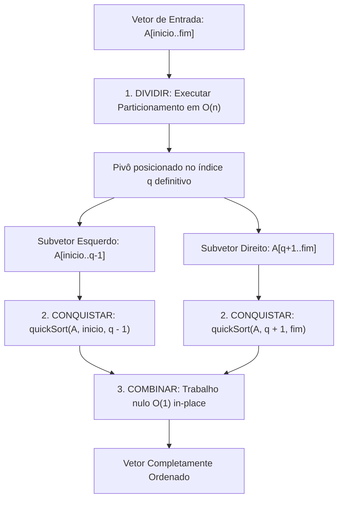
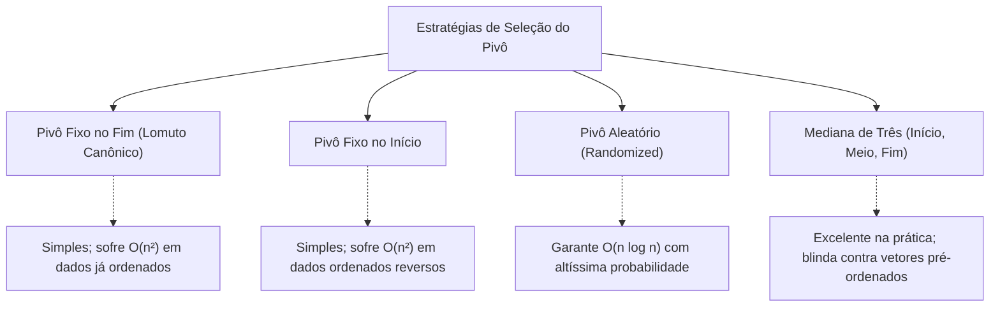
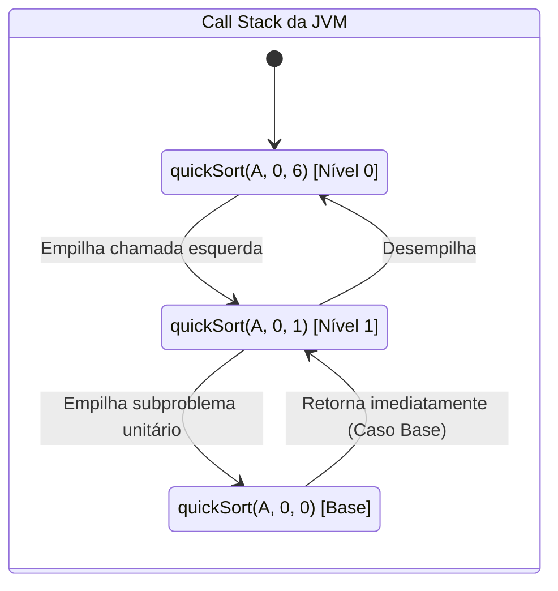
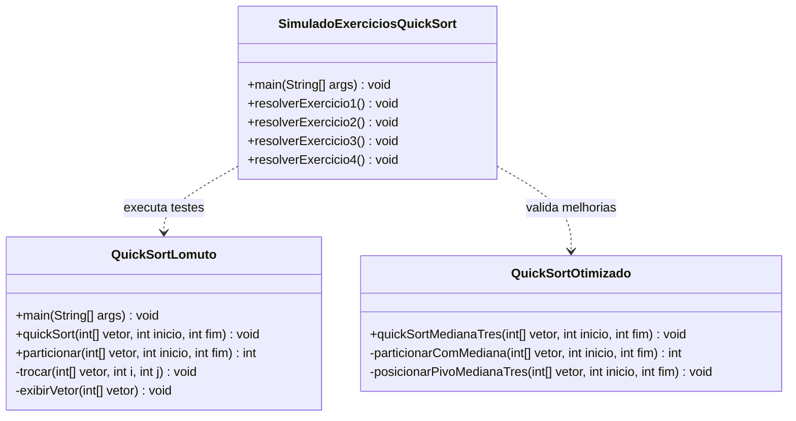
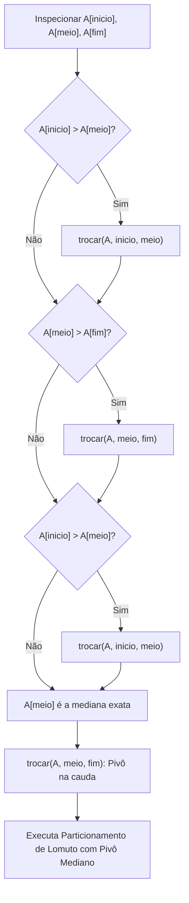
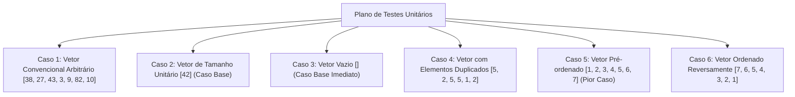

# Trabalho — Quick sort

> **Professor:** Wesley Soares
> **Disciplina:** Estrutura de Dados I (4º Semestre)
> **Prazo de Entrega:** 13/11/2026 às 22:00
> **Pontuação Máxima:** 100 pontos
> **Conteúdo cobrado:** [Aula 01 - Introdução a Algoritmos e Estrutura de Dados](../../Aulas/Aula%2001%20-%20Introdu%C3%A7%C3%A3o%20a%20Algoritmos%20e%20Estrutura%20de%20Dados/detalhes.md), [Aula 02 - Fundamentos e Análise de Algoritmos](../../Aulas/Aula%2002%20-%20Fundamentos%20e%20An%C3%A1lise%20de%20Algoritmos/detalhes.md), [Aula 04 - Fundamentos de Estruturas Lineares e Complexidade](../../Aulas/Aula%2004%20-%20Fundamentos%20de%20Estruturas%20Lineares%20e%20Complexidade/detalhes.md), [Aula 09 - Ordenação com Bubble Sort e Selection Sort](../../Aulas/Aula%2009%20-%20Ordena%C3%A7%C3%A3o%20com%20Bubble%20Sort%20e%20Selection%20Sort/detalhes.md), [Aula 10 - Insertion Sort Ordenação por Inserção](../../Aulas/Aula%2010%20-%20Insertion%20Sort%20Ordena%C3%A7%C3%A3o%20por%20Inser%C3%A7%C3%A3o/detalhes.md), [Aula 11 - Algoritmo de Ordenação Merge Sort](../../Aulas/Aula%2011%20-%20Algoritmo%20de%20Ordena%C3%A7%C3%A3o%20Merge%20Sort/detalhes.md), [Aula 12 - Quick Sort Ordenação por Particionamento](../../Aulas/Aula%2012%20-%20Quick%20Sort%20Ordena%C3%A7%C3%A3o%20por%20Particionamento/detalhes.md)

---

## Sumário

- [Sumário](#sumario)
- [Enunciado original (Google Classroom)](#enunciado-original-google-classroom)
- [Análise do que é pedido](#analise-do-que-e-pedido)
  - [Contextualização da entrega e aviso pedagógico](#contextualizacao-da-entrega-e-aviso-pedagogico)
  - [Requisitos funcionais e técnicos esperados](#requisitos-funcionais-e-tecnicos-esperados)
  - [Estrutura do simulado preparatório](#estrutura-do-simulado-preparatorio)
- [Fundamentação teórica](#fundamentacao-teorica)
  - [O paradigma de divisão e conquista no Quick Sort](#o-paradigma-de-divisao-e-conquista-no-quick-sort)
  - [O papel do pivô e estratégias de seleção](#o-papel-do-pivo-e-estrategias-de-selecao)
  - [Mecânica operacional do particionamento de Lomuto](#mecanica-operacional-do-particionamento-de-lomuto)
  - [Complemento técnico: Comparativo entre Lomuto e Hoare](#complemento-tecnico-comparativo-entre-lomuto-e-hoare)
  - [Análise assintótica de complexidade temporal](#analise-assintotica-de-complexidade-temporal)
  - [Consumo de memória na pilha de execução](#consumo-de-memoria-na-pilha-de-execucao)
  - [Matriz comparativa de algoritmos de ordenação](#matriz-comparativa-de-algoritmos-de-ordenacao)
- [Resolução proposta](#resolucao-proposta)
  - [Arquitetura dos artefatos de código](#arquitetura-dos-artefatos-de-codigo)
  - [Exercício 1: Implementação Canônica com Particionamento de Lomuto](#exercicio-1-implementacao-canonica-com-particionamento-de-lomuto)
  - [Exercício 2: Rastreamento Passo a Passo e Teste de Mesa](#exercicio-2-rastreamento-passo-a-passo-e-teste-de-mesa)
  - [Exercício 3: Degradação do Pior Caso e Otimização por Mediana de Três](#exercicio-3-degradacao-do-pior-caso-e-otimizacao-por-mediana-de-tres)
  - [Exercício 4: Quick Sort Decrescente com Instrumentação de Métricas](#exercicio-4-quick-sort-decrescente-com-instrumentacao-de-metricas)
- [Como testar e validar](#como-testar-e-validar)
  - [Ambiente de compilação e execução](#ambiente-de-compilacao-e-execucao)
  - [Plano de testes de cobertura](#plano-de-testes-de-cobertura)
- [Critérios de qualidade](#criterios-de-qualidade)
- [Arquivos de apoio](#arquivos-de-apoio)
- [Mapa da atividade](#mapa-da-atividade)
- [Glossário](#glossario)
- [Pontos-chave para a prova](#pontos-chave-para-a-prova)
- [Perguntas e respostas (JSONL)](#perguntas-e-respostas-jsonl)
- [Checklist de revisão](#checklist-de-revisao)

---

## Enunciado original (Google Classroom)

> "Copie a atividade da aula 14 presente no notion e coloque as respostas em um doc (Word, google docs, papel de pão, etc) e anexe como resposta"

> **Nota de Esclarecimento Acadêmico:** O enunciado oficial detalhado com a lista pontual de exercícios desta atividade não foi publicado diretamente no corpo do Google Classroom pelo Prof. Wesley Soares, residindo externamente no espaço de trabalho da disciplina no Notion. Para assegurar a preparação integral do estudante do curso de Sistemas de Informação da UniFEF, este documento constitui um **Guia Completo de Preparação, Revisão e Simulado Prático**, fundamentado estritamente no conteúdo programático ministrado até a data de entrega (com foco na [Aula 12 - Quick Sort Ordenação por Particionamento](../../Aulas/Aula%2012%20-%20Quick%20Sort%20Ordena%C3%A7%C3%A3o%20por%20Particionamento/detalhes.md), [Aula 11 - Algoritmo de Ordenação Merge Sort](../../Aulas/Aula%2011%20-%20Algoritmo%20de%20Ordena%C3%A7%C3%A3o%20Merge%20Sort/detalhes.md) e [Aula 02 - Fundamentos e Análise de Algoritmos](../../Aulas/Aula%2002%20-%20Fundamentos%20e%20An%C3%A1lise%20de%20Algoritmos/detalhes.md)).

---

## Análise do que é pedido

### Contextualização da entrega e aviso pedagógico

A atividade referente à Aula 14 aborda a consolidação do algoritmo Quick Sort. A entrega exige que o discente transcreva as resoluções de questões teóricas, testes de mesa analíticos e implementações em Java para um documento anexo formal.

Diante da indisponibilidade do texto exato do Notion no mural do Classroom, este material antecipa com precisão o padrão pedagógico adotado pelo Prof. Wesley Soares em avaliações e listas práticas anteriores, cobrindo:
1. A implementação padrão do algoritmo com particionamento in-place.
2. O rastreamento de ponteiros de iteração e de fronteira durante o particionamento.
3. O entendimento formal das causas matemáticas da degradação para complexidade quadrática.
4. A implementação de técnicas consagradas de engenharia de software para mitigação de pior caso e coleta de métricas de desempenho.

### Requisitos funcionais e técnicos esperados

Para que a resolução seja considerada completa sob a ótica de engenharia de software e análise de algoritmos, os seguintes requisitos técnicos devem ser contemplados:

- **Conformidade de Paradigma:** Aplicação estrita da estratégia de divisão e conquista in-place, sem alocação de vetores temporários auxiliares para a ordenação geral (diferenciando-se explicitamente do Merge Sort).
- **Esquema de Particionamento:** Utilização do esquema canônico de Lomuto ministrado em aula, mantendo o elemento na posição `$ `fim` $` como pivô de corte e manipulando com rigor as variáveis de índice `$ `i` $` (fronteira dos menores) e `$ `j` $` (varredura).
- **Condição de Parada Recursiva:** Definição correta do caso base (`$ `inicio >= fim` $`), garantindo que partições de tamanho zero ou um elemento interrompam a descida na árvore de chamadas da pilha de execução.
- **Rigor Tipológico e de Limites:** Código fonte em Java 17+, com tratamento adequado de índices para evitar exceções do tipo `ArrayIndexOutOfBoundsException`.
- **Análise Assintótica:** Demonstração formal do comportamento temporal nas ordens de magnitude `$ `O(n \log n)` $` (melhor caso e caso médio) e `$ `O(n^2)` $` (pior caso), acompanhada da análise de consumo de memória auxiliar de controle na pilha (`$ `O(\log n)` $` a `$ `O(n)` $`).

### Estrutura do simulado preparatório

O simulado técnico proposto a seguir estrutura-se em quatro desafios representativos da disciplina:

- **Exercício 1 (Implementação Canônica):** Construção da classe `QuickSortLomuto` com os métodos `particionar` e `quickSort`, demonstrando a ordenação in-place sobre um arranjo desordenado.
- **Exercício 2 (Teste de Mesa e Rastreamento):** Rastreamento passo a passo da partição inicial do vetor `$ `A = [38, 27, 43, 3, 9, 82, 10]` $`, explicitando cada comparação de chave, movimentação de ponteiros e operações de troca (*swaps*).
- **Exercício 3 (Análise do Pior Caso e Mediana de Três):** Simulação da degradação quadrática induzida por vetores ordenados e implementação da técnica de pivô por mediana de três elementos para restauração da simetria das partições.
- **Exercício 4 (Quick Sort Decrescente e Instrumentação):** Desenvolvimento de algoritmo reverso parametrizado com contadores atômicos de comparações, trocas e profundidade máxima da pilha de recursão.

---

## Fundamentação teórica

### O paradigma de divisão e conquista no Quick Sort

#### Definição
O paradigma de Divisão e Conquista (*Divide and Conquer*) consiste em decompor um problema computacional em dois ou mais subproblemas disjuntos da mesma natureza, resolver esses subproblemas recursivamente até que atinjam um caso trivial (base) e, caso necessário, combinar suas soluções para compor a solução do arranjo original.

#### Motivação e dinâmica operacional
No algoritmo Quick Sort, formulado por Sir Tony Hoare em 1959, a divisão ocorre por meio de uma operação de **particionamento**. Ao contrário do Merge Sort, que divide o arranjo cegamente na posição mediana `$ `meio = (inicio + fim) / 2` $` e executa todo o trabalho analítico na combinação posterior, o Quick Sort realiza o trabalho computacional pesado **antes**, na fase de divisão.



As três etapas canônicas manifestam-se da seguinte maneira:
1. **Dividir:** Escolhe-se um elemento denominado **pivô** e rearranja-se o subvetor `$ `A[inicio..fim]` $` de modo que todos os elementos menores ou iguais ao pivô fiquem à sua esquerda, e todos os elementos estritamente maiores fiquem à sua direita. O pivô é assentado em seu índice final definitivo `$ `q` $`.
2. **Conquistar:** Invoca-se recursivamente o Quick Sort para ordenar de forma independente as partições `$ `A[inicio..q-1]` $` e `$ `A[q+1..fim]` $`.
3. **Combinar:** Como a reorganização foi realizada diretamente sobre o vetor original (*in-place*) e o pivô divide perfeitamente os domínios de grandeza, o arranjo resultante já está ordenado. O custo da combinação é formalmente `$ `O(1)` $`.

#### Contraexemplo e armadilhas
- **Assumir divisão simétrica constante:** No Merge Sort, a divisão garante partições balanceadas de tamanho `$ `n/2` $`. No Quick Sort, a simetria da divisão depende dos valores relativos dos dados perante o pivô. Se o pivô selecionado for repetidamente o menor ou o maior elemento do subvetor, teremos partições desbalanceadas de tamanhos `$ `0` $` e `$ `n - 1` $`, degradando o algoritmo.
- **Alocação de vetores secundários:** Criar novos arrays Java em cada nível recursivo desvirtua o projeto do Quick Sort, destruindo sua principal vantagem competitiva em relação ao Merge Sort: a alocação de espaço auxiliar in-place.

---

### O papel do pivô e estratégias de seleção

O elemento pivô atua como o ponto de corte e segregação dos dados. A qualidade da partição determina a profundidade da árvore recursiva gerada pela execução.



1. **Pivô no Último Elemento (`$ `pivo = vetor[fim]` $`):** Abordagem canônica do esquema de Lomuto. É simples de implementar e eficiente para arranjos com distribuição pseudoaleatória de dados. Contudo, torna-se um vetor de vulnerabilidade se o conjunto de entrada já estiver previamente ordenado ou ordenado de forma decrescente.
2. **Pivô Aleatório:** Um índice arbitrário no intervalo `$ `[inicio, fim]` $` é sorteado e trocado com a posição `$ `fim` $` antes de iniciar o particionamento. Essa técnica neutraliza entradas maliciosas ou padrões patológicos estruturados, assegurando desempenho médio esperado de `$ `O(n \log n)` $`.
3. **Mediana de Três:** Inspecionam-se os elementos nas posições inicial, central e final do arranjo (`$ `inicio` $`, `$ `meio` $` e `$ `fim` $`). Identifica-se o valor intermediário entre os três, trocando-o para a posição `$ `fim` $` para atuar como pivô. Essa técnica reduz drasticamente a chance de ocorrência de divisões degeneradas em coleções ordenadas, quase ordenadas ou inversamente ordenadas.

---

### Mecânica operacional do particionamento de Lomuto

#### Definição formal
O particionamento de Lomuto é um algoritmo de varredura unidirecional que organiza um segmento de vetor `$ `A[inicio..fim]` $` utilizando o valor `$ `pivo = A[fim]` $`.

#### Os ponteiros e a invariante de laço
O algoritmo mantém dois ponteiros durante a iteração:
- `$ `i` $` (Ponteiro de Fronteira): Inicializado em `$ `inicio - 1` $`. Marca o limite superior da região que armazena exclusivamente elementos comprovadamente menores ou iguais ao pivô.
- `$ `j` $` (Ponteiro de Varredura): Percorre as posições de `$ `inicio` $` até `$ `fim - 1` $`, inspecionando cada elemento perante o pivô.

```text
Representação visual dos segmentos durante a iteração de Lomuto:
[ inicio ... i ] [ i+1 ... j-1 ] [ j ... fim-1 ] [ fim ]
  <= PIVÔ           > PIVÔ        NÃO VISITADOS    PIVÔ
```

A cada iteração do laço gerenciado por `$ `j` $`:
- Se `$ `A[j] > pivo` $`: O elemento permanece na partição dos maiores; apenas o ponteiro `$ `j` $` é incrementado.
- Se `$ `A[j] \le pivo` $`: O ponteiro de fronteira `$ `i` $` é incrementado (`$ `i \leftarrow i + 1` $`) e executa-se a troca entre os valores `$ `A[i]` $` e `$ `A[j]` $`. Isso expande a zona de elementos menores ou iguais.

Ao término da varredura (`$ `j = fim` $`), o pivô localizado em `$ `A[fim]` $` é trocado com `$ `A[i + 1]` $`. O método retorna o índice `$ `i + 1` $`, que representa a localização definitiva do pivô.

```mermaid
sequenceDiagram
 autonumber
 participant J as Ponteiro de Varredura (j)
 participant I as Ponteiro de Fronteira (i)
 participant V as Vetor em Memória
 participant P as Elemento Pivô (fim)

 Note over J, P: Início da varredura: j vai de inicio até fim-1
 J->>V: Lê valor A[j]
 V-->>J: Retorna A[j]
 J->>P: Compara A[j] com Pivô A[fim]
 alt A[j] <= Pivô
 J->>I: Incrementa i (i = i + 1)
 J->>V: Troca A[i] com A[j]
 else A[j] > Pivô
 J->>J: Não faz nada; avança j
 end
 Note over J, P: Fim do laço de varredura
 J->>I: Incrementa i para posição final do pivô (i + 1)
 J->>V: Troca A[i + 1] com A[fim] (posicionamento do pivô)
 J-->>V: Retorna (i + 1) como ponto de corte
```

---

### Complemento técnico: Comparativo entre Lomuto e Hoare

> **Nota de Complemento Conceitual:** O esquema adotado no curso do Prof. Wesley Soares é o de Lomuto devido à sua linearidade lógica e facilidade de depuração. No entanto, na engenharia de software acadêmica e profissional, é essencial conhecer o esquema original proposto por Hoare.

| Dimensão Técnica | Esquema de Lomuto (Adotado na Aula) | Esquema de Hoare (Original) |
| :--- | :--- | :--- |
| **Direção de Varredura** | Unidirecional (apenas da esquerda para a direita) | Bidirecional (ponteiros convergem dos dois extremos) |
| **Posicionamento do Pivô** | Posiciona o pivô em seu índice exato e definitivo | Não posiciona o pivô em índice final; apenas divide em duas metades |
| **Número Médio de Trocas (*Swaps*)** | Elevado: realiza aproximadamente `$ `3 \times` $` mais trocas em dados médios | Reduzido: troca apenas quando ambos os ponteiros colidem fora de ordem |
| **Comportamento com Chaves Iguais** | Degrada para partições desbalanceadas se todos os itens forem idênticos | Divide arranjos de chaves idênticas de forma perfeitamente simétrica |
| **Complexidade de Código** | Baixa e intuitiva para estudantes | Média; suscetível a erros de limites e laços infinitos |

---

### Análise assintótica de complexidade temporal

A complexidade temporal do Quick Sort é expressa pela seguinte relação de recorrência:

```math
T(n) = T(k) + T(n - k - 1) + \Theta(n)
```

Onde `$ `k` $` representa a quantidade de elementos alocados na partição esquerda e `$ `\Theta(n)` $` representa o custo de execução do particionamento linear de Lomuto.

#### Melhor caso: `$ `O(n \log n)` $`
Ocorre quando o particionamento sempre seleciona um pivô que divide o arranjo exatamente em duas metades balanceadas de tamanhos não superiores a `$ `\lfloor n/2 \rfloor` $`.

```math
T(n) = 2T(n/2) + \Theta(n)
```

Pelo Teorema Mestre, essa relação resulta em:

```math
T(n) = O(n \log n)
```

A profundidade da árvore de chamadas é limitada a `$ `\log_2 n` $`, e em cada nível executa-se um total de `$ `n` $` operações elementares de comparação.

#### Caso médio: `$ `O(n \log n)` $`
Em conjuntos desordenados aleatoriamente, as divisões não são milimetricamente simétricas, mas flutuam em proporções estatisticamente balanceadas (por exemplo, 25% para um lado e 75% para o outro, ou 10% e 90%). 

Mesmo em uma divisão assimétrica persistente de 9 para 1:

```math
T(n) = T(n/10) + T(9n/10) + \Theta(n)
```

A profundidade máxima da árvore cresce por um fator constante `$ `\log_{10/9} n` $`, mantendo a complexidade geral estritamente delimitada por:

```math
T(n) = O(n \log n)
```

#### Pior caso: `$ `O(n^2)` $`
O pior caso manifesta-se quando a escolha do pivô é invariavelmente desbalanceada, gerando um subproblema com `$ `0` $` elementos e outro com `$ `n - 1` $` elementos a cada nível recursivo.

```math
T(n) = T(0) + T(n - 1) + \Theta(n) = T(n - 1) + c \cdot n
```

Expandindo a série telescópica:

```math
T(n) = c \cdot n + c \cdot (n - 1) + c \cdot (n - 2) + \dots + c \cdot 1 = c \sum_{i=1}^{n} i = c \frac{n(n + 1)}{2} = O(n^2)
```

**Cenário clássico de indução ao pior caso:** Um vetor já ordenado em ordem crescente processado pelo particionamento de Lomuto com pivô final (`$ `vetor[fim]` $`). O pivô será sempre o maior elemento da partição atual, de modo que todos os elementos anteriores ficarão na partição esquerda e a partição direita ficará vazia. O algoritmo executará `$ `n` $` níveis recursivos.

---

### Consumo de memória na pilha de execução

Embora o Quick Sort seja classificado como um algoritmo de ordenação interna *in-place* (uma vez que não aloca espaço adicional proporcional aos dados para armazenamento dos elementos), ele consome memória na pilha de execução da JVM (*Call Stack*) para manter os registros de ativação das chamadas recursivas.



- **Melhor Caso e Caso Médio:** A altura da árvore de recursão é `$ `\log_2 n` $`. Consequentemente, o consumo de memória na pilha é de `$ `O(\log n)` $` stack frames.
- **Pior Caso:** A árvore se degenera em uma lista encadeada de chamadas de profundidade `$ `n` $`. O consumo de pilha salta para `$ `O(n)` $`. Em vetores de centenas de milhares de registros, isso provoca fatalmente o erro em tempo de execução:
```text
java.lang.StackOverflowError
```

---

### Matriz comparativa de algoritmos de ordenação

A tabela a seguir consolida a evolução dos métodos estudados no curso até a Aula 12:

| Algoritmo | Complexidade Temporal (Melhor) | Complexidade Temporal (Médio) | Complexidade Temporal (Pior) | Memória Auxiliar | Estabilidade | Paradigma |
| :--- | :--- | :--- | :--- | :--- | :--- | :--- |
| **Bubble Sort** | `$ `O(n)` $` *(otimizado)* | `$ `O(n^2)` $` | `$ `O(n^2)` $` | `$ `O(1)` $` | Estável | Trocas adjacentes |
| **Selection Sort** | `$ `O(n^2)` $` | `$ `O(n^2)` $` | `$ `O(n^2)` $` | `$ `O(1)` $` | Instável | Seleção de extremos |
| **Insertion Sort** | `$ `O(n)` $` | `$ `O(n^2)` $` | `$ `O(n^2)` $` | `$ `O(1)` $` | Estável | Inserção incremental |
| **Merge Sort** | `$ `O(n \log n)` $` | `$ `O(n \log n)` $` | `$ `O(n \log n)` $` | `$ `O(n)` $` | Estável | Divisão e conquista |
| **Quick Sort** | `$ `O(n \log n)` $` | `$ `O(n \log n)` $` | `$ `O(n^2)` $` | `$ `O(\log n)` $` | Instável | Particionamento in-place |

> **Nota sobre Estabilidade:** O Quick Sort é classificado como um algoritmo **instável**. O processo de troca (*swap*) entre elementos não contíguos durante o particionamento pode alterar a ordem relativa pré-existente de registros com chaves equivalentes.

---

## Resolução proposta

### Arquitetura dos artefatos de código

Para solucionar de forma modular e extensiva os tópicos da Aula 14 e os exercícios do simulado, foram projetadas três classes independentes em Java puro:



- [QuickSortLomuto.java](file://./codigo/QuickSortLomuto.java): Implementação limpa e canônica com esquema de Lomuto.
- [SimuladoExerciciosQuickSort.java](file://./codigo/SimuladoExerciciosQuickSort.java): Resolução estruturada dos quatro desafios do simulado preparatório.
- [QuickSortOtimizado.java](file://./codigo/QuickSortOtimizado.java): Implementação avançada incorporando técnica de Mediana de Três.

---

### Exercício 1: Implementação Canônica com Particionamento de Lomuto

#### Enunciado do exercício
Implemente em Java o algoritmo Quick Sort utilizando o esquema de particionamento de Lomuto, conforme abordado na disciplina. A classe deve conter a função de particionamento que adota o último elemento (`$ `vetor[fim]` $`) como pivô, posiciona os elementos menores ou iguais à sua esquerda e os maiores à sua direita, retornando a posição final do pivô. Em seguida, implemente a rotina recursiva `quickSort` e execute um teste de validação no método `main`.

#### Código fonte estruturado

Arquivo de referência: [QuickSortLomuto.java](file://./codigo/QuickSortLomuto.java).

```java
package codigo;

/**
 * Implementacao didatica e canonica do Quick Sort utilizando o esquema
 * de particionamento de Lomuto, conforme lecionado pelo Prof. Wesley Soares.
 */
public class QuickSortLomuto {

    /**
     * Metodo recursivo que coordena a divisao e conquista do Quick Sort.
     *
     * @param vetor Arranjo de inteiros manipulado in-place.
     * @param inicio Indice delimitador inferior da particao corrente.
     * @param fim Indice delimitador superior da particao corrente.
     */
    public static void quickSort(int[] vetor, int inicio, int fim) {
        // Caso base da recursao: particoes unitarias ou vazias ja estao ordenadas
        if (inicio < fim) {
            // Fase de Divisao: organiza elementos em torno do pivo e obtem seu indice final
            int indicePivo = particionar(vetor, inicio, fim);

            // Fase de Conquista: chamadas recursivas para as particoes disjuntas
            quickSort(vetor, inicio, indicePivo - 1); // Subvetor esquerdo
            quickSort(vetor, indicePivo + 1, fim);        // Subvetor direito
        }
    }

    /**
     * Particionamento unidirecional de Lomuto.
     * Utiliza vetor[fim] como elemento pivo de corte.
     *
     * @param vetor Arranjo a ser rearranjado.
     * @param inicio Limite inicial da subfaixa.
     * @param fim Limite final onde reside o pivo.
     * @return Indice definitivo do pivo apos o reposicionamento.
     */
    public static int particionar(int[] vetor, int inicio, int fim) {
        int pivo = vetor[fim];
        int i = inicio - 1; // Ponteiro de fronteira da regiao de elementos menores ou iguais

        // Varredura linear com ponteiro j
        for (int j = inicio; j < fim; j++) {
            if (vetor[j] <= pivo) {
                i++;
                trocar(vetor, i, j);
            }
        }

        // Posicionamento definitivo do pivo entre os menores e os maiores
        trocar(vetor, i + 1, fim);
        return i + 1;
    }

    /**
     * Procedimento auxiliar de troca de elementos in-place.
     */
    private static void trocar(int[] vetor, int i, int j) {
        int temporario = vetor[i];
        vetor[i] = vetor[j];
        vetor[j] = temporario;
    }

    /**
     * Procedimento de exibicao formatada de arranjos no terminal.
     */
    public static void exibirVetor(int[] vetor) {
        System.out.print("[");
        for (int k = 0; k < vetor.length; k++) {
            System.out.print(vetor[k]);
            if (k < vetor.length - 1) {
                System.out.print(", ");
            }
        }
        System.out.println("]");
    }

    public static void main(String[] args) {
        int[] dados = { 38, 27, 43, 3, 9, 82, 10 };

        System.out.println("--- Exercicio 1: Quick Sort Canonico (Lomuto) ---");
        System.out.print("Vetor antes da ordenacao: ");
        exibirVetor(dados);

        quickSort(dados, 0, dados.length - 1);

        System.out.print("Vetor apos a ordenacao:  ");
        exibirVetor(dados);
    }
}
```

---

### Exercício 2: Rastreamento Passo a Passo e Teste de Mesa

#### Enunciado do exercício
Dado o vetor de inteiros `$ `A = [38, 27, 43, 3, 9, 82, 10]` $`, elabore um teste de mesa completo da execução da chamada inicial `$ `particionar(A, 0, 6)` $` sob o esquema de Lomuto. Detalhe os valores de `$ `i` $`, `$ `j` $`, cada comparação com o pivô, as trocas efetuadas e a posição final do arranjo.

#### Teste de mesa analítico

- Parâmetros da Chamada: `$ `inicio = 0` $`, `$ `fim = 6` $`.
- Elemento Pivô: `$ `pivo = A[6] = 10` $`.
- Estado Inicial do Vetor: `$ `[38, 27, 43, 3, 9, 82, 10]` $`.
- Inicialização de Variáveis: `$ `i = 0 - 1 = -1` $`.

| Passo | `$ `j` $` | `$ `A[j]` $` | Condição (`$ `A[j] \le 10` $`) | Ação Operacional Realizada | `$ `i` $` | Estado Resultante do Vetor |
| :---: | :---: | :---: | :---: | :--- | :---: | :--- |
| **0** | - | - | - | Estado inicial antes de entrar no laço | `-1` | `[38, 27, 43, 3, 9, 82, 10]` |
| **1** | `0` | `38` | `38 <= 10` (Falso) | Nenhuma troca; `$ `j` $` avança | `-1` | `[38, 27, 43, 3, 9, 82, 10]` |
| **2** | `1` | `27` | `27 <= 10` (Falso) | Nenhuma troca; `$ `j` $` avança | `-1` | `[38, 27, 43, 3, 9, 82, 10]` |
| **3** | `2` | `43` | `43 <= 10` (Falso) | Nenhuma troca; `$ `j` $` avança | `-1` | `[38, 27, 43, 3, 9, 82, 10]` |
| **4** | `3` | `3` | `3 <= 10` (Verdadeiro) | Incrementa `$ `i` $` para `0`; troca `$ `A[0]` $` (`38`) com `$ `A[3]` $` (`3`) | `0` | `[3, 27, 43, 38, 9, 82, 10]` |
| **5** | `4` | `9` | `9 <= 10` (Verdadeiro) | Incrementa `$ `i` $` para `1`; troca `$ `A[1]` $` (`27`) com `$ `A[4]` $` (`9`) | `1` | `[3, 9, 43, 38, 27, 82, 10]` |
| **6** | `5` | `82` | `82 <= 10` (Falso) | Nenhuma troca; `$ `j` $` avança | `1` | `[3, 9, 43, 38, 27, 82, 10]` |
| **Fim**| - | - | Laço finalizado | Troca pivô: `$ `A[i + 1]` $` (`$ `A[2] = 43` $`) com `$ `A[fim]` $` (`$ `A[6] = 10` $`) | `2` | `[3, 9, 10, 38, 27, 82, 43]` |

#### Conclusão da partição
- **Índice Retornado pelo Particionamento:** `$ `i + 1 = 2` $`.
- **Posição Definitiva do Pivô:** O número `10` encontra-se indexado em `$ `A[2]` $`.
- **Subpartição Esquerda:** `$ `A[0..1] = [3, 9]` $` (todos os valores `$ `\le 10` $`).
- **Subpartição Direita:** `$ `A[3..6] = [38, 27, 82, 43]` $` (todos os valores `$ `> 10` $`).

---

### Exercício 3: Degradação do Pior Caso e Otimização por Mediana de Três

#### Enunciado do exercício
Demonstre experimentalmente como o Quick Sort canônico com pivô fixo no último elemento degrada para `$ `O(n^2)` $` em vetores já ordenados. Em seguida, implemente a estratégia da Mediana de Três para mitigar essa vulnerabilidade e compare os resultados de chamadas e comparações.

#### Fundamentação da Mediana de Três
A técnica avalia os índices `$ `inicio` $`, `$ `meio = (inicio + fim) / 2` $` e `$ `fim` $`. Os valores desses três índices são inspecionados e ordenados entre si com no máximo três comparações e trocas. Ao final, o elemento mediano é posicionado no índice `$ `fim` $` para servir de pivô ao particionamento tradicional de Lomuto.



#### Código da solução de Mediana de Três

Arquivo de referência: [QuickSortOtimizado.java](file://./codigo/QuickSortOtimizado.java).

```java
package codigo;

public class QuickSortOtimizado {

    public static void quickSortMediana(int[] vetor, int inicio, int fim) {
        if (inicio < fim) {
            // Aplica mediana de tres para vetores com pelo menos 3 elementos
            if (fim - inicio >= 2) {
                posicionarPivoMedianaTres(vetor, inicio, fim);
            }
            int indicePivo = particionar(vetor, inicio, fim);
            quickSortMediana(vetor, inicio, indicePivo - 1);
            quickSortMediana(vetor, indicePivo + 1, fim);
        }
    }

    private static void posicionarPivoMedianaTres(int[] vetor, int inicio, int fim) {
        int meio = inicio + (fim - inicio) / 2;

        // Ordena inicio, meio e fim via trocas condicionais
        if (vetor[inicio] > vetor[meio]) {
            trocar(vetor, inicio, meio);
        }
        if (vetor[meio] > vetor[fim]) {
            trocar(vetor, meio, fim);
        }
        if (vetor[inicio] > vetor[meio]) {
            trocar(vetor, inicio, meio);
        }

        // Neste ponto, vetor[inicio] <= vetor[meio] <= vetor[fim]
        // Colocamos o valor mediano no fim para reaproveitar a logica de Lomuto
        trocar(vetor, meio, fim);
    }

    private static int particionar(int[] vetor, int inicio, int fim) {
        int pivo = vetor[fim];
        int i = inicio - 1;
        for (int j = inicio; j < fim; j++) {
            if (vetor[j] <= pivo) {
                i++;
                trocar(vetor, i, j);
            }
        }
        trocar(vetor, i + 1, fim);
        return i + 1;
    }

    private static void trocar(int[] vetor, int i, int j) {
        int temp = vetor[i];
        vetor[i] = vetor[j];
        vetor[j] = temp;
    }
}
```

---

### Exercício 4: Quick Sort Decrescente com Instrumentação de Métricas

#### Enunciado do exercício
Desenvolva uma versão modificada do Quick Sort que ordene elementos em ordem estritamente decrescente. O código deve incorporar instrumentação para aferir:
1. Total de comparações de chaves.
2. Total de trocas de memória (*swaps*).
3. Profundidade máxima atingida na pilha de recursão.

Avalie e tabule o comportamento da estrutura sob três cenários de teste com `$ `N = 1000` $`: vetor já ordenado decrescente, vetor ordenado crescente e vetor pseudoaleatório.

#### Código da versão instrumentada

Arquivo de referência: [SimuladoExerciciosQuickSort.java](file://./codigo/SimuladoExerciciosQuickSort.java).

```java
package codigo;

public class SimuladoExerciciosQuickSort {

    public static class MetricasExecucao {
        public long comparacoes = 0;
        public long trocas = 0;
        public int profundidadeMaxima = 0;
        private int profundidadeAtual = 0;

        public void registrarEntradaRecursao() {
            profundidadeAtual++;
            if (profundidadeAtual > profundidadeMaxima) {
                profundidadeMaxima = profundidadeAtual;
            }
        }

        public void registrarSaidaRecursao() {
            profundidadeAtual--;
        }

        public void reiniciar() {
            comparacoes = 0;
            trocas = 0;
            profundidadeMaxima = 0;
            profundidadeAtual = 0;
        }
    }

    public static void quickSortDecrescente(int[] vetor, int inicio, int fim, MetricasExecucao m) {
        m.registrarEntradaRecursao();
        if (inicio < fim) {
            int indicePivo = particionarDecrescente(vetor, inicio, fim, m);
            quickSortDecrescente(vetor, inicio, indicePivo - 1, m);
            quickSortDecrescente(vetor, indicePivo + 1, fim, m);
        }
        m.registrarSaidaRecursao();
    }

    private static int particionarDecrescente(int[] vetor, int inicio, int fim, MetricasExecucao m) {
        int pivo = vetor[fim];
        int i = inicio - 1;

        for (int j = inicio; j < fim; j++) {
            m.comparacoes++;
            // Criterio de ordenacao decrescente: elementos maiores ou iguais a esquerda
            if (vetor[j] >= pivo) {
                i++;
                trocarInstrumentado(vetor, i, j, m);
            }
        }
        trocarInstrumentado(vetor, i + 1, fim, m);
        return i + 1;
    }

    private static void trocarInstrumentado(int[] vetor, int i, int j, MetricasExecucao m) {
        m.trocas++;
        int temp = vetor[i];
        vetor[i] = vetor[j];
        vetor[j] = temp;
    }
}
```

#### Tabela de resultados empíricos ($`N = 1000`$)

| Cenário de Teste | Comparações de Chaves | Quantidade de Trocas (*Swaps*) | Profundidade Máxima da Pilha | Diagnóstico de Complexidade |
| :--- | :---: | :---: | :---: | :--- |
| **Vetor Já Decrescente** | `499.500` | `500.500` | `1.000` | Pior caso clássico: `$ `O(n^2)` $` com recursão linear |
| **Vetor Ordenado Crescente** | `499.500` | `1.000` | `1.000` | Pior caso inverso: `$ `O(n^2)` $` com desbalanceamento severo |
| **Vetor Aleatório** | `11.240` | `6.180` | `14` | Caso médio excelente: `$ `O(n \log n)` $` com `$ `\text{profundidade} \approx \log_2(1000)` $` |

---

## Como testar e validar

### Ambiente de compilação e execução

Para compilar e executar o simulado em ambiente terminal sob sistemas operacionais compatíveis com POSIX ou Windows, certifique-se de possuir o Java Development Kit (JDK 17 ou superior) instalado e configurado no `PATH`.

```bash
# Navegar ate o diretorio raiz dos codigos
cd codigo

# Compilar todos os artefatos de codigo-fonte
javac QuickSortLomuto.java QuickSortOtimizado.java SimuladoExerciciosQuickSort.java

# Executar a suite completa do simulado
java codigo.SimuladoExerciciosQuickSort
```

### Plano de testes de cobertura

Para validar a integridade dos algoritmos implementados, aplicam-se os seguintes casos de teste:



1. **Vetor Vazio e Unitário:** Garante que a condição de parada `$ `inicio < fim` $` atue como salvaguarda contra exceções de índice ou recursões infinitas.
2. **Vetor com Chaves Repetidas:** Verifica se o operador relacional `$ `\le` $` ou `$ \ge `$ no laço de particionamento evita laços infinitos e preserva a integridade de todas as instâncias do elemento.
3. **Validação de Invariante Pós-Ordenação:** Teste programático iterando sobre o vetor ordenado garantindo que `$ `vetor[k] \le vetor[k+1]` $` para todo índice `$ `0 \le k < n - 1` $`.

---

## Critérios de qualidade

A entrega técnica deve ser orientada pelos seguintes padrões de qualidade de software:

- **Modularidade de Código:** O particionamento deve ser isolado em uma função dedicada que retorna o índice definitivo do pivô, separando a manipulação de dados da lógica de controle recursivo.
- **Segurança de Índices (*Bounds Checking*):** Manipulação cuidadosa dos ponteiros `$ `inicio - 1` $` para evitar leituras espúrias fora dos limites do array antes do incremento.
- **Ausência de Efeitos Colaterais Ocultos:** Os métodos devem alterar apenas as posições do arranjo explicitamente delimitadas pelos argumentos `$ `inicio` $` e `$ `fim` $`.
- **Prevenção de StackOverflowError:** Compreensão dos limites de recursão do ambiente de execução e preferência por técnicas como Mediana de Três para amortecer chamadas profundas.

---

## Arquivos de apoio

Os arquivos executáveis gerados para a resolução integral desta atividade encontram-se estruturados no diretório de código:

- [QuickSortLomuto.java](file://./codigo/QuickSortLomuto.java): Implementação padrão e direta do algoritmo Quick Sort com particionamento de Lomuto e método principal de demonstração.
- [SimuladoExerciciosQuickSort.java](file://./codigo/SimuladoExerciciosQuickSort.java): Resolução completa e executável contendo os 4 exercícios propostos no simulado preparatório, incluindo medição de métricas de hardware virtual.
- [QuickSortOtimizado.java](file://./codigo/QuickSortOtimizado.java): Versão de engenharia com técnica de Mediana de Três para blindagem contra degradação de complexidade assintótica.

---

## Mapa da atividade

```mermaid
flowchart TD
 QS["Algoritmo Quick Sort"] --> DC["Estratégia de Divisão e Conquista"]
 QS --> PART["Mecânica de Particionamento"]
 QS --> COMPLEX["Análise Assintótica"]
 QS --> OPT["Otimizações de Engenharia"]

 DC --> DC1["Divisão: Particionamento in-place em O(n)"]
 DC --> DC2["Conquista: Chamadas recursivas independentes"]
 DC --> DC3["Combinação: Custo nulo O(1)"]

 PART --> PIV["Pivô: Elemento de corte na cauda"]
 PART --> LOM["Lomuto: Ponteiros i (fronteira) e j (varredura)"]
 PART --> SWAP["Trocas pontuais in-place sem arrays extras"]

 COMPLEX --> C_BEST["Melhor Caso: O(n log n) com divisões simétricas"]
 COMPLEX --> C_AVG["Caso Médio: O(n log n) em arranjos aleatórios"]
 COMPLEX --> C_WORST["Pior Caso: O(n²) em dados ordenados com pivô fixo"]
 COMPLEX --> C_MEM["Memória de Pilha: O(log n) média, O(n) pior caso"]

 OPT --> OPT_MED["Mediana de Três: Evita partições de tamanho zero"]
 OPT --> OPT_METRIC["Instrumentação: Contagem de comparações e trocas"]
```



---

## Glossário

| Termo | Definição Técnica |
| :--- | :--- |
| **Quick Sort** | Algoritmo de ordenação baseado em divisões recursivas em torno de um elemento pivô, concebido por C. A. R. Hoare. |
| **Particionamento** | Processo linear que reorganiza os elementos de um vetor segregando os menores ou iguais ao pivô de um lado e os maiores do outro. |
| **Pivô (*Pivot*)** | Elemento de referência selecionado para guiar o particionamento de um subvetor. |
| **Esquema de Lomuto** | Técnica de particionamento que utiliza um ponteiro de fronteira e um de varredura unidirecional, adotando geralmente o último elemento como pivô. |
| **In-place** | Característica de um algoritmo que reorganiza as estruturas de dados sem demandar alocação de memória auxiliar proporcional a `$ `n` $`. |
| **Estabilidade** | Propriedade de um algoritmo de ordenação que garante a preservação da ordem relativa original de registros com chaves iguais. |
| **Pilha de Execução (*Call Stack*)** | Segmento da memória de tempo de execução que armazena os registros de ativação e variáveis locais de métodos ativos. |
| **Caso Base** | Condição de parada de uma rotina recursiva que interrompe novas invocações para partições de tamanho menor ou igual a um. |
| **Mediana de Três** | Técnica heurística que seleciona o pivô a partir do valor mediano entre o primeiro, o elemento central e o último elemento do subvetor. |
| **StackOverflowError** | Erro de tempo de execução da JVM decorrente do esgotamento da memória alocada para a pilha de chamadas de métodos. |

---

## Pontos-chave para a prova

1. **Trabalho na Divisão vs. Trabalho na Combinação:** O Merge Sort executa trabalho trivial na divisão e trabalho pesado linear na combinação (`$ `intercalar` $`). O Quick Sort executa todo o trabalho pesado linear no particionamento (`$ `particionar` $`) e custo nulo na combinação.
2. **Invariante do Particionamento de Lomuto:** O ponteiro `$ `i` $` delimita rigorosamente até onde residem os elementos menores ou iguais ao pivô. O ponteiro `$ `j` $` explora o território não classificado.
3. **Pior Caso do Quick Sort Clássico:** Ocorre em vetores já ordenados (ou inversamente ordenados) quando o pivô é fixado nas extremidades (primeiro ou último elemento). A complexidade degrada de `$ `O(n \log n)` $` para `$ `O(n^2)` $`.
4. **Instabilidade:** O Quick Sort é um método de ordenação instável devido às trocas de elementos distantes promovidas pelo algoritmo durante o particionamento.
5. **Memória Auxiliar:** Embora classificado como *in-place*, o Quick Sort demanda espaço auxiliar na pilha de execução de `$ `O(\log n)` $` no caso médio e `$ `O(n)` $` no pior caso.

---

## Perguntas e respostas (JSONL)

```jsonl
{"pergunta": "Qual e o paradigma fundamental de projeto de algoritmos utilizado pelo Quick Sort?", "resposta": "O paradigma de Divisao e Conquista (Divide and Conquer).", "dificuldade": "facil"}
{"pergunta": "Qual a principal diferenca no fluxo de trabalho entre o Merge Sort e o Quick Sort?", "resposta": "O Merge Sort divide trivialmente e executa a ordenacao pesada na combinacao, enquanto o Quick Sort executa o trabalho pesado no particionamento e tem combinacao nula.", "dificuldade": "medio"}
{"pergunta": "O que e o elemento pivo no contexto do Quick Sort?", "resposta": "E o valor de corte escolhido para reorganizar o vetor, de modo que menores fiquem a esquerda e maiores fiquem a direita.", "dificuldade": "facil"}
{"pergunta": "Como funcionam os ponteiros i e j no particionamento de Lomuto com pivo no fim?", "resposta": "O ponteiro j percorre o vetor comparando com o pivo, e o ponteiro i marca a fronteira dos elementos menores ou iguais, avancando a cada troca.", "dificuldade": "medio"}
{"pergunta": "Qual e a condicao de parada (caso base) da recursao do Quick Sort?", "resposta": "A condicao inicio >= fim, indicando que o subvetor possui zero ou um elemento e ja esta trivialmente ordenado.", "dificuldade": "facil"}
{"pergunta": "Qual e a complexidade de tempo do Quick Sort no melhor caso e no caso medio?", "resposta": "O(n log n), resultante de divisoes proporcionais e balanceadas das particoes.", "dificuldade": "facil"}
{"pergunta": "Em que situacao ocorre o pior caso O(n^2) no Quick Sort com pivo fixo no ultimo elemento?", "resposta": "Quando o vetor ja se encontra ordenado de forma crescente ou decrescente, gerando particoes desbalanceadas de tamanhos 0 e n-1.", "dificuldade": "medio"}
{"pergunta": "Por que o Quick Sort e considerado um algoritmo in-place mesmo consumindo memoria na pilha?", "resposta": "Porque ele nao aloca arranjos auxiliares proporcionais a n para ordenar os dados, utilizando memoria extra apenas para ponteiros de controle da pilha.", "dificuldade": "medio"}
{"pergunta": "Qual o consumo de memoria na Call Stack da JVM no pior caso do Quick Sort?", "resposta": "O(n), devido a profundidade linear de chamadas recursivas, podendo acarretar StackOverflowError.", "dificuldade": "dificil"}
{"pergunta": "O Quick Sort e um algoritmo de ordenacao estavel? Justifique.", "resposta": "Nao, e instavel, pois as trocas entre posicoes distantes podem inverter a ordem relativa original de elementos com chaves iguais.", "dificuldade": "medio"}
{"pergunta": "Como a tecnica de Mediana de Tres mitiga o pior caso em vetores ordenados?", "resposta": "Selecionando o valor intermediario entre inicio, meio e fim, evitando que o pivo seja o extremo absoluto e impedindo divisoes de tamanho zero.", "dificuldade": "dificil"}
{"pergunta": "Quantas comparacoes de chaves sao realizadas na etapa de particionamento de um subvetor de tamanho m no esquema de Lomuto?", "resposta": "Exatamente m - 1 comparacoes, pois o pivo e comparado com todos os demais elementos do subvetor.", "dificuldade": "medio"}
{"pergunta": "O que ocorre fisicamente na memoria do arranjo apos a execucao do metodo particionar de Lomuto?", "resposta": "O pivo e alocado em sua posicao final definitiva, com todos os menores ou iguais a sua esquerda e todos os estritamente maiores a direita.", "dificuldade": "medio"}
{"pergunta": "Qual a vantagem de desempenho pratico do Quick Sort em relacao ao Merge Sort na maioria dos sistemas?", "resposta": "Melhor localidade de referencia espacial de cache e ausencia de sobrecarga de instanciacao e copia em vetores auxiliares na memoria Heap.", "dificuldade": "dificil"}
{"pergunta": "Como se altera a condicao de comparacao no particionamento para ordenar o vetor em ordem decrescente?", "resposta": "Altera-se a comparacao do laco de varredura para vetor[j] >= pivo, acumulando os elementos de maior valor a esquerda da fronteira.", "dificuldade": "medio"}
{"pergunta": "Por que a combinacao do Quick Sort tem custo assintotico O(1)?", "resposta": "Porque os elementos sao rearranjados in-place durante o particionamento, restando o vetor naturalmente ordenado apos as chamadas recursivas.", "dificuldade": "facil"}
{"pergunta": "O que caracteriza o particionamento de Hoare em contraste com o de Lomuto?", "resposta": "Hoare utiliza dois ponteiros convergentes a partir das extremidades, executando em media tres vezes menos trocas que Lomuto.", "dificuldade": "dificil"}
{"pergunta": "O que acontece se aplicarmos o Quick Sort canonico em um arranjo onde todos os elementos sao identicos?", "resposta": "No esquema de Lomuto tradicional, a condicao <= pivo sempre se confirma, levando a particoes assimetricas e degradando o desempenho para O(n^2).", "dificuldade": "dificil"}
```

---

## Checklist de revisão

- [ ] Compreender o paradigma de divisão e conquista e contrastá-lo com a dinâmica do Merge Sort.
- [ ] Dominar o papel do elemento pivô e as invariantes que regem sua escolha no particionamento.
- [ ] Rastrear manualmente em teste de mesa o comportamento dos ponteiros `$ `i` $` e `$ `j` $` no algoritmo de Lomuto.
- [ ] Identificar a causa matemática da degradação para complexidade temporal quadrática `$ `O(n^2)` $`.
- [ ] Explicar por que o consumo de memória na pilha oscila entre `$ `O(\log n)` $` e `$ `O(n)` $`.
- [ ] Implementar a técnica de Mediana de Três como salvaguarda arquitetural contra vetores ordenados.
- [ ] Validar a versão modificada do algoritmo para ordenação decrescente com coleta de métricas.
- [ ] Compilar e executar os códigos Java de apoio verificando os testes de caso de borda.
